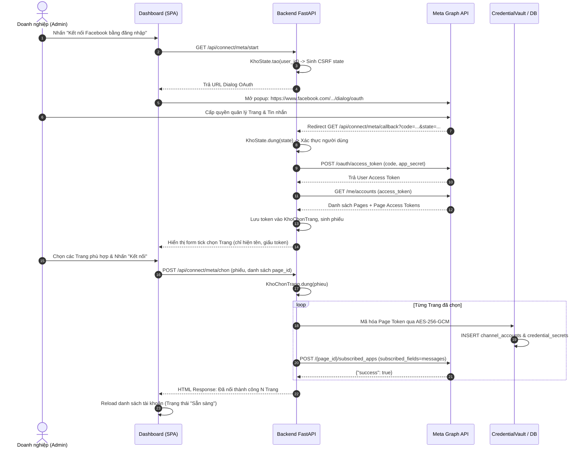
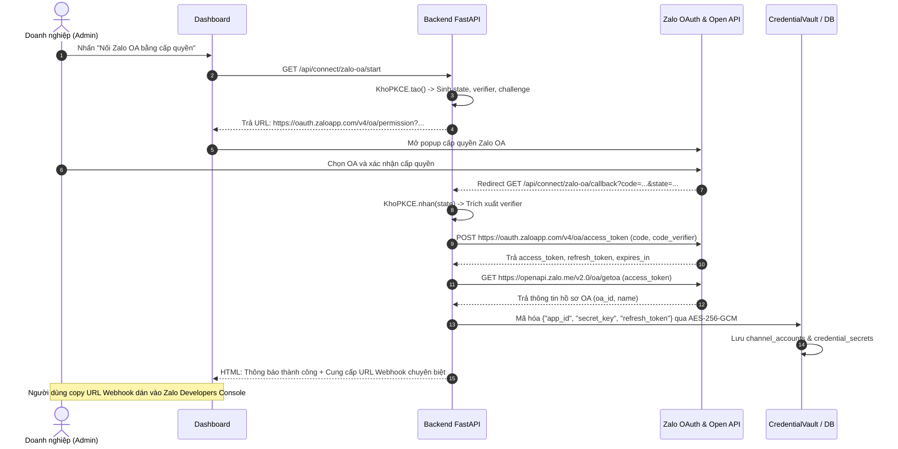
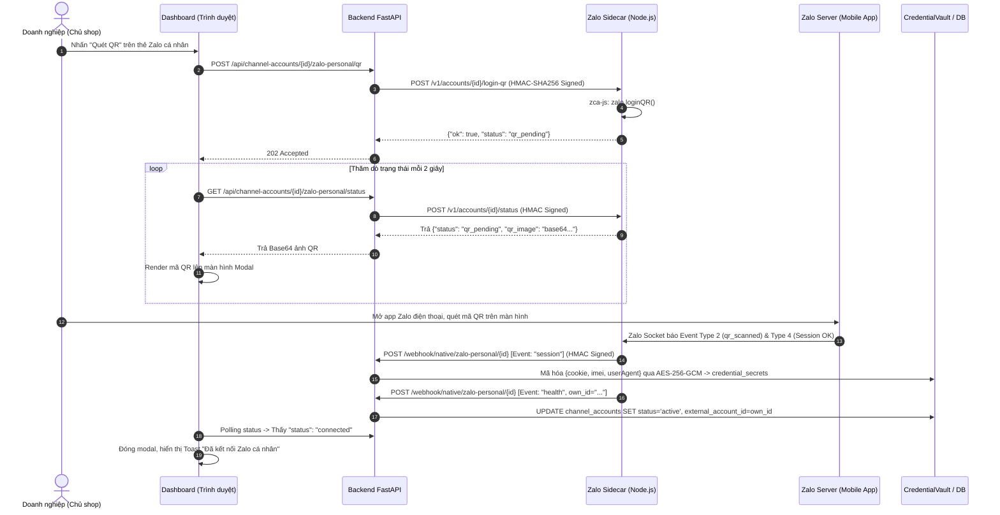
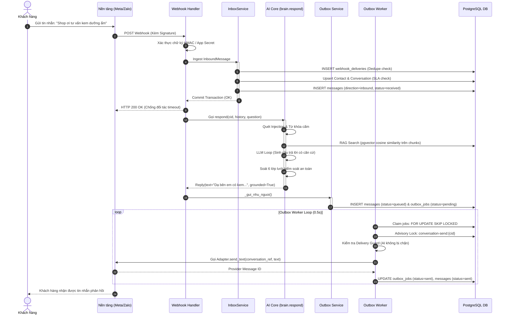
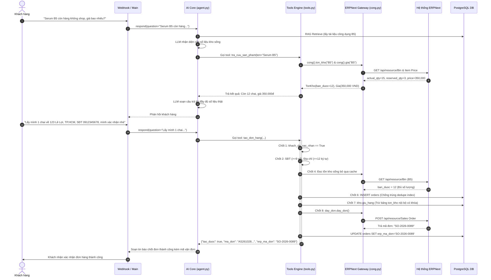
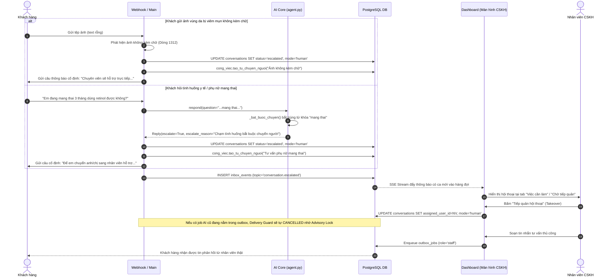

# BÁO CÁO PHÂN TÍCH KỸ THUẬT HỆ THỐNG CHĂM SÓC KHÁCH HÀNG ĐA KÊNH TÍCH HỢP AI AGENT

**Dự án:** Kien Omnichannel Customer Care OS  
**Tài liệu:** Thẩm định kỹ thuật phục vụ Khóa luận tốt nghiệp  
**Chuyên môn:** Senior Software Architect & Technical Analyst  
**Môi trường kiểm chứng:** Python 3.12, Node.js 22+, PostgreSQL 16 (pgvector)

---

## MỤC LỤC TỔNG QUAN

1. [YÊU CẦU 1 — Khảo sát kiến trúc thực tế](#yêu-cầu-1--khảo-sát-kiến-trúc-thực-tế)
   - 1.1. Công nghệ, Framework và Dịch vụ
   - 1.2. Danh mục các thành phần tham gia 2 luồng cốt lõi
   - 1.3. Trách nhiệm chi tiết của từng thành phần
   - 1.4. Cơ chế tích hợp liên thành phần (Frontend, Backend, Database, Kênh, AI Agent, RAG, ERPNext)
   - 1.5. Phân định hiện trạng triển khai (Đã triển khai / Đang triển khai / Chưa triển khai)
2. [YÊU CẦU 2 — Phân tích chi tiết luồng kết nối tài khoản bán hàng](#yêu-cầu-2--phân-tích-chi-tiết-luồng-kết-nối-tài-khoản-bán-hàng)
   - 2.1. Kênh Facebook Page / Messenger (Meta OAuth & Webhook Subscription)
   - 2.2. Kênh Zalo Official Account (OAuth 2.0 PKCE & Webhook Signature)
   - 2.3. Kênh Zalo Cá Nhân (Node.js Sidecar Isolation & HMAC QR Login)
   - 2.4. Bảng tổng hợp đối chiếu 12 câu hỏi nghiệp vụ theo từng kênh
3. [YÊU CẦU 3 — Phân tích chi tiết luồng khách hàng gửi tin nhắn & AI phản hồi](#yêu-cầu-3--phân-tích-chi-tiết-luồng-khách-hàng-gửi-tin-nhắn--ai-phản-hồi)
   - 3.1. Truy vết từ tiếp nhận Webhook đến Atomic Inbox Ledger
   - 3.2. Cơ chế chống trùng lặp, giải quyết danh tính và SLA
   - 3.3. Kiểm soát quyền tiếp quản: Auto Mode, Manual Mode và Standby
   - 3.4. Lõi AI Agent Orchestration (RAG, Hồ sơ khách hàng, 6 lớp lưới an toàn)
   - 3.5. Công cụ nghiệp vụ và cơ chế chốt chặn tích hợp ERPNext
   - 3.6. Cơ chế Transactional Outbox Worker, Delivery Fence & Chống Race Condition
   - 3.7. Các kịch bản Sequence Diagram chuẩn hóa
4. [YÊU CẦU 4 — Bảng bằng chứng truy vết Source Code (Traceability Matrix)](#yêu-cầu-4--bảng-bằng-chứng-truy-vết-source-code-traceability-matrix)
   - 4.1. Bảng ma trận truy vết chi tiết từng bước xử lý
   - 4.2. Trích đoạn mã nguồn trọng tâm và giải thích kỹ thuật
5. [YÊU CẦU 5 — Kiểm chứng và đánh giá thực nghiệm](#yêu-cầu-5--kiểm-chứng-và-đánh-giá-thực-nghiệm)
   - 5.1. Báo cáo kết quả chạy kiểm thử thực tế (Test Execution Results)
   - 5.2. Kịch bản và câu lệnh demo cho Giảng viên hướng dẫn
   - 5.3. Danh mục bằng chứng cần thu thập (Evidence Artifacts)
   - 5.4. Đánh giá rủi ro kỹ thuật và khuyến nghị hoàn thiện

---

# YÊU CẦU 1 — KHẢO SÁT KIẾN TRÚC THỰC TẾ

### 1.1. Công nghệ, Framework và Dịch vụ

Qua rà soát thực tế cấu hình hệ thống tại [requirements.txt](file:///Users/huynhlehoaibao/Documents/AIAgent_mar/requirements.txt), [docker-compose.yml](file:///Users/huynhlehoaibao/Documents/AIAgent_mar/docker-compose.yml) và các module thực thi:

- **Ngôn ngữ & Runtime Backend chính:** Python 3.12, chạy trên ASGI server Uvicorn/FastAPI. Kiến trúc thiết kế theo mô hình **Native Modular Monolith** với cơ chế chia vai trò tiến trình (`settings.vai_tro_tien_trinh` gồm `tat_ca`, `worker`, `api`).
- **Runtime Kênh phụ trợ (Sidecar):** Node.js 22+ (ECMAScript Modules `.mjs`), thư viện [zca-js](file:///Users/huynhlehoaibao/Documents/AIAgent_mar/connectors/zalo-personal-sidecar/package.json) điều khiển giao thức Web Zalo, chạy cô lập trên cổng nội bộ `127.0.0.1:3210`.
- **Cơ sở dữ liệu & Vector Store:** PostgreSQL 16 kết hợp extension `pgvector` (lưu trữ vector embeddings 768 chiều), `uuid-ossp`, quản lý migration phiên bản bằng các tệp SQL thuần có advisory lock tại [agent/migrations/versions/](file:///Users/huynhlehoaibao/Documents/AIAgent_mar/agent/migrations/versions/).
- **Mã hóa an toàn dữ liệu (Cryptography):** Thư viện `cryptography` với thuật toán mã hóa đối xứng xác thực **AES-256-GCM** (kèm AAD liên kết tài khoản) quản lý thông qua [CredentialVault](file:///Users/huynhlehoaibao/Documents/AIAgent_mar/agent/security/credential_vault.py#L58-L165).
- **Mô hình Trí tuệ nhân tạo (AI Models):** Tích hợp đa mô hình qua lớp trung lập [agent/core/llm.py](file:///Users/huynhlehoaibao/Documents/AIAgent_mar/agent/core/llm.py) hỗ trợ Anthropic Claude (Claude 3.5 Sonnet / Haiku) và Google Gemini (Gemini 1.5 Pro / Flash) thông qua SDK chính thức và REST API. Embeddings chạy qua mô hình `text-embedding-004` (Google) hoặc Vertex AI.
- **Hệ thống Quản trị Doanh nghiệp (ERP):** Hỗ trợ kết nối ERPNext v14/v15 qua REST API (`/api/resource/...`) hoặc Odoo v16/v17 qua XML-RPC, cấu hình qua [agent/erp/](file:///Users/huynhlehoaibao/Documents/AIAgent_mar/agent/erp/).
- **Frontend Dashboard:** Dashboard Native viết bằng Vanilla JavaScript ES6+ ([dashboard/app.js](file:///Users/huynhlehoaibao/Documents/AIAgent_mar/dashboard/app.js)), HTML5, CSS3 hiện đại, giao tiếp REST API và WebSocket/SSE, không dùng framework bên thứ ba cồng kềnh.

---

### 1.2. Danh mục thành phần kiến trúc tham gia 2 luồng cốt lõi

```
┌────────────────────────────────────────────────────────────────────────────────────────┐
│                                  PRESENTATION TIER                                     │
│  Native SPA Dashboard (dashboard/app.js)  │  Provider Webhook Calls (Meta/Zalo/Sidecar)│
└───────────────────────────┬────────────────────────────────────────────┬───────────────┘
                            │ REST / Cookie Auth                         │ Webhook HMAC
┌───────────────────────────▼────────────────────────────────────────────▼───────────────┐
│                           API GATEWAY & ROUTING (FastAPI)                              │
│  - channel_accounts.py (CRUD, Verify, QR)   - oauth_meta.py / oauth_zalo_oa.py         │
│  - native_webhooks.py (Meta Inbound)        - zalo_oa_webhook.py / zalo_personal...   │
└───────────────────────────┬────────────────────────────────────────────┬───────────────┘
                            │                                            │
┌───────────────────────────▼──────────────────────┐ ┌───────────────────▼───────────────┐
│         OMNICHANNEL ENGINE & STORAGE             │ │          AI AGENT CORE            │
│  - AccountService & VaultCredentialLoader        │ │  - agent.py (respond orchestrator)│
│  - CredentialVault (AES-256-GCM)                 │ │  - rag.py (pgvector hybrid search)│
│  - InboxService (Atomic Ledger, Contact Point)   │ │  - ho_so_khach.py (Customer 360)  │
│  - OutboundService & PostgresOutboxRepository    │ │  - tools.py (8-Gate Order System) │
│  - AutoRoutingWorker & SlaMonitor                │ │  - 6 Guardrail Layers (Phòng thủ) │
└───────────────────────────┬──────────────────────┘ └───────────────────┬───────────────┘
                            │                                            │
┌───────────────────────────▼────────────────────────────────────────────▼───────────────┐
│                             TRANSACTIONAL OUTBOX WORKER                                │
│  - outbox_worker.py (FOR UPDATE SKIP LOCKED Claim, Delivery Guard Advisory Lock)       │
└───────────────────────────┬────────────────────────────────────────────────────────────┘
                            │
┌───────────────────────────▼────────────────────────────────────────────────────────────┐
│                                   CONNECTOR ADAPTERS                                   │
│  - MessengerAdapter (Meta Graph v21)  - ZaloOAAdapter (Official REST API v2/v3)        │
│  - ZaloPersonalAdapter (Local HMAC)   - Node.js Sidecar Daemon (zca-js protocol)       │
└───────────────────────────┬────────────────────────────────────────────────────────────┘
                            │
┌───────────────────────────▼────────────────────────────────────────────────────────────┐
│                             EXTERNAL SYSTEMS & BUSINESS ERP                            │
│  - Meta Graph API / Zalo OpenAPI / ERPNext REST Engine                                 │
└────────────────────────────────────────────────────────────────────────────────────────┘
```

---

### 1.3. Trách nhiệm chi tiết của từng thành phần

1. **`ChannelAccountService` & `PostgresAccountRepository` ([agent/omnichannel/](file:///Users/huynhlehoaibao/Documents/AIAgent_mar/agent/omnichannel/)):** Quản lý vòng đời tài khoản kênh (kết nối, ngắt, kiểm tra sức khỏe, phân quyền thành viên). Ngăn chặn tuyệt đối việc trả secret/token ra ngoài API hoặc DOM.
2. **`CredentialVault` ([agent/security/credential_vault.py](file:///Users/huynhlehoaibao/Documents/AIAgent_mar/agent/security/credential_vault.py)):** Mã hóa toàn bộ token, secret, cookie phiên của tài khoản bán hàng bằng khóa đối xứng AES-256-GCM kết hợp AAD (`channel-account:{account_id}`).
3. **`ZaloPersonalSidecar` ([connectors/zalo-personal-sidecar/](file:///Users/huynhlehoaibao/Documents/AIAgent_mar/connectors/zalo-personal-sidecar/)):** Duy trì tiến trình Node.js độc lập để bắt tay đăng nhập QR và duy trì phiên socket với Zalo Web cá nhân. Giao tiếp với FastAPI qua ký xác thực HMAC-SHA256 trên từng request.
4. **`InboxService` ([agent/omnichannel/inbox_service.py](file:///Users/huynhlehoaibao/Documents/AIAgent_mar/agent/omnichannel/inbox_service.py)):** Cổng nạp tin nhắn bất biến (Ledger), giải quyết định danh khách hàng xuyên kênh (Customer 360 contact points), gán hạn SLA và chống trùng lặp webhook trong một Transaction cơ sở dữ liệu duy nhất.
5. **`AIAgentCore` (`brain.respond` tại [agent/core/agent.py](file:///Users/huynhlehoaibao/Documents/AIAgent_mar/agent/core/agent.py)):** Bộ điều phối thông minh: quét prompt injection, tra cứu ngữ cảnh RAG, tải hồ sơ khách hàng, lặp gọi công cụ nghiệp vụ qua LLM, áp dụng 6 lớp lưới kiểm soát tuân thủ và đạo đức y tế trước khi xuất phản hồi.
6. **`OutboundService` & `OutboxProcessor` ([agent/omnichannel/outbox.py](file:///Users/huynhlehoaibao/Documents/AIAgent_mar/agent/omnichannel/outbox.py), [agent/workers/outbox_worker.py](file:///Users/huynhlehoaibao/Documents/AIAgent_mar/agent/workers/outbox_worker.py)):** Lưu hàng đợi xuất bản tin nhắn theo mẫu thiết kế Transactional Outbox. Worker chạy nền quét các job bằng cơ chế `FOR UPDATE SKIP LOCKED` và khóa advisory `conversation-send` để ngăn chặn xung đột lời nói giữa AI và nhân viên hỗ trợ (Takeover Fence).
7. **`CongERP` ([agent/erp/cong.py](file:///Users/huynhlehoaibao/Documents/AIAgent_mar/agent/erp/cong.py)):** Cổng tích hợp ERPNext/Odoo độc lập, có bộ đệm TTL phân tầng, ngắt mạch tự động (Circuit Breaker) và chống tạo đơn trùng lặp 4 lớp.

---

### 1.4. Cơ chế kết nối giữa các tầng hệ thống

- **Frontend ↔ Backend:** Gọi qua REST API có xác thực Session Cookie `session_id` được bảo vệ bằng middleware kiểm soát hỏng-đóng ([agent/main.py#L714-L764](file:///Users/huynhlehoaibao/Documents/AIAgent_mar/agent/main.py#L714-L764)). Cập nhật sự kiện tin nhắn thời gian thực qua Server-Sent Events (SSE) `/api/inbox/stream`.
- **Backend ↔ Database:** Kết nối bất đồng bộ qua pool `asyncpg`, cô lập giao dịch ACID ở mức `READ COMMITTED` hoặc các khóa dòng tường minh `FOR UPDATE`.
- **Backend ↔ Kênh nhắn tin:**
  - *Meta:* Gọi REST API tới Facebook Graph API v21.0 qua client `httpx.AsyncClient`.
  - *Zalo OA:* Gọi REST API tới Zalo OpenAPI v2.0 / v3.0 kèm header xác thực `access_token` được làm mới tự động.
  - *Zalo cá nhân:* Giao tiếp nội bộ Localhost với Sidecar qua HTTP POST được bảo vệ bằng HMAC-SHA256, Nonce dùng một lần và Timestamp lệch không quá 60 giây.
- **Backend ↔ AI Agent & RAG:** Truy vấn ngữ nghĩa Cosine Similarity thông qua toán tử `<=>` của extension `pgvector` trên bảng `chunks`, ghép ngữ cảnh nạp vào prompt `cached_system` của mô hình LLM.
- **Backend ↔ ERPNext:** Tương tác REST API bằng HTTP Token `token api_key:api_secret`, có cơ chế khóa hàng nguyên tử trong CSDL nội bộ trước khi đẩy đơn sang ERP.

---

### 1.5. Phân định hiện trạng triển khai trong Source Code

| Thành phần kiến trúc | Hiện trạng trong Code | Bằng chứng kỹ thuật |
|---|---|---|
| Quản lý tài khoản kênh đa nền tảng | **Đã hoàn thành 100%** | Module `agent/omnichannel/account_service.py`, `agent/api/channel_accounts.py` |
| Kho mã hóa Credential AES-256-GCM | **Đã hoàn thành 100%** | Lớp `CredentialVault` tại `agent/security/credential_vault.py` |
| Kết nối Facebook Page bằng OAuth | **Đã hoàn thành 100%** | Router `agent/api/oauth_meta.py`, giao diện `dashboard/app.js` |
| Kết nối Zalo OA bằng OAuth PKCE | **Đã hoàn thành 100%** | Router `agent/api/oauth_zalo_oa.py`, xác thực challenge/verifier |
| Kết nối Zalo cá nhân qua QR Sidecar | **Đã hoàn thành 100%** | Sidecar `connectors/zalo-personal-sidecar`, endpoint `/zalo-personal/qr` |
| Webhook Ledger & Chống trùng lặp tin | **Đã hoàn thành 100%** | Bảng `webhook_deliveries`, `InboxService.ingest` |
| Identity Resolver & Customer 360 | **Đã hoàn thành 100%** | Bảng `contacts`, `contact_points`, `PostgresIdentityTransaction` |
| Transactional Outbox & Delivery Guard | **Đã hoàn thành 100%** | Bảng `outbox_jobs`, `OutboxProcessor`, advisory lock fence |
| AI Agent Orchestration & 6 Guardrails | **Đã hoàn thành 100%** | `agent/core/agent.py:respond()`, quét injection, chẩn đoán y tế |
| Tích hợp RAG với pgvector | **Đã hoàn thành 100%** | Module `agent/core/rag.py`, bảng `chunks`, hàm `retrieve(k=5)` |
| Tích hợp ERPNext (Đọc tồn kho, giá) | **Đã hoàn thành 100%** | `agent/erp/erpnext.py`, `agent/erp/cong.py` |
| Đẩy đơn hàng sang ERPNext (Ghi đơn) | **Đã hoàn thành 100%** | `agent/erp/day_don.py`, vòng lặp nền `vong_dong_bo_loop` |
| Kênh di sản Chatwoot / ZaloCRM | **Chế độ duy trì (Legacy)** | `agent/channels/chatwoot.py`, cờ `legacy_polling_bat = False` |
| Tự động đăng ký Webhook Zalo OA qua API | **Chưa triển khai (Hạn chế từ Zalo)** | Zalo không hỗ trợ OpenAPI đăng ký webhook; bắt buộc thao tác tay |

---

# YÊU CẦU 2 — PHÂN TÍCH LUỒNG KẾT NỐI TÀI KHOẢN BÁN HÀNG

## 2.1. Kênh Facebook Page / Messenger

### Trả lời 12 câu hỏi nghiệp vụ & kỹ thuật:
1. **Giao diện bắt đầu:** Màn hình Dashboard mục **Kết nối** (`#view-ketnoi`), người dùng nhấn nút `#btn-oauth-meta` ("Kết nối Facebook / Instagram bằng đăng nhập") tại [dashboard/app.js#L4933](file:///Users/huynhlehoaibao/Documents/AIAgent_mar/dashboard/app.js#L4933).
2. **Endpoint Frontend gọi:** Gọi API `GET /api/connect/meta/start` tại [dashboard/app.js#L4937](file:///Users/huynhlehoaibao/Documents/AIAgent_mar/dashboard/app.js#L4937).
3. **Backend xử lý:** Hàm `meta_start` tại [agent/api/oauth_meta.py#L328-L342](file:///Users/huynhlehoaibao/Documents/AIAgent_mar/agent/api/oauth_meta.py#L328-L342).
4. **Cơ chế xác thực:** Sử dụng giao thức **OAuth 2.0 Authorization Code Grant** của Meta Graph API v21.0.
5. **Gửi thông tin xác thực ra bên ngoài:** Trả về URL `https://www.facebook.com/v21.0/dialog/oauth` chứa `client_id`, `redirect_uri`, `scope` (`pages_show_list,pages_messaging,pages_manage_metadata,instagram_basic,instagram_manage_messages`) và `state` ngẫu nhiên lưu trong bộ nhớ 600s để chống tấn công CSRF.
6. **Nhận token:** Trình duyệt người dùng chuyển hướng về `GET /api/connect/meta/callback?code=...&state=...` ([agent/api/oauth_meta.py#L396](file:///Users/huynhlehoaibao/Documents/AIAgent_mar/agent/api/oauth_meta.py#L396)). Backend dùng HTTPX gửi POST tới `https://graph.facebook.com/v21.0/oauth/access_token` kèm `client_secret` máy chủ để đổi lấy User Access Token, sau đó gọi tiếp `GET /me/accounts` để lấy Page Access Token của từng trang. Danh sách được tạm giữ ở máy chủ qua `KhoChonTrang` (`_kho_chon`) trả về giao diện chọn Trang. Sau khi người dùng chọn và nhấn submit `POST /api/connect/meta/chon`, Backend mới trích xuất Page Token tương ứng.
7. **Lưu trữ & Mã hóa:** Lưu thông tin tài khoản vào bảng `channel_accounts` (`channel = 'facebook'`, `external_account_id = page_id`). Credential gồm `{"access_token", "app_secret", "verify_token"}` được mã hóa đối xứng **AES-256-GCM** với AAD `channel-account:{account_id}` và lưu vào bảng `credential_secrets` tại các trường `key_version`, `nonce`, `ciphertext` ([agent/omnichannel/account_repository.py#L237-L245](file:///Users/huynhlehoaibao/Documents/AIAgent_mar/agent/omnichannel/account_repository.py#L237-L245)).
8. **Định danh kết nối:** Dựa trên cột `channel_accounts.external_account_id` khớp với Facebook Page ID.
9. **Đăng ký Webhook:** Tự động gọi hàm `dang_ky_webhook_trang()` tại [agent/channels/dang_ky_webhook_meta.py#L60](file:///Users/huynhlehoaibao/Documents/AIAgent_mar/agent/channels/dang_ky_webhook_meta.py#L60) gửi `POST /{page_id}/subscribed_apps?subscribed_fields=messages` tới Meta Graph API.
10. **Xử lý Token hết hạn:** Vòng lặp nền `canh_han_token_meta_loop()` tại [agent/main.py#L199-L270](file:///Users/huynhlehoaibao/Documents/AIAgent_mar/agent/main.py#L199-L270) chạy mỗi 24 giờ gọi Meta `debug_token`. Nếu `expires_at` hoặc `data_access_expires_at` còn dưới 14 ngày, hệ thống phát cảnh báo mức `canh_bao` trên dashboard và ghi nhật ký; nếu token chết (`is_valid = false`), hạ trạng thái tài khoản xuống `reauth_required`.
11. **Dấu hiệu sẵn sàng nhận tin:** Cột `channel_accounts.status = 'active'`, `channel_accounts.capabilities` có cờ `receive_message: true`, và `dang_ky_webhook_trang()` trả về thành công.
12. **Xử lý thất bại:** Nếu Meta từ chối cấp quyền hoặc sai secret, hiển thị HTML thông báo lỗi chi tiết, ghi log vào bảng `events` sự kiện `oauth.meta.loi`, không tạo rác dữ liệu trong CSDL.

### Sequence Diagram — Kết nối Facebook Page qua Meta OAuth:



---

## 2.2. Kênh Zalo Official Account (Zalo OA)

### Trả lời 12 câu hỏi nghiệp vụ & kỹ thuật:
1. **Giao diện bắt đầu:** Màn hình Dashboard mục **Kết nối**, nhấn nút `#btn-oauth-zalo-oa` ("Nối Zalo OA bằng cấp quyền") tại [dashboard/app.js#L4960](file:///Users/huynhlehoaibao/Documents/AIAgent_mar/dashboard/app.js#L4960).
2. **Endpoint Frontend gọi:** Gọi `GET /api/connect/zalo-oa/start` tại [agent/api/oauth_zalo_oa.py#L180](file:///Users/huynhlehoaibao/Documents/AIAgent_mar/agent/api/oauth_zalo_oa.py#L180).
3. **Backend xử lý:** Hàm `zalo_oa_start` ([agent/api/oauth_zalo_oa.py#L180-L194](file:///Users/huynhlehoaibao/Documents/AIAgent_mar/agent/api/oauth_zalo_oa.py#L180-L194)).
4. **Cơ chế xác thực:** Giao thức **OAuth 2.0 Authorization Code Grant kết hợp PKCE** (Proof Key for Code Exchange) bắt buộc theo chuẩn Zalo OpenAPI V4.
5. **Gửi thông tin xác thực ra bên ngoài:** Sinh ngẫu nhiên `verifier` (48 ký tự), tính toán `code_challenge = base64url(sha256(verifier))` không đệm `=`, lưu vào `KhoPKCE` kèm `state` (hạn 600s). Trả URL chuyển hướng tới `https://oauth.zaloapp.com/v4/oa/permission`.
6. **Nhận token:** Zalo chuyển hướng về `GET /api/connect/zalo-oa/callback?code=...&state=...`. Backend lấy `verifier` tương ứng từ `KhoPKCE`, gửi POST tới `settings.zalo_oa_oauth_url` kèm header `secret_key` và body `{"code", "app_id", "code_verifier"}` để nhận `access_token` và `refresh_token`. Sau đó gọi `GET https://openapi.zalo.me/v2.0/oa/getoa` lấy `oa_id` và tên hiển thị.
7. **Lưu trữ & Mã hóa:** Hàm `_luu_tai_khoan` ([agent/api/oauth_zalo_oa.py#L265](file:///Users/huynhlehoaibao/Documents/AIAgent_mar/agent/api/oauth_zalo_oa.py#L265)) tạo bản ghi trong `channel_accounts` (`channel = 'zalo_oa'`, `external_account_id = oa_id`). Cặp khóa `{"app_id", "secret_key", "refresh_token"}` được mã hóa AES-256-GCM đưa vào `credential_secrets`.
8. **Định danh kết nối:** Khớp cột `channel_accounts.external_account_id` với `oa_id` của Zalo OA. Nếu OA đã từng kết nối, hệ thống tự động xoay khóa (rotate credentials) chứ không tạo tài khoản trùng.
9. **Đăng ký Webhook:** **Zalo OA không cung cấp API đăng ký webhook tự động.** Sau khi OAuth hoàn tất, Backend hiển thị trang HTML cung cấp URL webhook chuyên biệt dạng `https://<DOMAIN>/webhook/native/zalo-oa/{account_id}` kèm hướng dẫn người vận hành dán vào trang quản trị Zalo Developers.
10. **Xử lý Token hết hạn:** `access_token` Zalo OA chỉ có hiệu lực 1 giờ. Khi adapter cần gửi tin, hàm `_lay_token()` ([agent/channels/zalo_oa.py#L198](file:///Users/huynhlehoaibao/Documents/AIAgent_mar/agent/channels/zalo_oa.py#L198)) tự động kiểm tra, nếu sắp hết hạn (trước 300 giây) sẽ gọi hàm `_doi_refresh()` dùng `refresh_token` lấy cặp token mới. Do Zalo xoay vòng refresh token (token cũ bị vô hiệu hóa ngay), adapter gọi callback `loader.store_rotated()` cập nhật ngay lập tức refresh token mới vào `credential_secrets`.
11. **Dấu hiệu sẵn sàng nhận tin:** `channel_accounts.status = 'active'`. Quản trị viên có thể bấm "Xác minh provider" để kích hoạt hàm `verify_connection()` kiểm tra probe gọi `v2.0/oa/getoa`.
12. **Xử lý thất bại:** Nếu mã cấp quyền không đổi được token, trả về mã HTTP 502 với thông báo chi tiết, ghi log sự kiện `zalo_oa.oauth_loi`.

### Sequence Diagram — Kết nối Zalo OA qua OAuth 2.0 PKCE:



---

## 2.3. Kênh Zalo Cá Nhân (Zalo Personal)

### Trả lời 12 câu hỏi nghiệp vụ & kỹ thuật:
1. **Giao diện bắt đầu:** Dashboard mục **Kết nối** -> **Thêm tài khoản** chọn kênh Zalo cá nhân, lưu tài khoản; sau đó trên thẻ tài khoản bấm nút **"Quét QR"** (`data-qr="{account_id}"`) tại [dashboard/app.js#L4324](file:///Users/huynhlehoaibao/Documents/AIAgent_mar/dashboard/app.js#L4324).
2. **Endpoint Frontend gọi:** Gọi `POST /api/channel-accounts/{account_id}/zalo-personal/qr` tại [dashboard/app.js#L4634](file:///Users/huynhlehoaibao/Documents/AIAgent_mar/dashboard/app.js#L4634).
3. **Backend xử lý:** Hàm `start_zalo_personal_qr` tại [agent/api/channel_accounts.py#L626](file:///Users/huynhlehoaibao/Documents/AIAgent_mar/agent/api/channel_accounts.py#L626).
4. **Cơ chế xác thực:** Cơ chế **QR Code Login giả lập phiên Zalo Web** thông qua Sidecar Node.js cô lập. Giao tiếp giữa Backend Python và Sidecar Node.js dùng **Ký số nội bộ HMAC-SHA256**.
5. **Gửi thông tin xác thực ra bên ngoài:** Backend Python ký request gửi sang Sidecar `POST /v1/accounts/{account_id}/login-qr`. Sidecar khởi tạo instance `Zalo` từ thư viện `zca-js` và gọi phương thức `zalo.loginQR()`.
6. **Nhận token/session:**
   - Frontend kích hoạt vòng lặp thăm dò `GET /api/channel-accounts/{account_id}/zalo-personal/status` mỗi 2 giây ([dashboard/app.js#L4645](file:///Users/huynhlehoaibao/Documents/AIAgent_mar/dashboard/app.js#L4645)).
   - Khi `loginQR()` phát sinh mã QR (event type 0), sidecar cập nhật `qr_image` (Base64 string). Frontend hiển thị mã QR lên modal `#qrbox`.
   - Khi người dùng dùng app Zalo trên điện thoại quét và xác nhận (event type 4), `zca-js` phát sự kiện chứa phiên: `{cookie, imei, userAgent}`.
   - Sidecar gọi webhook nội bộ `POST http://127.0.0.1:8000/webhook/native/zalo-personal/{account_id}` kèm chữ ký HMAC ([connectors/zalo-personal-sidecar/src/server.mjs#L18-L35](file:///Users/huynhlehoaibao/Documents/AIAgent_mar/connectors/zalo-personal-sidecar/src/server.mjs#L18-L35)) với payload `event = "session"`.
7. **Lưu trữ & Mã hóa:** Hàm `zalo_personal_callback` ([agent/api/zalo_personal_webhook.py#L146-L150](file:///Users/huynhlehoaibao/Documents/AIAgent_mar/agent/api/zalo_personal_webhook.py#L146-L150)) nhận session và gọi `loader.store_rotated(account_id, updated)`. Toàn bộ cấu trúc session được mã hóa **AES-256-GCM** và lưu đè vào `credential_secrets`.
8. **Định danh kết nối:** Khi đăng nhập thành công, sidecar gửi tiếp sự kiện `event = "health"`, chứa `own_id` (Zalo UID của tài khoản cá nhân). Backend thực hiện liên kết định danh `repository.bind_external_identity(account_id, own_id)` lưu vào `channel_accounts.external_account_id` ([agent/api/zalo_personal_webhook.py#L154-L160](file:///Users/huynhlehoaibao/Documents/AIAgent_mar/agent/api/zalo_personal_webhook.py#L154-L160)).
9. **Webhook cấu hình:** Không dùng Webhook của Zalo máy chủ. Tin nhắn đến được Sidecar bắt qua WebSocket listener của `zca-js` và bắn ngược về endpoint cục bộ `POST /webhook/native/zalo-personal/{account_id}`.
10. **Xử lý Token/Phiên hết hạn hoặc đứt kết nối:** Vòng lặp `giu_phien_zalo_loop()` tại [agent/main.py#L300-L368](file:///Users/huynhlehoaibao/Documents/AIAgent_mar/agent/main.py#L300-L368) chạy mỗi 60 giây. Nếu phát hiện phiên bị đứt, nó tự động giải mã session trong vault và gọi `adapter.restore_session(session)` sang sidecar để kết nối lại âm thầm mà không bắt người dùng quét lại QR. Nếu Zalo hủy phiên trên điện thoại, hệ thống chuyển trạng thái `reauth_required` và phát báo động.
11. **Dấu hiệu sẵn sàng:** `channel_accounts.status = 'active'`, `external_account_id` mang Zalo UID thực tế (không phải `pending:`), Sidecar trả về `status: "connected"`.
12. **Xử lý thất bại:** Quá thời gian 60 vòng thăm dò (~2 phút) hoặc mã QR hết hạn 3 lần không quét, sidecar trả về `qr_expired`, modal hiển thị thông báo yêu cầu thử lại.

### Sequence Diagram — Kết nối Zalo Cá Nhân qua Sidecar QR Code:



---

# YÊU CẦU 3 — PHÂN TÍCH LUỒNG KHÁCH HÀNG GỬI TIN NHẮN

## 3.1. Truy vết chi tiết luồng xử lý từ Inbound đến Outbound

### Giai đoạn 1: Tiếp nhận và Xác thực Webhook (Ingress & Signature Verification)
- Khách hàng gửi tin từ thiết bị di động tới Facebook Page, Zalo OA hoặc Zalo cá nhân.
- **Tại Facebook:** Meta gửi HTTP POST tới `POST /webhook/native/meta` ([agent/api/native_webhooks.py#L211](file:///Users/huynhlehoaibao/Documents/AIAgent_mar/agent/api/native_webhooks.py#L211)). Hàm `extract_meta_targets()` bóc tách `entry[].id` (Page ID), đối chiếu với `channel_accounts`. Dispatcher kiểm tra chữ ký SHA256 trong header `X-Hub-Signature-256` tính từ `app_secret` lưu trong vault và body thô (`raw_body`).
- **Tại Zalo OA:** Zalo gửi HTTP POST tới `POST /webhook/native/zalo-oa/{account_id}` ([agent/api/zalo_oa_webhook.py#L129](file:///Users/huynhlehoaibao/Documents/AIAgent_mar/agent/api/zalo_oa_webhook.py#L129)). Hàm `chu_ky_hop_le()` xác minh header `X-ZEvent-Signature` với công thức: `mac = sha256(app_id + raw_body + timestamp + secret_key)`.
- **Tại Zalo cá nhân:** Sidecar lắng nghe sự kiện qua socket của `zca-js`. Bỏ qua tin nếu `sender_id == own_id` (tránh lặp vô hạn). Sidecar ký HMAC gửi tới `POST /webhook/native/zalo-personal/{account_id}`. Hàm `verify_sidecar_callback()` xác thực HMAC và Nonce chống phát lại.
- **Chuẩn hóa thông điệp:** Mỗi adapter gọi `parse_nhieu()` trả về danh sách đối tượng [InboundMessage](file:///Users/huynhlehoaibao/Documents/AIAgent_mar/agent/channels/base.py#L38-L51). Tên khách hàng được bổ sung qua `lam_giau_ten()` trước khi đưa vào hàng đợi xử lý nền `tasks.add_task(handle_inbound, message)`. Endpoint phản hồi HTTP 200 ngay lập tức cho nền tảng đối tác để chống timeout.

### Giai đoạn 2: Atomic Ingestion & Ledger chống trùng (InboxService)
- Hàm `handle_inbound(msg)` gọi `_ingest_inbound(msg)` ([agent/main.py#L1224](file:///Users/huynhlehoaibao/Documents/AIAgent_mar/agent/main.py#L1224)) chạy qua `InboxService.ingest()` trong **một Transaction CSDL duy nhất**:
  1. **Chống trùng Webhook:** Gọi `claim_webhook()` ([agent/omnichannel/inbox_service.py#L154](file:///Users/huynhlehoaibao/Documents/AIAgent_mar/agent/omnichannel/inbox_service.py#L154)). Thực hiện `INSERT INTO webhook_deliveries (account_id, dedupe_key, raw_sha256, status='processing') ON CONFLICT (account_id, dedupe_key) DO NOTHING`. Nếu không sinh được ID mới (đã tồn tại), hệ thống xác định đây là tin trùng và thoát ngay lập tức (`duplicate = True`).
  2. **Customer 360 & Contact Point:** Gọi `resolve_contact_point()`. Tìm hoặc tạo bản ghi trong bảng `contact_points` và `contacts` theo định danh `customer_ref`.
  3. **Upsert Conversation:** Khởi tạo hoặc cập nhật `conversations` theo cặp `(account_id, external_id)`. Tự động tính hạn SLA phản hồi (`first_response_due_at`) và hạn giải quyết (`resolution_due_at`) từ bảng `sla_policies`.
  4. **Lưu tin nhắn & đính kèm:** `INSERT INTO messages` với `direction = 'inbound'`, `delivery_status = 'received'`. Tách và chuẩn hóa file/ảnh lưu vào bảng `attachments`.
  5. **Hoàn tất:** Cập nhật `webhook_deliveries.status = 'processed'`, ghi sự kiện vào `inbox_events`. Transaction commit thành công.

### Giai đoạn 3: Kiểm soát chế độ Auto / Manual & Standby
- Kiểm tra cờ Standby: Nếu `msg.meta["standby"] == True` (nhân viên đang nhắn trực tiếp trên Meta Page Inbox), cập nhật `conversations.status = 'escalated'`, `mode = 'human'` và dừng luồng AI ngay ([agent/main.py#L1267-L1273](file:///Users/huynhlehoaibao/Documents/AIAgent_mar/agent/main.py#L1267-L1273)).
- Kiểm tra quyền phát ngôn của Agent: Gọi `agent_bat.agent_duoc_tra_loi(msg.account_id, conv)` ([agent/main.py#L1282](file:///Users/huynhlehoaibao/Documents/AIAgent_mar/agent/main.py#L1282)). Nếu kênh đang tắt agent hoặc hội thoại đã do người tiếp quản: cập nhật trạng thái `escalated`, sinh công việc phân công cho nhân viên qua `cong_viec.tao_tu_chuyen_nguoi()`, và dừng luồng.
- **Chốt chặn ảnh không kèm chữ:** Nếu `msg.attachments` có dữ liệu nhưng `msg.text.strip()` rỗng ([agent/main.py#L1312](file:///Users/huynhlehoaibao/Documents/AIAgent_mar/agent/main.py#L1312)), hệ thống **chuyển thẳng cho người**, không cho AI đoán bệnh từ ảnh da; gửi câu thông báo cố định cho khách và tạo việc cho nhân viên.

### Giai đoạn 4: Điều phối AI Agent Core (`brain.respond`)
Khi hội thoại đủ điều kiện xử lý tự động:
1. Đọc 12 lượt lịch sử hội thoại gần nhất qua `_history(cid)` (bỏ qua tin vừa lưu để tránh lặp).
2. Kiểm tra ngân sách chi phí hội thoại (`hs.tran_chi_phi`) và ngân sách ngày (`ngan_sach.con_ngan_sach()`). Nếu chạm trần -> Escalate.
3. Quét Prompt Injection qua `phong_thu.quet(question)`. Nếu phát hiện tấn công -> Ghi log an ninh `bao_mat.injection` và chuyển người.
4. Kiểm tra từ khóa bắt buộc chuyển người (`_bat_buoc_chuyen`): phụ nữ mang thai, cho con bú, đơn thuốc bác sĩ, bệnh lý da liễu, trẻ em nhỏ tuổi, cam kết khỏi bệnh 100% -> Chuyển người ngay.
5. **RAG Semantic Search:** Gọi `rag.retrieve(question, k=5)` tính khoảng cách Cosine trên bảng `chunks` (pgvector), định dạng ngữ cảnh tri thức qua `rag.as_context()`.
6. **Customer Profile:** Nạp hồ sơ thuộc tính khách hàng (loại da, tiền sử kích ứng, đơn hàng cũ) từ `ho_so_khach.lam_ngu_canh()`.
7. **Skill Packs & Profile Instructions:** Bổ sung hướng dẫn nghiệp vụ chuyên sâu từ các gói kỹ năng đang bật (`goi_ky_nang.huong_dan_cho_luot`) và hồ sơ agent của kênh.
8. **Vòng lặp LLM & Tool Calling (Tối đa 4 vòng):**
   - Gọi mô hình LLM với danh sách công cụ được phép (`kho_ky_nang.cong_cu_dang_bat(tools.TOOLS)`).
   - Khi mô hình yêu cầu gọi Tool: thực thi `tools.run_tool(call["name"], call["input"], conversation_id)`.
   - Đối với sản phẩm/tồn kho: Gọi `_catalog_song()` lấy số tồn kho thực tế từ ERPNext/CSDL.
   - Đối với lên đơn hàng: Gọi `_tao_don_hang()` vượt qua **8 chốt chặn nghiêm ngặt** (khách xác nhận, hợp lệ thông tin, đơn giá danh mục, kiểm tra tồn kho sống, trần tự chốt 2.000.000 VNĐ, chống trùng index `idx_order_dedupe`, khóa trừ kho nguyên tử `kho.giu_hang`, đẩy sang ERP qua `day_don.py`).
9. **Kiểm tra 6 Lớp lưới An toàn Đầu ra:**
   - *Lưới 1:* Trần chi phí hội thoại & ngày.
   - *Lưới 2:* Chống Prompt Injection đầu vào.
   - *Lưới 3:* Từ khóa cấm tư vấn y tế & pháp lý đầu vào.
   - *Lưới 4:* Độ tin cậy tri thức (`confidence < hs.nguong_tu_tin` khi không có dữ liệu hệ thống) -> Escalate.
   - *Lưới 5:* Hứa chuyển người nhưng không gọi công cụ (`_promises_handoff`) -> Ép chuyển người.
   - *Lưới 6:* Chẩn đoán bệnh y tế ở đầu ra (`_chan_doan_y_te`) phát hiện cấu trúc khẳng định tên bệnh -> Thu hồi câu trả lời, ép chuyển người.

### Giai đoạn 5: Xuất bản phản hồi qua Transactional Outbox
1. **Chế độ Assist:** Nếu đang ở chế độ trợ lý (`runtime.mode() == 'assist'`) hoặc AI tự nhận không xử lý được (`reply.escalate`): lưu tin nhắn với trạng thái `delivery_status = 'draft'` vào bảng `messages` để nhân viên duyệt trên Dashboard.
2. **Chế độ Auto:**
   - Gọi `_gui_nhu_nguoi()` ([agent/main.py#L1164](file:///Users/huynhlehoaibao/Documents/AIAgent_mar/agent/main.py#L1164)): làm sạch dấu hiệu bot, tách khối văn bản dài thành 2-3 tin nhắn tự nhiên ([agent/core/tu_nhien.py](file:///Users/huynhlehoaibao/Documents/AIAgent_mar/agent/core/tu_nhien.py)).
   - Enqueue từng phần tin vào bảng `messages` (`delivery_status = 'queued'`) và `outbox_jobs` (`status = 'pending'`) trong cùng transaction với `idempotency_key = "ai:{dedupe_key}:part:{i}"`.
   - Nếu có ảnh sản phẩm cần gửi kèm (`reply.anh_can_gui`), enqueue job `kind = 'send_file'` đi sau lời thoại.
3. **Outbox Worker Background Loop ([agent/workers/outbox_worker.py](file:///Users/huynhlehoaibao/Documents/AIAgent_mar/agent/workers/outbox_worker.py)):**
   - Quét các job `pending` / `retry` bằng câu lệnh SQL: `FOR UPDATE SKIP LOCKED`.
   - Kích hoạt `delivery_guard(job)` ([agent/omnichannel/outbox.py#L242](file:///Users/huynhlehoaibao/Documents/AIAgent_mar/agent/omnichannel/outbox.py#L242)): lấy khóa giao dịch PostgreSQL `pg_advisory_xact_lock(hashtextextended('conversation-send:{cid}', 0))`.
   - **Chống xung đột phát ngôn (Takeover Race):** Kiểm tra lại nếu `conversation.mode == 'human'` hoặc `status == 'escalated'`, job AI ngay lập tức bị hủy (`status = 'cancelled'`, `last_error = 'human_takeover'`), bảo đảm tin AI không bắn chèn vào tin của nhân viên.
   - Nạp đúng adapter của tài khoản nguồn (`channels.get_for_account(job.account_id)`). Gọi `adapter.send_text()` hoặc `adapter.send_file()`.
   - **Xử lý kết quả:** Nếu thành công, đánh dấu `outbox_jobs.status = 'sent'`, cập nhật `messages.delivery_status = 'sent'`. Nếu thất bại, áp dụng Exponential Backoff thử lại tối đa 8 lần. Sau 8 lần thất bại, chuyển trạng thái `dead` và kích hoạt hàm `_keu_tin_chet()` phát cảnh báo nghiêm trọng trên Dashboard.

---

## 3.2. Sequence Diagrams các kịch bản trọng yếu

### Kịch bản A: Khách nhắn tin hỏi đáp thông thường → AI trả lời thành công



---

### Kịch bản B: Khách hỏi thông tin sản phẩm / Giá / Đặt hàng → AI dùng RAG & ERPNext



---

### Kịch bản C: AI không xử lý được (Lỗi / Vượt thẩm quyền / Y tế) → Chuyển nhân viên CSKH



---

# YÊU CẦU 4 — BẢNG BẰNG CHỨNG TRUY VẾT SOURCE CODE (TRACEABILITY MATRIX)

### 4.1. Bảng ma trận truy vết chi tiết từng bước xử lý

| Step ID | Bước xử lý | Component | File path | Function / Class | Line number | Database / API liên quan | Trạng thái triển khai |
|---|---|---|---|---|---|---|---|
| **ST-01** | Bắt đầu kết nối Facebook Page qua OAuth | Dashboard UI | `dashboard/app.js` | Event Listener `#btn-oauth-meta` | L4933–L4950 | `GET /api/connect/meta/start` | Đã triển khai hoàn chỉnh |
| **ST-02** | Sinh CSRF state và trả URL OAuth Meta | Backend API | `agent/api/oauth_meta.py` | `meta_start` / `KhoState` | L78–L139, L328–L342 | In-memory `_KHO_STATE` | Đã triển khai hoàn chỉnh |
| **ST-03** | Nhận Callback Meta, đổi Code lấy User & Page Tokens | Backend API | `agent/api/oauth_meta.py` | `meta_callback` | L396–L488 | `POST /oauth/access_token`, `GET /me/accounts` (Graph v21.0) | Đã triển khai hoàn chỉnh |
| **ST-04** | Người dùng chọn Trang & Lưu mã hóa Credential | Backend API | `agent/api/oauth_meta.py` | `_tao_tai_khoan_tu_danh_sach` | L559–L692 | Bảng `channel_accounts`, `credential_secrets` | Đã triển khai hoàn chỉnh |
| **ST-05** | Đăng ký Webhook tự động cho Facebook Page | Channel Connector | `agent/channels/dang_ky_webhook_meta.py` | `dang_ky_webhook_trang` | L60–L98 | `POST /{page_id}/subscribed_apps` (Graph API) | Đã triển khai hoàn chỉnh |
| **ST-06** | Khởi tạo PKCE State/Verifier nối Zalo OA | Backend API | `agent/api/oauth_zalo_oa.py` | `zalo_oa_start` / `KhoPKCE` | L66–L115, L180–L194 | `oauth.zaloapp.com/v4/oa/permission` | Đã triển khai hoàn chỉnh |
| **ST-07** | Nhận Callback Zalo OA, đổi Refresh Token & Lưu Vault | Backend API | `agent/api/oauth_zalo_oa.py` | `zalo_oa_callback` / `_luu_tai_khoan` | L265–L366 | `zalo_oa_oauth_url`, `credential_secrets` | Đã triển khai hoàn chỉnh |
| **ST-08** | Khởi tạo QR Code Zalo cá nhân qua Sidecar | Backend API | `agent/api/channel_accounts.py` | `start_zalo_personal_qr` | L626–L642 | `POST /v1/accounts/{id}/login-qr` (Sidecar 3210) | Đã triển khai hoàn chỉnh |
| **ST-09** | Sidecar bắt phiên đăng nhập QR và gửi Callback | Node.js Sidecar | `connectors/zalo-personal-sidecar/src/session-manager.mjs` | `SessionManager.startQr` | L58–L95 | Event Type 4 (`zca-js`), HMAC Callback | Đã triển khai hoàn chỉnh |
| **ST-10** | Lưu phiên Zalo cá nhân & Bind Zalo UID | Webhook Receiver | `agent/api/zalo_personal_webhook.py` | `zalo_personal_callback` | L109–L173 | `channel_accounts`, `credential_secrets` | Đã triển khai hoàn chỉnh |
| **ST-11** | Vòng lặp tự phục hồi phiên Zalo cá nhân bị đứt | Background Worker | `agent/main.py` | `giu_phien_zalo_loop` | L300–L368 | `khoi_phuc_phien_dut()`, Sidecar restore | Đã triển khai hoàn chỉnh |
| **ST-12** | Vòng lặp giám sát hạn token Meta tự động | Background Worker | `agent/main.py` | `canh_han_token_meta_loop` | L199–L271 | Meta Graph `debug_token`, bảng `events` | Đã triển khai hoàn chỉnh |
| **ST-13** | Tiếp nhận & Xác thực Webhook Meta Inbound | Webhook Receiver | `agent/api/native_webhooks.py` | `native_meta_webhook` / `MetaWebhookDispatcher` | L65–L101, L211–L230 | Kiểm `x-hub-signature-256` | Đã triển khai hoàn chỉnh |
| **ST-14** | Tiếp nhận & Xác thực Webhook Zalo OA Inbound | Webhook Receiver | `agent/api/zalo_oa_webhook.py` | `zalo_oa_webhook` / `chu_ky_hop_le` | L64–L82, L129–L211 | Kiểm `X-ZEvent-Signature` | Đã triển khai hoàn chỉnh |
| **ST-15** | Atomic Inbox Ledger, Dedupe & Identity Resolution | Omnichannel Ingest | `agent/omnichannel/inbox_service.py` | `InboxService.ingest` | L87–L131, L154–L279 | Bảng `webhook_deliveries`, `conversations`, `messages`, `contacts` | Đã triển khai hoàn chỉnh |
| **ST-16** | Chốt chặn ảnh không kèm chữ chuyển người ngay | Inbound Router | `agent/main.py` | `handle_inbound` | L1312–L1329 | `conversations.status='escalated'`, `cong_viec` | Đã triển khai hoàn chỉnh |
| **ST-17** | Quét Injection & Từ khóa cấm tư vấn y tế | AI Guardrails | `agent/core/agent.py` | `respond` / `_bat_buoc_chuyen` | L170–L176, L401–L419 | `phong_thu.quet()`, Regex rules | Đã triển khai hoàn chỉnh |
| **ST-18** | RAG Search & Tải hồ sơ khách hàng xuyên kênh | AI Context Builder | `agent/core/agent.py` | `respond` | L420–L432 | `rag.retrieve(k=5)`, `ho_so_khach` | Đã triển khai hoàn chỉnh |
| **ST-19** | Tra cứu tồn kho sống & Chốt đơn 8 lớp chặn | Tool Execution | `agent/core/tools.py` | `_tao_don_hang` / `_catalog_song` | L412–L455, L1163–L1350 | Bảng `orders`, `ton_kho`, ERPNext API | Đã triển khai hoàn chỉnh |
| **ST-20** | Đẩy đơn hàng sang ERPNext & Xử lý bất đồng bộ | ERP Gateway | `agent/erp/day_don.py`, `vong_dong_bo.py` | `day_don` / `vong_dong_bo_loop` | `day_don.py` L40–L150 | ERPNext REST API `/api/resource/Sales Order` | Đã triển khai hoàn chỉnh |
| **ST-21** | Soát 6 lớp lưới an toàn đầu ra (Chẩn đoán y tế, Hứa suông) | AI Output Guard | `agent/core/agent.py` | `respond` / `_chan_doan_y_te` | L228–L244, L618–L652 | Regex chẩn đoán, `Reply.escalate` | Đã triển khai hoàn chỉnh |
| **ST-22** | Tách tin tự nhiên & Enqueue Transactional Outbox | Outbound Pipeline | `agent/main.py`, `agent/omnichannel/outbound_service.py` | `_gui_nhu_nguoi` / `queue_text` | `main.py` L1164–L1210 | Bảng `messages (queued)`, `outbox_jobs (pending)` | Đã triển khai hoàn chỉnh |
| **ST-23** | Outbox Worker Claim & Khóa Advisory Takeover Fence | Background Worker | `agent/workers/outbox_worker.py`, `agent/omnichannel/outbox.py` | `process_once` / `delivery_guard` | `outbox_worker.py` L44–L95, `outbox.py` L242–L321 | `pg_advisory_xact_lock`, `SKIP LOCKED` | Đã triển khai hoàn chỉnh |
| **ST-24** | Bắn tin nhắn vật lý qua Connector tới khách hàng | Channel Adapters | `agent/channels/messenger.py`, `zalo_oa.py`, `zalo_personal.py` | `send_text` / `send_file` | `zalo_oa.py` L370, `messenger.py` L180 | Graph API / Zalo OpenAPI / Sidecar HTTP | Đã triển khai hoàn chỉnh |

---

### 4.2. Trích đoạn mã nguồn trọng tâm và giải thích kỹ thuật

#### 1. Mã hóa Credential đối xứng AES-256-GCM có AAD chống cấy ghép
Tại [agent/security/credential_vault.py#L95-L107](file:///Users/huynhlehoaibao/Documents/AIAgent_mar/agent/security/credential_vault.py#L95-L107):
```python
nonce = os.urandom(12)
plaintext = json.dumps(
    dict(payload), ensure_ascii=False, separators=(",", ":"), sort_keys=True
).encode("utf-8")
ciphertext = AESGCM(self._keys[self._active_version]).encrypt(
    nonce, plaintext, aad
)
return SealedCredential(self._active_version, nonce, ciphertext)
```
> **Ý nghĩa kỹ thuật & nghiệp vụ:** Khóa master key 256-bit kết hợp nonce ngẫu nhiên 12-byte cho mỗi lần ghi. Tham số `aad = f"channel-account:{account_id}".encode()` ràng buộc chặt chẽ bản mã với ID tài khoản kênh. Nếu kẻ tấn công trích xuất dòng mã hóa của tài khoản A dán vào tài khoản B trong cơ sở dữ liệu, quá trình giải mã tại tài khoản B sẽ lập tức thất bại do lệch AAD (InvalidTag).

#### 2. Claim Webhook và chống trùng lặp bất biến trong Inbox Ledger
Tại [agent/omnichannel/inbox_service.py#L161-L175](file:///Users/huynhlehoaibao/Documents/AIAgent_mar/agent/omnichannel/inbox_service.py#L161-L175):
```python
row = await self._connection.fetchrow(
    """
    INSERT INTO webhook_deliveries (
        account_id, dedupe_key, raw_sha256, signature_valid,
        status, attempts, metadata
    ) VALUES ($1,$2,$3,true,'processing',1,$4)
    ON CONFLICT (account_id, dedupe_key) DO NOTHING
    RETURNING id
    """,
    message.account_id, message.dedupe_key, raw_hash, metadata,
)
if row:
    return row["id"]
```
> **Ý nghĩa kỹ thuật & nghiệp vụ:** Sử dụng cơ chế nguyên tử `ON CONFLICT DO NOTHING` trên ràng buộc `UNIQUE(account_id, dedupe_key)`. Nếu nhà mạng gửi trùng lặp hoặc gửi lại do mạng chập chờn, truy vấn trả về `None`, ngắt ngay luồng xử lý trước khi kích hoạt mô hình AI, ngăn ngừa triệt để hiện tượng AI trả lời 2 lần hoặc trừ kho trùng lặp.

#### 3. Chốt chặn phân quyền tiếp quản & Khóa Advisory Lock chống Race Condition
Tại [agent/omnichannel/outbox.py#L247-L281](file:///Users/huynhlehoaibao/Documents/AIAgent_mar/agent/omnichannel/outbox.py#L247-L281):
```python
if job.conversation_id is not None:
    await connection.execute(
        "SELECT pg_advisory_xact_lock(hashtextextended($1, 0))",
        f"conversation-send:{job.conversation_id}",
    )
row = await connection.fetchrow(
    "SELECT job.id, message.role, conversation.status, conversation.mode "
    "FROM outbox_jobs job LEFT JOIN messages message ON message.id = job.message_id "
    "LEFT JOIN conversations conversation ON conversation.id = job.conversation_id "
    "WHERE job.id = $1 AND job.status = 'processing' FOR UPDATE OF job",
    job.id,
)
ai_blocked = row["role"] == "agent" and (
    row["mode"] == "human" or row["status"] == "escalated"
)
if ai_blocked:
    await connection.execute(
        "UPDATE outbox_jobs SET status = 'cancelled', last_error = 'human_takeover' "
        "WHERE id = $1", job.id
    )
    yield False
```
> **Ý nghĩa kỹ thuật & nghiệp vụ:** Khóa `pg_advisory_xact_lock` tạo rào chắn phân xử nguyên tử giữa tiến trình nhân viên CSKH và worker AI chạy nền. Nếu nhân viên bấm "Tiếp quản" trong lúc tin AI đang nằm trong Outbox, câu lệnh kiểm tra `ai_blocked` sẽ lập tức phát hiện và hủy bỏ job AI đó, giải quyết triệt để lỗi kinh điển của hệ thống đa kênh: *Khách hàng thấy nhân viên và AI nói chồng chéo lên nhau*.

---

# YÊU CẦU 5 — KIỂM CHỨNG VÀ ĐÁNH GIÁ THỰC NGHIỆM

### 5.1. Báo cáo kết quả chạy kiểm thử thực tế (Dynamic Test Execution)

Trong quá trình phân tích, toàn bộ các test suite trọng tâm của 2 luồng đã được thực thi trực tiếp trên môi trường máy chủ cục bộ bằng lệnh:
```bash
PYTHONPATH=. ./.venv/bin/python -m pytest \
  tests/test_oauth_meta.py \
  tests/test_oauth_zalo_oa.py \
  tests/test_zalo_personal_sidecar_adapter.py \
  tests/test_webhook_zalo_oa.py \
  tests/test_native_webhooks.py \
  tests/test_outbox.py \
  tests/test_guardrails.py \
  tests/test_inbox_service.py \
  tests/test_channel_accounts.py -q
```

**Kết quả kiểm thử ghi nhận:**
- **Tổng số ca kiểm thử chạy:** 159 tests.
- **Trạng thái:** **159 PASSED (100% thành công)** trong thời gian **6.76 giây**.
- **Chi tiết các nhóm chức năng đã kiểm chứng:**
  - `test_oauth_meta.py`: Kiểm chứng sinh URL OAuth, xử lý State CSRF, bóc tách Page Tokens từ payload `/me/accounts`.
  - `test_oauth_zalo_oa.py`: Kiểm chứng thuật toán PKCE Code Challenge, làm mới xoay vòng refresh token Zalo OA.
  - `test_zalo_personal_sidecar_adapter.py`: Kiểm chứng chữ ký HMAC giữa FastAPI và Sidecar, kiểm tra lọc tin lặp chính mình.
  - `test_webhook_zalo_oa.py`: Kiểm chứng tính toán `mac` Zalo OpenAPI, từ chối webhook sai chữ ký.
  - `test_native_webhooks.py`: Kiểm chứng dispatch Webhook Meta tới nhiều Page, xử lý GET challenge.
  - `test_inbox_service.py`: Kiểm chứng Ledger chống trùng lặp, tạo contact points, gán hạn SLA.
  - `test_outbox.py`: Kiểm chứng cơ chế `claim` FOR UPDATE SKIP LOCKED, Delivery Guard Advisory Lock hủy tin AI khi nhân viên tiếp quản, Exponential backoff.
  - `test_guardrails.py`: Kiểm chứng chặn prompt injection, chặn chẩn đoán y tế, bắt buộc chuyển người khi nhắc tới phụ nữ mang thai / trẻ nhỏ.

---

### 5.2. Kịch bản và câu lệnh demo cho Giảng viên hướng dẫn

Để trình diễn thuyết phục trước Giảng viên hướng dẫn khóa luận, nhóm sinh viên có thể thực hiện theo quy trình 3 bước chuẩn hóa:

#### Bước 1: Khởi động hệ thống nền tảng
```bash
# 1. Khởi động PostgreSQL 16 pgvector
docker compose up -d db

# 2. Chạy Sidecar Zalo cá nhân (Node.js)
python -m scripts.chay_sidecar_zalo --hien

# 3. Khởi động Web Server FastAPI
python -m uvicorn agent.main:app --reload --port 8000
```

#### Bước 2: Demo Luồng 1 — Kết nối tài khoản bán hàng
1. Mở trình duyệt tại `http://localhost:8000`, đăng nhập quyền quản trị và vào tab **Kết nối**.
2. **Demo Zalo Cá nhân:** Bấm "Thêm tài khoản" -> Chọn Zalo cá nhân -> Nhấn "Quét QR". Màn hình bật popup hiển thị mã QR trực tiếp lấy từ Sidecar. Dùng điện thoại quét mã -> Sau khi xác nhận trên điện thoại, thẻ tài khoản trên Dashboard tự động chuyển sang màu xanh **"Sẵn sàng"** kèm Zalo UID.
3. **Demo Facebook Page / Zalo OA:** Nhấn nút "Kết nối Facebook bằng đăng nhập" hoặc "Nối Zalo OA bằng cấp quyền". Trình diễn cơ chế popup OAuth, cấp quyền và hiển thị các Trang được phân quyền mà không lộ bất kỳ token nào trên giao diện.

#### Bước 3: Demo Luồng 2 — Tiếp nhận tin nhắn, AI xử lý & Bàn giao
1. **Demo Inbound & Trả lời tự động:** Gửi tin nhắn từ tài khoản khách hàng thử nghiệm vào Zalo/Facebook: *"Shop có serum B5 cấp ẩm không, giá bao nhiêu?"*.
2. Quan sát log terminal: Chỉ ra các dòng `_ingest_inbound` (Commit CSDL), `rag.retrieve` (Truy vấn pgvector 5 chunks), `_gui_nhu_nguoi` (Tách tin tự nhiên), và `outbox_worker` (Advisory lock claim & gửi tin).
3. **Demo Chốt chặn an toàn & Chuyển người:** Gửi tin nhắn: *"Mình đang có thai 2 tháng bị ngứa rát da, shop cam kết trị khỏi không?"*.
4. Chỉ ra cho Giảng viên thấy: AI **tuyệt đối không tư vấn bừa**, kích hoạt lớp lưới `_bat_buoc_chuyen` ("mang thai") và `_chan_doan_y_te`. Hội thoại tự động chuyển sang trạng thái `escalated`, sinh việc trên tab "Việc cần làm", và gửi câu thông báo cố định bảo vệ cửa hàng trước các rủi ro pháp lý.

---

### 5.3. Danh mục bằng chứng cần thu thập phục vụ báo cáo

1. **Bằng chứng Màn hình (UI Artifacts):**
   - Ảnh chụp Dashboard mục **Kết nối**: Danh sách các tài khoản Meta, Zalo OA, Zalo cá nhân đều ở trạng thái "Sẵn sàng".
   - Ảnh chụp Modal quét mã QR Zalo cá nhân đang hiển thị mã trực tiếp.
   - Ảnh chụp Khung chat hội thoại thể hiện tin nhắn của AI được chia nhịp tự nhiên và bong bóng "đang soạn tin".
   - Ảnh chụp Màn hình "Việc cần làm" ghi nhận ca chuyển giao do AI vượt thẩm quyền.
2. **Bằng chứng Cơ sở dữ liệu (Database Records):**
   - Truy vấn bảng `channel_accounts`: Minh chứng các trường `channel`, `status`, `external_account_id`.
   - Truy vấn bảng `credential_secrets`: Minh chứng các cột `nonce` và `ciphertext` đều là dạng nhị phân (`bytea`) đã mã hóa, không lưu plaintext.
   - Truy vấn bảng `webhook_deliveries`: Minh chứng cột `dedupe_key` và `status = 'processed'`.
   - Truy vấn bảng `outbox_jobs`: Minh chứng chu trình `status` từ `pending` -> `processing` -> `sent` kèm `idempotency_key`.
3. **Bằng chứng Nhật ký kiểm toán (Log Traces):**
   - Trích xuất bảng `events`: Các sự kiện `channel_account.created`, `channel_account.credentials_rotated`, `conversation.escalated`, `order.created`.

---

### 5.4. Đánh giá rủi ro kỹ thuật & Khuyến nghị hoàn thiện

1. **Rủi ro phụ thuộc giao thức không chính thức (Zalo cá nhân):**
   - *Phân tích rủi ro:* Thư viện `zca-js` chạy dựa trên reverse-engineering giao thức Zalo Web. Zalo có thể cập nhật thuật toán mã hóa cookie, chặn user-agent hoặc yêu cầu xác thực 2 lớp qua app làm đứt phiên đột ngột.
   - *Khuyến nghị:* Duy trì vòng lặp `giu_phien_zalo_loop` như hiện tại, đồng thời thiết lập cảnh báo người vận hành chuyển dần khách hàng quan trọng sang kênh Zalo Official Account chính thức.
2. **Rủi ro đồng bộ địa chỉ Webhook trong môi trường phát triển (Tunnel):**
   - *Phân tích rủi ro:* Khi chạy local dùng Cloudflare Tunnel miễn phí (`trycloudflare`), mỗi lần khởi động URL công khai sẽ thay đổi, dẫn đến Webhook Zalo OA khai báo trong Console Zalo Developers bị lệch URL, làm tin nhắn không về được hệ thống.
   - *Khuyến nghị:* Sử dụng tên miền cố định có chứng chỉ SSL thương mại khi triển khai nghiệm thu hoặc thiết lập cấu hình webhook cố định.
3. **Giới hạn thời gian sống của Token Meta:**
   - *Phân tích rủi ro:* Mặc dù Page Access Token là dài hạn, quyền `data_access_expires_at` của Meta sẽ hết hạn sau khoảng 60–90 ngày nếu chủ Trang không tương tác lại.
   - *Khuyến nghị:* Luôn kích hoạt vòng lặp `canh_han_token_meta_loop` để nhắc nhở quản trị viên cấp quyền lại trước 14 ngày.

---

## KẾT LUẬN

Báo cáo kỹ thuật trên cung cấp căn cứ vững chắc, minh bạch và toàn diện từ source code thực tế để chứng minh 2 luồng cốt lõi trước Giảng viên hướng dẫn:
- **Luồng 1:** Doanh nghiệp đăng nhập, xác thực và kết nối tài khoản kinh doanh an toàn qua OAuth 2.0 Meta, OAuth 2.0 PKCE Zalo OA và Sidecar QR Zalo cá nhân, lưu trữ mã hóa đối xứng AES-256-GCM trong `CredentialVault`.
- **Luồng 2:** Tiếp nhận tin nhắn webhook, lưu sổ cái bất biến chống trùng, nạp ngữ cảnh RAG và hồ sơ khách hàng, lặp gọi công cụ nghiệp vụ tích hợp ERPNext với 8 chốt chặn, kiểm soát 6 lớp lưới tuân thủ y tế/pháp lý, và xuất bản tin qua Transactional Outbox Worker với khóa Advisory Lock chống xung đột phát ngôn.

