# LƯỢC ĐỒ CƠ SỞ DỮ LIỆU HIỆN TẠI (DATABASE SCHEMA)
## Hệ Thống CSKH Đa Kênh Tích Hợp AI Agent

> **Phiên bản:** Cập nhật theo `agent/schema.sql` (baseline) kết hợp toàn bộ **26 tệp migration** trong [`agent/migrations/versions/`](../agent/migrations/versions/).  
> **Tổng số bảng:** **56 bảng**, phân bổ thành **11 phân hệ nghiệp vụ**.  
> **Hệ quản trị CSDL:** PostgreSQL 16 + Tiện ích mở rộng `pgvector` & `uuid-ossp`.  
> **Quy ước định tuyến cốt lõi:** Bất biến định tuyến bắt buộc dựa trên cặp `(account_id, external_id)` để đảm bảo trả lời đúng kênh và đúng tài khoản nguồn.

---

## 1. BẢNG PHÂN NHÓM 56 BẢNG THEO NGHIỆP VỤ

| Nhóm nghiệp vụ | Danh sách các bảng CSDL | Mục đích & Ý nghĩa nghiệp vụ |
|---|---|---|
| **1. Hội thoại** | `conversations`, `messages`, `ho_so_khach`, `processed_webhooks` | Lưu trữ phiên chat đa kênh, lịch sử tin nhắn, trí nhớ khách hàng và chống trùng lặp tin nhắn |
| **2. Bán hàng & Kho** | `orders`, `ton_kho`, `kho_bien_dong` | Quản lý đơn hàng, số lượng tồn kho thực tế/bán được và nhật ký xuất nhập kho |
| **3. Tri thức (RAG)** | `documents`, `chunks` | Quản lý tài liệu tri thức, cắt đoạn văn bản và lưu trữ vector nhúng (`pgvector`) |
| **4. Nội dung & Video (KHÔNG CÒN DÙNG)** | `videos`, `video_assets`, `posts`, `post_metrics` | Tính năng dựng video và đăng bài đã gỡ khỏi mã ngày 19.11.2026. Bảng giữ lại vì còn dữ liệu cũ và migration đã chốt checksum; không mã nào đọc/ghi nữa |
| **5. Phân quyền (RBAC)** | `vai_tro`, `vai_tro_quyen`, `nguoi_dung_vai_tro` | Kiểm soát quyền truy cập chi tiết theo vai trò quản trị, trưởng ca, nhân viên trực chat |
| **6. Quản lý công việc** | `cong_viec` | Giao việc nội bộ phát sinh từ hội thoại hoặc chăm sóc khách hàng |
| **7. Hồ sơ AI Agent** | `agent_ho_so` | Cấu hình prompt, tone giọng, ngưỡng tự tin và trần chi phí cho từng agent |
| **8. Vận hành & Kỹ năng** | `nguoi_dung`, `phien`, `events`, `zalo_oa_token`, `ky_nang_cai_dat`, `goi_ky_nang`, `goi_ky_nang_lich_su`, `ky_nang_lich_su`, `tich_hop_ung_dung`, `cau_hinh_agent`, `cau_hinh_bi_mat`, `mcp_may_chu` | Quản lý phiên đăng nhập, chứng chỉ kết nối, kho kỹ năng động, cấu hình nhạy cảm và máy chủ MCP |
| **9. Tài khoản kênh** | `channel_accounts`, `credential_secrets`, `account_memberships`, `account_health_events` | Quản lý nhiều tài khoản Zalo cá nhân, Zalo OA, Fanpage, mã hóa secret AES-256-GCM |
| **10. Inbox & Outbox Native** | `webhook_deliveries`, `attachments`, `outbox_jobs`, `inbox_events`, `conversation_reads`, `worker_heartbeats` | Đường ống webhook gửi nhận, tệp đính kèm, Transactional Outbox, sự kiện realtime SSE |
| **11. Customer 360** | `contacts`, `contact_points`, `contact_tags`, `contact_notes`, `contact_consents`, `contact_merges`, `data_retention_jobs`, `contact_owner_history`, `truong_khach` | Hợp nhất danh tính khách hàng đa kênh, đồng thuận dữ liệu, tuân thủ Nghị định 13/2023 |
| **12. Định tuyến & SLA** | `teams`, `team_members`, `routing_rules`, `routing_cursors`, `conversation_assignments`, `sla_policies`, `sla_events` | Tự động phân chia ca trực theo kỹ năng/đội nhóm, theo dõi và cảnh báo vi phạm SLA |

---

## 2. SƠ ĐỒ THỰC THỂ QUAN HỆ (MERMAID ERD)

```mermaid
erDiagram
    conversations {
        UUID id PK
        UUID account_id FK
        TEXT channel
        TEXT nen_tang
        TEXT external_id
        TEXT customer_name
        TEXT customer_ref
        TEXT status
        TEXT outcome
        NUMERIC cost_usd
        INT msg_count
        TIMESTAMPTZ created_at
        TIMESTAMPTZ updated_at
    }
    messages {
        UUID id PK
        UUID conversation_id FK
        TEXT role
        TEXT content
        BOOLEAN delivered
        BOOLEAN grounded
        REAL confidence
        JSONB sources
        NUMERIC cost_usd
        JSONB attachments
        TEXT direction
        TIMESTAMPTZ created_at
    }
    documents {
        UUID id PK
        TEXT title
        TEXT source
        INT chunk_count
        TIMESTAMPTZ created_at
    }
    chunks {
        UUID id PK
        UUID document_id FK
        INT ord
        TEXT content
        VECTOR embedding
    }
    orders {
        UUID id PK
        TEXT ma_don
        UUID conversation_id FK
        TEXT channel
        TEXT khach_ten
        TEXT khach_sdt
        TEXT khach_dia_chi
        JSONB items
        NUMERIC tong_tien
        TEXT trang_thai
    }
    ton_kho {
        TEXT ma PK
        INT so_luong
        TIMESTAMPTZ cap_nhat_luc
    }
    kho_bien_dong {
        BIGSERIAL id PK
        TEXT ma
        INT thay_doi
        TEXT ly_do
        TEXT ma_don
        TIMESTAMPTZ luc
    }
    channel_accounts {
        UUID id PK
        TEXT channel
        TEXT display_name
        TEXT external_account_id
        TEXT status
        JSONB capabilities
        JSONB metadata
        UUID agent_profile_id FK
    }
    credential_secrets {
        UUID account_id PK, FK
        INT key_version
        BYTEA nonce
        BYTEA ciphertext
    }
    account_memberships {
        UUID account_id PK, FK
        UUID user_id PK, FK
        TEXT role
    }
    outbox_jobs {
        UUID id PK
        UUID account_id FK
        UUID conversation_id FK
        UUID message_id FK
        TEXT kind
        JSONB payload
        TEXT idempotency_key
        TEXT status
        INT attempts
    }
    contacts {
        UUID id PK
        TEXT display_name
        TEXT phone
        TEXT email
        JSONB profile
        TEXT status
        UUID merged_into FK
        INT version
    }
    contact_points {
        UUID id PK
        UUID contact_id FK
        UUID channel_account_id FK
        TEXT external_user_id
        TEXT handle
    }
    teams {
        UUID id PK
        TEXT name
        TEXT description
        TEXT status
    }
    team_members {
        UUID team_id PK, FK
        UUID user_id PK, FK
        TEXT role
        JSONB skills
        INT max_active
        BOOLEAN is_available
    }
    routing_rules {
        UUID id PK
        UUID account_id FK
        UUID team_id FK
        TEXT priority
        JSONB required_skills
        INT weight
        BOOLEAN active
    }
    sla_policies {
        UUID id PK
        UUID account_id FK
        TEXT priority
        INT first_response_minutes
        INT resolution_minutes
        JSONB business_hours
        BOOLEAN active
    }
    sla_events {
        BIGSERIAL id PK
        UUID conversation_id FK
        TEXT kind
        TIMESTAMPTZ due_at
        JSONB detail
    }
    nguoi_dung {
        UUID id PK
        TEXT ten_dang_nhap
        TEXT mat_khau_bam
        TEXT ho_ten
        TEXT vai_tro
        BOOLEAN khoa
    }
    vai_tro {
        UUID id PK
        TEXT ten
        TEXT mo_ta
        BOOLEAN he_thong
    }
    vai_tro_quyen {
        UUID vai_tro_id PK, FK
        TEXT quyen PK
    }
    nguoi_dung_vai_tro {
        UUID nguoi_dung_id PK, FK
        UUID vai_tro_id PK, FK
        UUID gan_boi FK
    }
    agent_ho_so {
        UUID id PK
        TEXT ten
        TEXT mo_ta
        TEXT huong_dan
        NUMERIC nguong_tu_tin
        NUMERIC tran_chi_phi
        BOOLEAN bat
    }

    %% Quan hệ giữa các bảng chính
    channel_accounts ||--o{ conversations : "sở hữu"
    conversations ||--o{ messages : "chứa"
    conversations ||--o{ orders : "sinh ra"
    documents ||--o{ chunks : "chia nhỏ"
    channel_accounts ||--|| credential_secrets : "bảo vệ bí mật"
    channel_accounts ||--o{ account_memberships : "phân quyền"
    nguoi_dung ||--o{ account_memberships : "tham gia"
    channel_accounts ||--o{ outbox_jobs : "gửi qua"
    conversations ||--o{ outbox_jobs : "gửi tin"
    contacts ||--o{ contact_points : "điểm chạm"
    channel_accounts ||--o{ contact_points : "tiếp nhận"
    teams ||--o{ team_members : "thành viên"
    nguoi_dung ||--o{ team_members : "thuộc"
    channel_accounts ||--o{ routing_rules : "áp dụng"
    teams ||--o{ routing_rules : "đích đến"
    channel_accounts ||--o{ sla_policies : "chính sách"
    conversations ||--o{ sla_events : "theo dõi"
    vai_tro ||--o{ vai_tro_quyen : "quyền"
    nguoi_dung ||--o{ nguoi_dung_vai_tro : "gán"
    vai_tro ||--o{ nguoi_dung_vai_tro : "thuộc"
    agent_ho_so ||--o{ channel_accounts : "áp dụng hồ sơ"
```

---

## 3. ĐẶC TẢ CHI TIẾT CÁC PHÂN HỆ DỮ LIỆU CỐT LÕI

### 3.1. Phân hệ Hội thoại & Tin nhắn đa kênh

#### Bảng `conversations` (Cuộc hội thoại)
* `id` (UUID, PK): Định danh duy nhất phiên hội thoại.
* `account_id` (UUID, FK -> `channel_accounts.id`): Tài khoản kênh cụ thể nhận tin (bắt buộc, không để trống).
* `channel` (TEXT): Loại kênh (`zalocrm`, `chatwoot`, `messenger`, `zalo_oa`...).
* `nen_tang` (TEXT): Mạng xã hội gốc (`facebook`, `instagram`, `whatsapp`, `zalo`, `website`).
* `external_id` (TEXT): ID hội thoại từ phía nền tảng chat.
* `customer_name` (TEXT): Tên hiển thị của khách hàng.
* `customer_ref` (TEXT): Mã định danh khách trên kênh (PSID, Zalo ID).
* `status` (TEXT): Trạng thái (`auto` = agent đang xử lý, `assist` = chờ nhân viên duyệt, `escalated` = đã chuyển người, `closed` = đã đóng).
* `outcome` (TEXT): Kết quả (`resolved`, `escalated`, `abandoned`).
* `cost_usd` (NUMERIC): Tổng chi phí token LLM tích lũy cho cuộc hội thoại.
* `msg_count` (INT): Tổng số tin nhắn trong phiên.
* **Ràng buộc:** `UNIQUE (account_id, external_id)` — đảm bảo không bị lẫn lộn giữa các Page/tài khoản khác nhau.

#### Bảng `messages` (Chi tiết tin nhắn)
* `id` (UUID, PK): Định danh tin nhắn.
* `conversation_id` (UUID, FK -> `conversations.id` ON DELETE CASCADE).
* `role` (TEXT): Vai trò gửi (`customer`, `agent`, `staff`, `system`).
* `content` (TEXT): Nội dung văn bản tin nhắn.
* `direction` (TEXT): Hướng tin (`inbound` = khách gửi vào, `outbound` = hệ thống gửi ra).
* `delivered` (BOOLEAN): Trạng thái đã gửi tới khách thành công.
* `grounded` (BOOLEAN): Đánh dấu câu trả lời có căn cứ trích xuất từ RAG hay không.
* `confidence` (REAL): Độ tự tin của câu trả lời.
* `sources` (JSONB): Danh sách trích dẫn chunk RAG dùng để sinh câu trả lời.
* `tokens_in`, `tokens_out`, `cost_usd`: Thống kê token và chi phí API tương ứng.
* `latency_ms` (INT): Độ trễ sinh câu trả lời (mili-giây).
* `attachments` (JSONB): Danh sách tệp đính kèm (ảnh, video).

---

### 3.2. Phân hệ Bán hàng, Kho & Đơn hàng

#### Bảng `orders` (Đơn hàng)
* `id` (UUID, PK): Mã đơn hàng hệ thống.
* `ma_don` (TEXT, UNIQUE): Mã đơn kinh doanh (ví dụ: `AS260904120000`).
* `conversation_id` (UUID, FK -> `conversations.id`): Hội thoại nguồn sinh ra đơn.
* `khach_ten`, `khach_sdt`, `khach_dia_chi` (TEXT): Thông tin người nhận.
* `items` (JSONB): Danh sách món hàng `[{ma: "SP01", ten: "...", so_luong: 2, don_gia: 250000}]`.
* `tong_tien` (NUMERIC): Tổng giá trị đơn hàng.
* `trang_thai` (TEXT): Trạng thái đơn (`cho_duyet`, `da_chot`, `cho_dong_bo`, `da_giao`, `huy`).
* `ma_van_don` (TEXT): Mã vận đơn từ đơn vị giao hàng (GHN, GHTK...).
* `erp_order_id` (TEXT): ID đơn hàng đã đồng bộ sang ERPNext.

#### Bảng `ton_kho` (Tồn kho thực tế)
* `ma` (TEXT, PK): Mã sản phẩm (SKU).
* `so_luong` (INT): Số lượng vật lý có trong kho.
* `cap_nhat_luc` (TIMESTAMPTZ): Thời điểm cập nhật cuối cùng.

#### Bảng `kho_bien_dong` (Nhật ký biến động kho)
* `id` (BIGSERIAL, PK): Mã giao dịch kho.
* `ma` (TEXT): Mã sản phẩm.
* `thay_doi` (INT): Số lượng tăng (+) hoặc giảm (-).
* `ly_do` (TEXT): Lý do (`tao_don`, `huy_don`, `nhap_kho`, `kiem_ke`).
* `ma_don` (TEXT): Mã đơn liên quan.

---

### 3.3. Phân hệ Cơ sở tri thức (RAG & Vector Embeddings)

#### Bảng `documents` (Tài liệu nguồn)
* `id` (UUID, PK): Định danh tài liệu.
* `title` (TEXT): Tiêu đề tài liệu (chính sách đổi trả, cẩm nang chăm sóc da, bảng giá mỹ phẩm).
* `source` (TEXT): Đường dẫn tệp hoặc nguồn nạp.
* `chunk_count` (INT): Số đoạn cắt ra từ tài liệu.

#### Bảng `chunks` (Đoạn tri thức nhúng)
* `id` (UUID, PK): Định danh chunk.
* `document_id` (UUID, FK -> `documents.id` ON DELETE CASCADE).
* `ord` (INT): Thứ tự đoạn trong tài liệu gốc.
* `content` (TEXT): Nội dung văn bản của đoạn tri thức.
* `embedding` (VECTOR(768)): Vector nhúng sinh bởi mô hình tiếng Việt trên Google Vertex AI, phục vụ tìm kiếm ngữ nghĩa tương đồng cosine.

---

### 3.4. Phân hệ Tài khoản Kênh & Mã hóa Bảo mật

#### Bảng `channel_accounts` (Tài khoản tiếp nhận)
* `id` (UUID, PK): Mã tài khoản kênh trong hệ thống.
* `channel` (TEXT): `zalo_personal`, `zalo_oa`, `meta_page`, `whatsapp`, `web`.
* `display_name` (TEXT): Tên hiển thị (ví dụ: "Zalo Bán Hàng Kiên", "Fanpage Mỹ Phẩm Chính Hãng").
* `external_account_id` (TEXT): ID tài khoản từ nền tảng ngoại vi (Page ID, Zalo OA ID).
* `status` (TEXT): `active`, `paused`, `error`, `revoked`.
* `agent_profile_id` (UUID, FK -> `agent_ho_so.id`): Hồ sơ agent áp dụng cho tài khoản này.

#### Bảng `credential_secrets` (Kho khóa bí mật mã hóa)
* `account_id` (UUID, PK, FK -> `channel_accounts.id` ON DELETE CASCADE).
* `key_version` (INT): Phiên bản Master Key dùng để mã hóa.
* `nonce` (BYTEA): Initialization Vector (IV/Nonce) ngẫu nhiên 12 bytes cho AES-GCM.
* `ciphertext` (BYTEA): Chuỗi JSON chứa API Key, App Secret, Refresh Token đã được mã hóa **AES-256-GCM**.
* **Nguyên tắc:** Secret chỉ nhận ghi từ Dashboard/API, **không bao giờ trả lại qua API hoặc render ra DOM**.

---

### 3.5. Phân hệ Đường ống Tin nhắn (Transactional Outbox & Inbox Native)

#### Bảng `outbox_jobs` (Hàng đợi gửi tin bền vững)
* `id` (UUID, PK): Mã công việc gửi tin.
* `account_id` (UUID, FK): Tài khoản gửi tin đi.
* `conversation_id` (UUID, FK): Hội thoại nhận phản hồi.
* `message_id` (UUID, FK): Tin nhắn cần gửi.
* `kind` (TEXT): Loại (`send_message`, `send_image`, `set_typing`).
* `payload` (JSONB): Dữ liệu gửi đi đóng gói theo API nhà cung cấp.
* `idempotency_key` (TEXT, UNIQUE): Khóa chống gửi lặp tin nhắn.
* `status` (TEXT): `pending`, `processing`, `delivered`, `dead_letter`.
* `attempts` (INT): Số lần đã thử lại (retry count).

#### Bảng `webhook_deliveries` (Nhật ký tiếp nhận Webhook)
* Lưu vết mọi webhook thô từ Meta/Zalo đến hệ thống, kiểm tra chữ ký HMAC, chống tấn công replay.

---

### 3.6. Phân hệ Customer 360 & Tuân thủ Nghị định 13/2023

#### Bảng `contacts` & `contact_points`
* Hợp nhất danh tính khách hàng: Một khách hàng thực tế (`contacts`) có thể liên kết với nhiều tài khoản mạng xã hội (`contact_points`: Zalo cá nhân, Zalo OA, Facebook Messenger, Instagram).
* Hỗ trợ gộp hồ sơ (`contact_merges`) có lưu snapshot để hoàn tác.

#### Bảng `data_retention_jobs` (Xóa dữ liệu bảo vệ quyền riêng tư)
* Lưu trữ các yêu cầu xuất hoặc xóa vĩnh viễn dữ liệu PII theo Nghị định 13/2023/NĐ-CP.
* Yêu cầu bắt buộc phải có chữ ký xác nhận của **hai quản trị viên độc lập** (`requested_by` và `approved_by`) trước khi thi hành xóa thật.

---

### 3.7. Phân hệ Định tuyến Hội thoại & Giám sát SLA

#### Bảng `sla_policies` & `sla_events`
* `first_response_minutes`: Ngưỡng cam kết thời gian phản hồi tin nhắn đầu tiên (SLA FRT).
* `resolution_minutes`: Ngưỡng thời gian giải quyết dứt điểm vấn đề khách hàng.
* `sla_events`: Ghi nhận sự kiện hẹn giờ, kích hoạt worker quét breach và đổi cờ cảnh báo đỏ trên Dashboard khi nhân viên chậm trễ.

#### Bảng `routing_rules` & `teams`
* Tự động điều phối hội thoại vào các đội chuyên trách (Đội Tư vấn Bán hàng, Đội Xử lý Khiếu nại) dựa trên kỹ năng (`required_skills`), trọng số (`weight`) và cơ chế vòng tròn luân phiên (Round-robin với `routing_cursors`).

---

## 4. CÁC TỆP NGUỒN CẤU THÀNH SCHEMA TRONG REPOSITORY

1. **Tệp khởi tạo Baseline ban đầu:** [`agent/schema.sql`](file:///Users/huynhlehoaibao/Documents/AIAgent_mar/agent/schema.sql)
2. **Thư mục 26 tệp di trú phiên bản:** [`agent/migrations/versions/`](file:///Users/huynhlehoaibao/Documents/AIAgent_mar/agent/migrations/versions/)
3. **Bộ sinh tài liệu & sơ đồ tự động:** [`scripts/sinh_so_do.py`](file:///Users/huynhlehoaibao/Documents/AIAgent_mar/scripts/sinh_so_do.py)
   * Lệnh cập nhật tài liệu khi đổi schema: `python -m scripts.sinh_so_do --ghi`
4. **Bộ kiểm thử toàn vẹn Schema & Di trú:** [`tests/test_so_do.py`](file:///Users/huynhlehoaibao/Documents/AIAgent_mar/tests/test_so_do.py)
