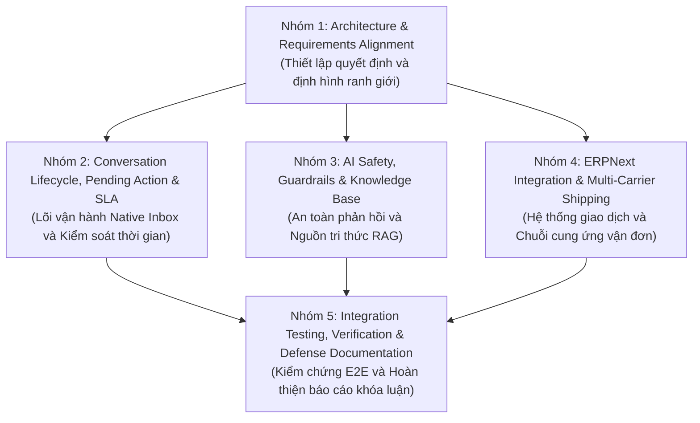
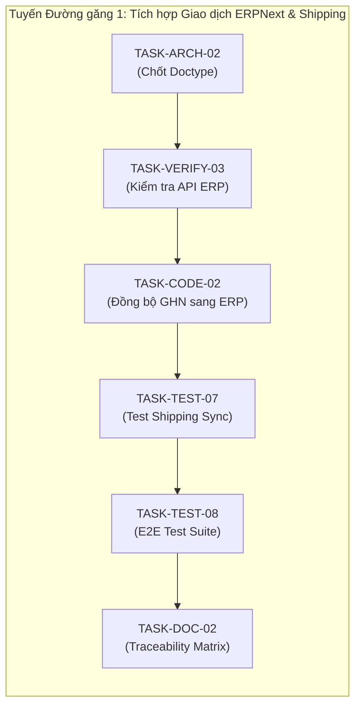
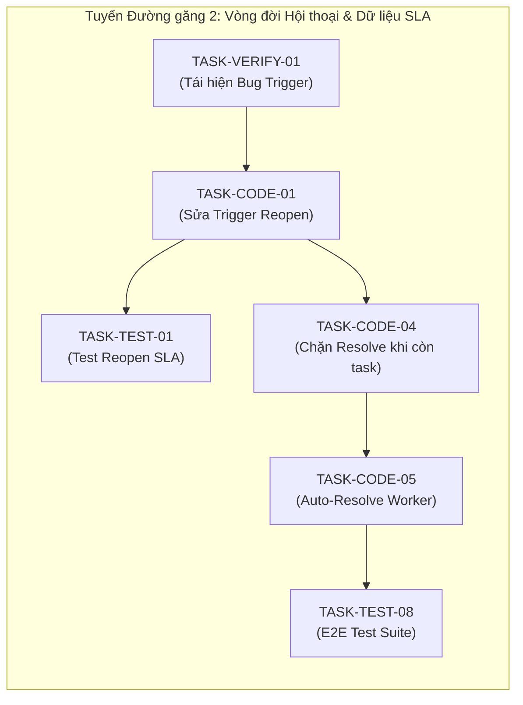

# Kế Hoạch Triển Khai & Implementation Backlog Toàn Diện (Release 1 - RB-R1-002)

> Tài liệu hợp nhất toàn diện kế hoạch phân bổ thứ tự triển khai, ma trận phụ thuộc, đường găng logic (Critical Path) và danh mục công việc kỹ thuật 12 trường cho Khóa luận Tốt nghiệp AI Agent.

---

## Mục I: Kế Hoạch Phụ Thuộc, Đường Găng & Phân Bổ Batch Triển Khai

# Implementation Dependency Plan – Release 1 v1.1 (RB-R1-002)

**Ngày lập:** 07/11/2026  
**Phiên bản:** v1.1 (Cập nhật chuẩn hóa sau Task G1-06A)  
**Phạm vi:** Kế hoạch phân bổ thứ tự triển khai, xác định quan hệ phụ thuộc chéo, đường găng logic (Logical Critical Path) và các mốc kiểm chứng nghiệm thu cho Khóa luận Tốt nghiệp AI Agent.

---

## MỤC LỤC
1. [Nguyên tắc Phân bổ Thứ tự Thực thi](#1-nguyên-tắc-phân-bổ-thứ-tự-thực-thi)
2. [Cấu trúc 5 Nhóm Công việc và Khả năng Thực thi Song song](#2-cấu-trúc-5-nhóm-công-việc-và-khả-năng-thực-thi-song-song)
3. [Phân loại Trạng thái Khả dụng của 35 Tasks](#3-phân-loại-trạng-thái-khả-dụng-của-35-tasks)
4. [Phân tích Tuyến Đường găng Logic (Logical Critical Path Analysis)](#4-phân-tích-tuyến-đường-găng-logic-logical-critical-path-analysis)
5. [Sơ đồ Phụ thuộc Tổng thể (Mermaid Dependency Graph)](#5-sơ-đồ-phụ-thuộc-tổng-thể-mermaid-dependency-graph)
6. [Lộ trình Triển khai theo 3 Cột mốc Nghiệm thu (Milestone Planning)](#6-lộ-trình-triển-khai-theo-3-cột-mốc-nghiệm-thu-milestone-planning)

---

## 1. NGUYÊN TẮC PHÂN BỔ THỨ TỰ THỰC THI

Bản kế hoạch v1.1 tuân thủ nghiêm ngặt các nguyên tắc tổ chức dự án phần mềm và yêu cầu kiểm toán:
1. **Phân định rõ trạng thái sẵn sàng:** Phân biệt rõ nhiệm vụ làm được ngay (`Ready - Can start immediately`), nhiệm vụ cần xác minh trước (`Needs Verification`), nhiệm vụ chờ quyết định kiến trúc (`Needs Decision`), và nhiệm vụ phụ thuộc code (`Blocked by Dependency`).
2. **Không gán thời gian tùy tiện:** Tuyệt đối không tự ý gán số ngày cố định (ví dụ 5 ngày, 6 ngày) cho các chuỗi phụ thuộc khi chưa có số liệu đo lường năng suất lập trình và nguồn lực thực tế của nhóm sinh viên. Mọi tuyến đường găng được định nghĩa dựa trên **quan hệ logic phụ thuộc trước–sau (Logical Prerequisites)**.
3. **Nguyên tắc "Verify before Fix":** Các lỗi liên quan đến CSDL (Trigger PostgreSQL, bảng `cong_viec`, Doctype ERP) bắt buộc phải có bước kiểm chứng thực tế trước khi viết code chỉnh sửa.
4. **Không trì hoãn tính năng Release 1:** Cả hai nhiệm vụ `TASK-CODE-08` (Draft/Published) và `TASK-CODE-11` (Versioning & Rollback tri thức) đều nằm trong lộ trình thực hiện của Release 1.

---

## 2. CẤU TRÚC 5 NHÓM CÔNG VIỆC VÀ KHẢ NĂNG THỰC THI SONG SONG

### Nhóm 1: Architecture & Requirements Alignment (ARCH / BA-DOC)
- **Đặc điểm:** Định hình các quyết định thiết kế và hợp đồng giao tiếp giữa các thành phần.
- **Thực thi song song:**
  - `TASK-ARCH-01` (CR-001 Native/Chatwoot), `TASK-ARCH-02` (Doctype ERP Shipping), `TASK-ARCH-03` (Pending Action Sửa/Hủy đơn), `TASK-ARCH-04` (Stale Batch Epoch vs Timestamp), `TASK-ARCH-05` (Đối soát Timeout Shipping), `TASK-ARCH-06` (Quy trình xuất bản tri thức) có thể thảo luận và xem xét song song độc lập.
- **Quan hệ tuần tự:**
  - `TASK-ARCH-01` hoàn thành $\rightarrow$ Mở khóa `TASK-DOC-01` và `TASK-CODE-12`.
  - `TASK-ARCH-02` hoàn thành $\rightarrow$ Mở khóa `TASK-VERIFY-03` $\rightarrow$ `TASK-CODE-02`.

---

### Nhóm 2: Conversation Lifecycle, Pending Action & SLA
- **Quan hệ tuần tự:**
  - `TASK-VERIFY-01` (Xác minh bug trigger PostgreSQL) $\rightarrow$ `TASK-CODE-01` (Sửa trigger `prevent_sla_deadline_reset`) $\rightarrow$ `TASK-TEST-01` (Test Reopen SLA).
  - `TASK-VERIFY-02` (Xác minh trạng thái bảng `cong_viec`) $\rightarrow$ `TASK-CODE-04` (Chốt chặn Resolve) $\rightarrow$ `TASK-CODE-05` (Tiến trình Auto-Resolve) $\rightarrow$ `TASK-TEST-02` & `TASK-TEST-03`.
- **Thực thi song song:**
  - Nhánh sửa Trigger Reopen SLA (`TASK-CODE-01`) hoàn toàn độc lập với nhánh SLA Warning 50% (`TASK-CODE-06`) và nhánh SLA Giờ làm việc 08:00–21:00 (`TASK-CODE-07`). Hai thành viên có thể lập trình song song.

---

### Nhóm 3: AI Safety, Guardrails & Knowledge Base
- **Quan hệ tuần tự:**
  - `TASK-ARCH-04` $\rightarrow$ `TASK-VERIFY-04` $\rightarrow$ `TASK-CODE-03` (Thu hồi Stale Batch AI) $\rightarrow$ `TASK-TEST-06`.
  - `TASK-ARCH-06` $\rightarrow$ `TASK-CODE-08` (Cột status Draft/Published và lọc RAG) $\rightarrow$ `TASK-CODE-11` (Bảng `document_versions` và API Rollback).
- **Thực thi song song:**
  - Nhánh Stale Batch (`TASK-CODE-03`) thuộc phân hệ Outbox/Worker; nhánh Knowledge Base (`TASK-CODE-08`, `TASK-CODE-11`) thuộc phân hệ RAG Service. Hai nhánh này chạy song song 100%.

---

### Nhóm 4: ERPNext Integration & Multi-Carrier Shipping
- **Quan hệ tuần tự:**
  - `TASK-ARCH-02` $\rightarrow$ `TASK-VERIFY-03` (Kiểm tra Doctype ERPNext thật) $\rightarrow$ `TASK-CODE-02` (Viết hàm đồng bộ mã vận đơn sang ERPNext) $\rightarrow$ `TASK-TEST-07`.
  - `TASK-ARCH-03` $\rightarrow$ `TASK-CODE-10` (UI/API xác nhận kết quả sửa/hủy đơn trên Dashboard).
  - `TASK-ARCH-05` $\rightarrow$ `TASK-CODE-09` (Check-before-retry đối soát Timeout).
- **Thực thi song song:**
  - Module đồng bộ Vận chuyển (`TASK-CODE-02`) và module xử lý Pending Action Sửa/Hủy đơn (`TASK-CODE-10`) có thể phân công độc lập.

---

### Nhóm 5: Integration Testing, Verification & Defense Documentation
- **Quan hệ tuần tự:**
  - Toàn bộ các nhiệm vụ Code (`TASK-CODE-01` đến `10`) hoàn thành $\rightarrow$ Thực thi `TASK-TEST-08` (E2E Integration Test Suite cho 18 Use Cases).
  - Có log chạy thực tế của `TASK-TEST-08` $\rightarrow$ Cập nhật Bảng ánh xạ kiểm thử `TASK-DOC-02`.
- **Thực thi song song:**
  - `TASK-DOC-03` (Đặc tả Vault, channel_accounts), `TASK-DOC-04` (Hiệu chỉnh CR-002), và `TASK-DOC-05` (Phụ lục DSR Luật 91/2025/QH15) có thể soạn thảo song song ngay từ đầu mà không cần chờ code.

---

## 3. PHÂN LOẠI TRẠNG THÁI KHẢ DỤNG CỦA 35 TASKS

Để thuận tiện cho việc giao việc, toàn bộ 35 Tasks được phân thành 4 trạng thái khả dụng rõ ràng:

### A. Nhiệm vụ Có thể Bắt đầu Ngay (`Ready - Can start immediately` - 11 Tasks):
- **Kiến trúc & Quyết định:** `TASK-ARCH-01`, `TASK-ARCH-02`, `TASK-ARCH-03`, `TASK-ARCH-04`, `TASK-ARCH-05`, `TASK-ARCH-06`.
- **Xác minh kỹ thuật:** `TASK-VERIFY-01` (xác minh trigger SLA), `TASK-VERIFY-02` (xác minh trạng thái cong_viec).
- **Phát triển độc lập:** `TASK-CODE-06` (SLA Warning 50%), `TASK-CODE-07` (SLA giờ làm việc).
- **Tài liệu độc lập:** `TASK-DOC-03` (đặc tả Vault/channel_accounts), `TASK-DOC-04` (hiệu chỉnh CR-002), `TASK-DOC-05` (Phụ lục DSR).

### B. Nhiệm vụ Cần Xác minh trước (`Needs Verification` - 2 Tasks):
- `TASK-CODE-01` (Sửa trigger SLA) $\rightarrow$ Cần kết quả tái hiện từ `TASK-VERIFY-01`.
- `TASK-CODE-04` (Chốt chặn Resolve) $\rightarrow$ Cần kết quả xác minh trạng thái từ `TASK-VERIFY-02`.

### C. Nhiệm vụ Đang chờ Quyết định Kiến trúc (`Needs Decision` - 6 Tasks):
- `TASK-CODE-02` (Đồng bộ GHN $\rightarrow$ ERPNext) $\rightarrow$ Chờ chốt Doctype tại DEC-01 và kiểm tra `TASK-VERIFY-03`.
- `TASK-CODE-03` (Stale Batch AI) $\rightarrow$ Chờ chốt phương án Epoch tại DEC-03 và kiểm tra `TASK-VERIFY-04`.
- `TASK-CODE-08` (Tri thức Draft/Published) $\rightarrow$ Chờ chốt quy trình tại DEC-06.
- `TASK-CODE-09` (Đối soát Timeout Shipping) $\rightarrow$ Chờ chốt tại DEC-04.
- `TASK-CODE-10` (UI Sửa/Hủy đơn) $\rightarrow$ Chờ chốt tại DEC-02.
- `TASK-CODE-12` & `TASK-DOC-01` $\rightarrow$ Chờ ký duyệt CR-001 tại DEC-05.

### D. Nhiệm vụ Bị phụ thuộc vào Code (`Blocked by Dependency` - 11 Tasks):
- `TASK-CODE-05` (Auto-Resolve) $\rightarrow$ Chờ hoàn thành `TASK-CODE-04`.
- `TASK-CODE-11` (Snapshot Rollback tri thức) $\rightarrow$ Chờ hoàn thành `TASK-CODE-08`.
- Toàn bộ 8 Tasks kiểm thử: `TASK-TEST-01` đến `TASK-TEST-08` $\rightarrow$ Chờ các file code tương ứng hoàn thành để thực thi và thu thập log.
- `TASK-DOC-02` (Test Traceability) $\rightarrow$ Chờ kết quả chạy test từ `TASK-TEST-08`.

---

## 4. PHÂN TÍCH TUYẾN ĐƯỜNG GĂNG LOGIC (LOGICAL CRITICAL PATH ANALYSIS)

Đường găng được xác định dựa trên chuỗi mắt xích phụ thuộc logic chặt chẽ nhất của hệ thống:

- **Điểm thắt cổ chai lớn nhất (Major Bottleneck):** `TASK-ARCH-02` và `TASK-VERIFY-03`. Nếu không thể kết nối hoặc không xác định được quyền hạn trên máy chủ ERPNext demo, toàn bộ nhánh đồng bộ vận chuyển (`TASK-CODE-02`) sẽ bị đình trệ.
- **Điểm kiểm chứng cốt lõi:** `TASK-TEST-08` là điểm hội tụ của toàn bộ 10 tasks code P0 và P1. Đây là điều kiện tiên quyết để nghiệm thu toàn bộ 18 Use Cases.

---

## 5. SƠ ĐỒ PHỤ THUỘC TỔNG THỂ (MERMAID DEPENDENCY GRAPH)

```mermaid
flowchart TD
    %% Nhóm 1: Architecture
    ARCH01["TASK-ARCH-01<br>Chốt CR-001 Native/Chatwoot"]
    ARCH02["TASK-ARCH-02<br>Chốt Doctype Shipping ERP"]
    ARCH03["TASK-ARCH-03<br>Chốt phương án Sửa/Hủy đơn"]
    ARCH04["TASK-ARCH-04<br>Chốt giải pháp Stale Batch"]
    ARCH05["TASK-ARCH-05<br>Chốt đối soát Timeout Shipping"]
    ARCH06["TASK-ARCH-06<br>Chốt quy trình RAG Published"]

    %% Nhóm Verification
    V01["TASK-VERIFY-01<br>Xác minh Trigger SLA"]
    V02["TASK-VERIFY-02<br>Xác minh trạng thái cong_viec"]
    V03["TASK-VERIFY-03<br>Kiểm tra schema ERPNext"]
    V04["TASK-VERIFY-04<br>Tái hiện race Stale Batch"]

    %% Nhóm Code P0 & P1
    C01["TASK-CODE-01 (P0)<br>Sửa Trigger Reopen SLA"]
    C02["TASK-CODE-02 (P0)<br>Đồng bộ GHN sang ERPNext"]
    C03["TASK-CODE-03 (P1)<br>Thu hồi Stale Batch AI"]
    C04["TASK-CODE-04 (P1)<br>Chốt chặn Resolve khi còn task"]
    C05["TASK-CODE-05 (P1)<br>Worker Auto-Resolve 4h"]
    C06["TASK-CODE-06 (P1)<br>SLA Warning 50%"]
    C07["TASK-CODE-07 (P1)<br>SLA Giờ làm việc 08-21h"]
    C08["TASK-CODE-08 (P1)<br>CSDL Tri thức Draft/Published"]
    C09["TASK-CODE-09 (P1)<br>Đối soát Timeout On-demand"]
    C10["TASK-CODE-10 (P1)<br>UI Xác nhận Sửa/Hủy đơn"]

    %% Nhóm Code P2
    C11["TASK-CODE-11 (P2)<br>Snapshot Rollback Tri thức"]
    C12["TASK-CODE-12 (P2)<br>Cách ly adapter Chatwoot"]

    %% Nhóm Test
    T01["TASK-TEST-01<br>Test Reopen SLA"]
    T02["TASK-TEST-02<br>Test Chặn Resolve"]
    T03["TASK-TEST-03<br>Test Auto-Resolve"]
    T04["TASK-TEST-04<br>Test SLA Warning"]
    T05["TASK-TEST-05<br>Test SLA Giờ làm việc"]
    T06["TASK-TEST-06<br>Test Stale Batch"]
    T07["TASK-TEST-07<br>Test Shipping ERP Sync"]
    T08["TASK-TEST-08<br>E2E Test Suite (18 UCs)"]

    %% Nhóm BA-DOC
    D01["TASK-DOC-01<br>System Context DFD & CR-001"]
    D02["TASK-DOC-02<br>Test Traceability M:N"]
    D03["TASK-DOC-03<br>Đặc tả Vault, channel_accounts"]
    D04["TASK-DOC-04<br>Hiệu chỉnh CR-002 Handling Ext"]
    D05["TASK-DOC-05<br>Phụ lục DSR Luật 91/2025/QH15"]

    %% Linking Dependencies
    ARCH01 --> D01
    ARCH01 --> C12
    ARCH02 --> V03 --> C02 --> T07
    ARCH03 --> C10
    ARCH04 --> V04 --> C03 --> T06
    ARCH05 --> C09
    ARCH06 --> C08 --> C11

    V01 --> C01 --> T01
    V02 --> C04 --> T02
    C04 --> C05 --> T03
    C06 --> T04
    C07 --> T05

    T01 & T02 & T03 & T04 & T05 & T06 & T07 & C08 & C09 & C10 --> T08
    T08 --> D02
```

---

## 6. LỘ TRÌNH TRIỂN KHAI THEO 3 CỘT MỐC NGHIỆM THU (MILESTONE PLANNING)

Thay vì áp đặt số ngày giả định, kế hoạch được tổ chức theo **3 Cột mốc hoàn thành mục tiêu (Deliverable-based Milestones)**:

### Cột mốc 1: Khắc phục Lỗi Cốt lõi & Đồng bộ Kiến trúc (Milestone 1 - P0 & Alignment)
- **Mục tiêu nghiệm thu:**
  - Chốt xong các quyết định kiến trúc tại `open_decisions_v1_1.md`.
  - Khắc phục triệt để lỗi Trigger PostgreSQL Reopen SLA (`TASK-CODE-01`).
  - Kết nối và đồng bộ thành công mã vận đơn GHN sang ERPNext (`TASK-CODE-02`).
  - Thiết lập chốt chặn Resolve không cho đóng hội thoại khi còn công việc (`TASK-CODE-04`).
- **Bằng chứng hoàn thành:**
  - Biên bản ký duyệt các mục DEC-01 đến DEC-06.
  - Log chạy PASS của `TASK-TEST-01`, `TASK-TEST-02`, và `TASK-TEST-07`.

### Cột mốc 2: Hoàn thiện An toàn AI, Tri thức & Vận hành Tự động (Milestone 2 - P1 Features)
- **Mục tiêu nghiệm thu:**
  - Hoàn thiện cơ chế thu hồi Stale Batch AI khi khách nhắn mới trong Auto Mode (`TASK-CODE-03`).
  - Đưa vào hoạt động tiến trình Auto-Resolve quét idle 4 giờ (`TASK-CODE-05`).
  - Kích hoạt sự kiện cảnh báo sớm SLA Warning 50% (`TASK-CODE-06`) và tính toán giờ làm việc 08:00–21:00 (`TASK-CODE-07`).
  - Hoàn thiện bảng phân quyền tri thức Draft/Published cho RAG (`TASK-CODE-08`).
  - Hoàn thiện cơ chế đối soát Timeout Vận đơn (`TASK-CODE-09`) và UI xác nhận sửa/hủy đơn (`TASK-CODE-10`).
- **Bằng chứng hoàn thành:**
  - Log chạy PASS của `TASK-TEST-03`, `TASK-TEST-04`, `TASK-TEST-05`, và `TASK-TEST-06`.

### Cột mốc 3: Kiểm chứng Tích hợp E2E & Hồ sơ Bảo vệ Khóa luận (Milestone 3 - Defense Readiness)
- **Mục tiêu nghiệm thu:**
  - Hoàn thiện tính năng Rollback tri thức (`TASK-CODE-11`) và cách ly Chatwoot (`TASK-CODE-12`).
  - Xây dựng và thực thi thành công bộ test tích hợp `TASK-TEST-08` bao phủ toàn bộ 18 Use Cases.
  - Cập nhật hoàn chỉnh tài liệu BA: sơ đồ System Context DFD, bảng ma trận Test Traceability M:N, đặc tả kiến trúc bảo mật Vault và Phụ lục Tuân thủ DSR Luật 91/2025/QH15.
- **Bằng chứng hoàn thành:**
  - File log thực thi `e2e_test_execution.log` đạt 100% kịch bản PASS.
  - Bản xuất PDF hoàn chỉnh của Báo cáo Khóa luận Tốt nghiệp sẵn sàng nộp Hội đồng thẩm định.

---

## Mục II: Implementation Backlog Chi Tiết Chuẩn Hóa 12 Trường

# Implementation Backlog v1.1 – Release 1 (RB-R1-002)

**Ngày lập:** 07/11/2026  
**Phiên bản:** v1.1 (Cập nhật chuẩn hóa sau Task G1-06A)  
**Phạm vi:** Kế hoạch thực thi chi tiết chuyển đổi kết quả kiểm toán BA–Code thành danh mục công việc kỹ thuật và tài liệu chuẩn xác cho Khóa luận Tốt nghiệp AI Agent (`AIAgent_mar`).  

---

## MỤC LỤC TỔNG QUAN

1. [Nguyên tắc Thực thi Bắt buộc](#nguyên-tắc-thực-thi-bắt-buộc)
2. [Bảng Tổng hợp Danh mục Công việc (Master Backlog Table)](#bảng-tổng-hợp-danh-mục-công-việc-master-backlog-table)
3. [Chi tiết Các Nhiệm vụ Triển khai (Detailed Task Specifications)](#chi-tiết-các-nhiệm-vụ-triển-khai-detailed-task-specifications)
   - [Nhóm 1: Architecture & Requirements Alignment (ARCH / BA-DOC)](#nhóm-1-architecture--requirements-alignment-arch--ba-doc)
   - [Nhóm 2: Conversation Lifecycle, Pending Action & SLA (CODE-FIX / CODE-NEW / TEST)](#nhóm-2-conversation-lifecycle-pending-action--sla-code-fix--code-new--test)
   - [Nhóm 3: AI Safety, Guardrails & Knowledge Base (CODE-NEW / ARCH / TEST)](#nhóm-3-ai-safety-guardrails--knowledge-base-code-new--arch--test)
   - [Nhóm 4: ERPNext Integration & Multi-Carrier Shipping (CODE-FIX / CODE-NEW / ARCH)](#nhóm-4-erpnext-integration--multi-carrier-shipping-code-fix--code-new--arch)
   - [Nhóm 5: Integration Testing, Verification & Defense Documentation (TEST / VERIFY / BA-DOC)](#nhóm-5-integration-testing-verification--defense-documentation-test--verify--ba-doc)

---

## NGUYÊN TẮC THỰC THI BẮT BUỘC

1. **Native Inbox là lõi CSKH trung tâm:** Toàn bộ vòng đời hội thoại, phân công nhân viên, kiểm soát SLA và giao diện vận hành trực tiếp do hệ thống Native Inbox (`agent/omnichannel/`, `inbox_service.py`, `dashboard/app.js`) quản lý. Chatwoot là hệ thống tham khảo mô hình dữ liệu và đóng vai trò adapter tùy chọn.
2. **Không tự ý phê duyệt Baseline hoặc Change Request:** Đề xuất kiến trúc CR-001 và Change Request CR-002 (Handling Extension) phải được phản ánh trung thực trong tài liệu, chờ xác nhận nội bộ của nhóm dự án và GVHD.
3. **Phân hệ Tri thức (Knowledge Base) thuộc phạm vi Release 1:** Không tự ý chuyển các yêu cầu phân biệt Draft/Published, Versioning hoặc Rollback sang Release 2 khi chưa có quyết định thay đổi phạm vi chính thức.
4. **Không bắt buộc ERPNext Webhook:** Đối với AC-19.3 và AC-20.4, quy trình nhân viên CSKH cập nhật trạng thái Pending Action thủ công trên Native Dashboard sau khi xử lý trên ERPNext là phương án hợp lệ và được ưu tiên.
5. **Không áp đặt một giải pháp kỹ thuật đơn lẻ:** Các bài toán tích hợp (Doctype ERP cho Shipping, cơ chế Stale Batch, đối soát Timeout) được trình bày thành các phương án lựa chọn, chỉ lập trình sau khi chốt quyết định.
6. **Xác minh trước khi sửa (Verify before Fix):** Các phát hiện nghi ngờ lỗi CSDL hoặc rủi ro race condition phải có Task `VERIFY` kiểm chứng trước khi tiến hành viết mã nguồn `CODE-FIX`.
7. **Tôn trọng kiểm chứng thực thi (Executed Evidence):** Chỉ đánh dấu hoàn thành Task kiểm thử khi có log chạy pytest thực tế trên snapshot tương ứng; sự tồn tại của file test không đồng nghĩa với việc test đã đạt.

---

## BẢNG TỔNG HỢP DANH MỤC CÔNG VIỆC (MASTER BACKLOG TABLE)

Tổng cộng: **35 Nhiệm vụ** (6 ARCH, 4 VERIFY, 12 CODE, 8 TEST, 5 BA-DOC).

| Task ID | Tên công việc | Loại việc | Req ID liên quan | Gap ID | Ưu tiên | Trạng thái | Phụ thuộc |
|---|---|:---:|---|---|:---:|:---:|---|
| **TASK-ARCH-01** | Quyết định ranh giới Native Inbox lõi và Chatwoot adapter (CR-001) | ARCH | FR-01, 02 | GAP-09 | P1 | Needs Decision | Không |
| **TASK-ARCH-02** | Thống nhất Doctype ERPNext tiếp nhận mã vận đơn (SO vs DN) | ARCH | FR-27, 28, 29 | GAP-02 | P0 | Needs Decision | Không |
| **TASK-ARCH-03** | Thống nhất cơ chế ghi nhận kết quả Sửa/Hủy đơn vào Pending Action | ARCH | FR-19, 20 | GAP-05 | P1 | Needs Decision | Không |
| **TASK-ARCH-04** | Thiết kế giải pháp thu hồi Batch AI lỗi thời (Epoch vs Timestamp) | ARCH | FR-07, QR-01 | GAP-03 | P1 | Needs Decision | Không |
| **TASK-ARCH-05** | Thiết kế giải pháp đối soát Timeout Vận chuyển (Worker vs On-demand) | ARCH | FR-29 | GAP-06 | P1 | Needs Decision | Không |
| **TASK-ARCH-06** | Thiết kế quy trình phê duyệt & xuất bản tri thức 2 bước | ARCH | FR-13, 14, 15 | GAP-04 | P1 | Needs Decision | Không |
| **TASK-VERIFY-01** | Xác minh lỗi trigger PostgreSQL `prevent_sla_deadline_reset` khi Reopen | VERIFY | FR-11, AC-11.3 | GAP-07C | P0 | Ready - Can start immediately | Không |
| **TASK-VERIFY-02** | Xác minh các giá trị trạng thái chưa hoàn thành của bảng `cong_viec` | VERIFY | FR-11, AC-11.2 | GAP-07B | P1 | Ready - Can start immediately | Không |
| **TASK-VERIFY-03** | Xác minh quyền API và schema Doctype trên máy chủ ERPNext kết nối | VERIFY | FR-27, AC-27.3 | GAP-02 | P0 | Blocked by Dependency | TASK-ARCH-02 |
| **TASK-VERIFY-04** | Xác minh race condition khi khách gửi tin dồn dập trong Auto Mode | VERIFY | FR-07, AC-07.2 | GAP-03 | P1 | Blocked by Dependency | TASK-ARCH-04 |
| **TASK-CODE-01** | Sửa Trigger `prevent_sla_deadline_reset` không chặn reset khi Reopen | CODE-FIX | AC-11.3 | GAP-07C | **P0** | Blocked by Dependency | TASK-VERIFY-01 |
| **TASK-CODE-02** | Đồng bộ mã vận đơn và trạng thái GHN sang ERPNext | CODE-NEW | AC-27.3, 28.2 | GAP-02 | **P0** | Needs Decision | TASK-ARCH-02, VERIFY-03 |
| **TASK-CODE-03** | Cơ chế thu hồi Batch phản hồi AI lỗi thời (SUPERSEDED) | CODE-NEW | AC-07.2, QR-01 | GAP-03 | **P1** | Needs Decision | TASK-ARCH-04, VERIFY-04 |
| **TASK-CODE-04** | Chốt chặn Resolve kiểm tra toàn bộ trạng thái công việc chưa xong | CODE-FIX | AC-11.2, 23.2 | GAP-07B | **P1** | Blocked by Dependency | TASK-VERIFY-02 |
| **TASK-CODE-05** | Xây dựng tiến trình nền Auto-Resolve khi hết thời gian chờ | CODE-NEW | AC-23.3 | GAP-07B | **P1** | Blocked by Dependency | TASK-CODE-04 |
| **TASK-CODE-06** | Bổ sung sự kiện cảnh báo sớm SLA Warning (50% thời hạn) | CODE-NEW | AC-24.5, 24.6 | GAP-07D | **P1** | Ready - Can start immediately | Không |
| **TASK-CODE-07** | Tính toán thời hạn SLA theo Giờ làm việc 08:00–21:00 (pause qua đêm) | CODE-FIX | AC-24.7 | GAP-07E | **P1** | Ready - Can start immediately | Không |
| **TASK-CODE-08** | Bổ sung cột `status` Draft/Published vào `documents` và lọc trong RAG | CODE-NEW | AC-13.1, 14.2 | GAP-04 | **P1** | Needs Decision | TASK-ARCH-06 |
| **TASK-CODE-09** | Xây dựng cơ chế đối soát tự động khi tạo vận đơn bị Timeout | CODE-NEW | AC-29.2, 29.3 | GAP-06 | **P1** | Needs Decision | TASK-ARCH-05 |
| **TASK-CODE-10** | Xây dựng UI/API xác nhận kết quả sửa/hủy đơn vào Pending Action | CODE-NEW | AC-19.3, 20.4 | GAP-05 | **P1** | Needs Decision | TASK-ARCH-03 |
| **TASK-CODE-11** | Bổ sung bảng `document_versions` lưu snapshot và hỗ trợ Rollback | CODE-NEW | AC-13.3, 15.2 | GAP-04 | **P2** | Blocked by Dependency | TASK-CODE-08 |
| **TASK-CODE-12** | Đóng gói cách ly adapter Chatwoot và cảnh báo cấu hình trùng lặp | CODE-FIX | Toàn hệ thống | GAP-09 | **P2** | Needs Decision | TASK-ARCH-01 |
| **TASK-TEST-01** | Kiểm thử tự động Reopen hội thoại và tính mới deadline SLA | TEST | AC-11.3 | GAP-07C | P0 | Blocked by Dependency | TASK-CODE-01 |
| **TASK-TEST-02** | Kiểm thử chốt chặn Resolve khi còn công việc chưa hoàn thành | TEST | AC-11.2, 23.2 | GAP-07B | P1 | Blocked by Dependency | TASK-CODE-04 |
| **TASK-TEST-03** | Kiểm thử tiến trình nền Auto-Resolve khi hết thời gian chờ | TEST | AC-23.3 | GAP-07B | P1 | Blocked by Dependency | TASK-CODE-05 |
| **TASK-TEST-04** | Kiểm thử phát sinh sự kiện cảnh báo SLA Warning ở mốc 50% | TEST | AC-24.5, 24.6 | GAP-07D | P1 | Blocked by Dependency | TASK-CODE-06 |
| **TASK-TEST-05** | Kiểm thử thời hạn SLA tạm dừng qua đêm ngoài khung 08:00–21:00 | TEST | AC-24.7 | GAP-07E | P1 | Blocked by Dependency | TASK-CODE-07 |
| **TASK-TEST-06** | Kiểm thử thu hồi Batch AI lỗi thời khi khách gửi tin nhắn mới | TEST | AC-07.2, QR-01 | GAP-03 | P1 | Blocked by Dependency | TASK-CODE-03 |
| **TASK-TEST-07** | Kiểm thử luồng đồng bộ mã vận đơn GHN sang ERPNext | TEST | AC-27.3, 28.2 | GAP-02 | P0 | Blocked by Dependency | TASK-CODE-02 |
| **TASK-TEST-08** | Xây dựng và thực thi bộ kiểm thử tích hợp E2E cho 18 Use Cases | TEST | UC-01 đến 18 | GAP-08 | P1 | Blocked by Dependency | Toàn bộ CODE-FIX/NEW |
| **TASK-DOC-01** | Cập nhật System Context DFD và CR-001 (Native Inbox lõi) | BA-DOC | Practice #20 | GAP-09, 10 | P1 | Needs Decision | TASK-ARCH-01 |
| **TASK-DOC-02** | Cập nhật Bảng ánh xạ kiểm thử Test Traceability (Practice #18) | BA-DOC | Practice #18 | GAP-08, 10 | P1 | Blocked by Dependency | TASK-TEST-08 |
| **TASK-DOC-03** | Bổ sung đặc tả kiến trúc CredentialVault, channel_accounts, dynamic config | BA-DOC | Mô hình Dữ liệu | GAP-10 | P2 | Ready - Can start immediately | Không |
| **TASK-DOC-04** | Hiệu chỉnh mô tả CR-002: Handling Extension (Bảng 199, DEC-MVP-40) | BA-DOC | Practice #20 | GAP-10 | P2 | Ready - Can start immediately | Không |
| **TASK-DOC-05** | Bổ sung Phụ lục Tuân thủ Quyền Chủ thể Dữ liệu (DSR - Luật 91/2025/QH15) | BA-DOC | Phụ lục Pháp lý | GAP-10 | P2 | Ready - Can start immediately | Không |

---

## CHI TIẾT CÁC NHIỆM VỤ TRIỂN KHAI (DETAILED TASK SPECIFICATIONS)

### NHÓM 1: ARCHITECTURE & REQUIREMENTS ALIGNMENT (ARCH / BA-DOC)

#### TASK-ARCH-01: Quyết định ranh giới Native Inbox lõi và Chatwoot adapter (CR-001)
- **Requirement ID liên quan:** FR-01, FR-02, CR-001, Practice #3, System Context DFD.
- **Gap ID liên quan:** `GAP-09`.
- **Vấn đề hiện tại:** Tài liệu BA nháp mô tả Chatwoot là giao diện hỗ trợ chính, trong khi mã nguồn thực tế đã phát triển hoàn chỉnh Native Inbox làm lõi CSKH.
- **Kết quả mong đợi:** Biên bản quyết định nội bộ phê duyệt CR-001: Native Inbox là Single Source of Truth; Chatwoot là adapter tham khảo ngoại vi.
- **Phạm vi thay đổi:** Biên bản quyết định kiến trúc, mục DEC-05 trong `open_decisions.md`.
- **Acceptance Criteria:**
  - Nhóm tác giả và GVHD ký duyệt lựa chọn Phương án 5A trong `open_decisions.md`.
  - Khẳng định 100% dữ liệu hội thoại, tin nhắn, SLA và gán việc lưu tại CSDL Native Postgres.
- **Bằng chứng cần thu thập:** Chữ ký duyệt trên file `open_decisions.md`.
- **Phụ thuộc:** Không.
- **Ưu tiên:** `P1`. Cần thiết để khóa phạm vi kiến trúc bảo vệ khóa luận.
- **Trạng thái:** `Needs Decision`.
- **Rủi ro:** Tranh luận kéo dài về việc có nên giữ lại tính năng chat trực tiếp trên Chatwoot.

---

#### TASK-ARCH-02: Thống nhất Doctype ERPNext tiếp nhận mã vận đơn (SO vs DN)
- **Requirement ID liên quan:** FR-27 (AC-27.3), FR-28 (AC-28.2), FR-29 (AC-29.4), DFR-18.
- **Gap ID liên quan:** `GAP-02`.
- **Vấn đề hiện tại:** Chưa thống nhất hợp đồng dữ liệu với ERPNext: ghi mã vận đơn vào Custom Field của `Sales Order` hay tạo `Delivery Note`.
- **Kết quả mong đợi:** Quyết định chọn Phương án 1A (Sales Order custom field) hoặc 1B (Delivery Note) tại DEC-01.
- **Phạm vi thay đổi:** Hợp đồng dữ liệu tích hợp ERPNext trong `open_decisions.md`.
- **Acceptance Criteria:**
  - Xác định rõ tên trường CSDL nhận dữ liệu trên ERPNext và quyền của tài khoản API.
- **Bằng chứng cần thu thập:** Tài liệu hợp đồng dữ liệu API được nhóm ERP chấp thuận.
- **Phụ thuộc:** Không.
- **Ưu tiên:** `P0`. Chặn toàn bộ công việc lập trình đồng bộ vận chuyển.
- **Trạng thái:** `Needs Decision`.
- **Rủi ro:** Tài khoản ERPNext demo không có quyền sửa Doctype hoặc quyền tạo Delivery Note.

---

#### TASK-ARCH-03: Thống nhất cơ chế ghi nhận kết quả Sửa/Hủy đơn vào Pending Action
- **Requirement ID liên quan:** FR-19 (AC-19.3), FR-20 (AC-20.4), DFR-11.
- **Gap ID liên quan:** `GAP-05`.
- **Vấn đề hiện tại:** Chưa chốt cơ chế hoàn tất Pending Action trên Dashboard: bấm nút xác nhận thủ công hay bắt buộc làm webhook ERPNext.
- **Kết quả mong đợi:** Quyết định phê duyệt Phương án 2A (Thủ công trên Dashboard) tại DEC-02.
- **Phạm vi thay đổi:** Luồng tương tác người dùng tại BPMN Practice #7 và DEC-02.
- **Acceptance Criteria:**
  - Thống nhất phương án xác nhận thủ công kèm kịch bản gửi tin nhắn mẫu cho khách.
- **Bằng chứng cần thu thập:** Phê duyệt DEC-02.
- **Phụ thuộc:** Không.
- **Ưu tiên:** `P1`. Định hình giao diện Dashboard.
- **Trạng thái:** `Needs Decision`.
- **Rủi ro:** Người dùng muốn tự động hoàn toàn nhưng hạ tầng mạng lab không hỗ trợ webhook vào.

---

#### TASK-ARCH-04: Thiết kế giải pháp thu hồi Batch AI lỗi thời (Epoch vs Timestamp)
- **Requirement ID liên quan:** FR-07 (AC-07.2), QR-01, DFR-03.
- **Gap ID liên quan:** `GAP-03`.
- **Vấn đề hiện tại:** Cần chọn giải pháp kỹ thuật tối ưu giữa Generation Epoch Counter và So sánh Timestamp để hủy phản hồi cũ khi khách nhắn mới trong Auto Mode.
- **Kết quả mong đợi:** Quyết định phê duyệt Phương án 3A (Epoch Counter) tại DEC-03.
- **Phạm vi thay đổi:** Thiết kế schema và Outbox Worker tại DEC-03.
- **Acceptance Criteria:**
  - Đảm bảo tính nguyên tử, chống race condition khi khách gửi nhiều tin liên tiếp trong vòng 1 giây.
- **Bằng chứng cần thu thập:** Phê duyệt DEC-03.
- **Phụ thuộc:** Không.
- **Ưu tiên:** `P1`.
- **Trạng thái:** `Needs Decision`.
- **Rủi ro:** Phát sinh thêm migration cột CSDL nếu chọn Epoch Counter.

---

#### TASK-ARCH-05: Thiết kế giải pháp đối soát Timeout Vận chuyển (Worker vs On-demand)
- **Requirement ID liên quan:** FR-29 (AC-29.2, AC-29.3), QR-25.
- **Gap ID liên quan:** `GAP-06`.
- **Vấn đề hiện tại:** Khi tạo vận đơn gặp lỗi Timeout mạng với GHN, chưa có kiến trúc chuẩn để đối soát phục hồi giao dịch kẹt.
- **Kết quả mong đợi:** Quyết định phê duyệt Phương án 4C kết hợp 4B tại DEC-04: triển khai On-demand Check-before-retry trong hàm tạo vận đơn kết hợp quét dọn định kỳ trong `vong_dong_bo.py`.
- **Phạm vi thay đổi:** Hợp đồng xử lý ngoại lệ Timeout tại DEC-04.
- **Acceptance Criteria:** Phê duyệt phương án đối soát on-demand đảm bảo không phát sinh đơn trùng khi nhân viên bấm thử lại.
- **Bằng chứng cần thu thập:** Phê duyệt DEC-04 trong `open_decisions.md`.
- **Phụ thuộc:** Không.
- **Ưu tiên:** `P1`.
- **Trạng thái:** `Needs Decision`.
- **Rủi ro:** Cần đảm bảo GHN API hỗ trợ tra cứu theo `client_order_code`.

---

#### TASK-ARCH-06: Thiết kế quy trình phê duyệt & xuất bản tri thức 2 bước
- **Requirement ID liên quan:** FR-13 (AC-13.1, AC-13.2), FR-14 (AC-14.2), DFR-13.
- **Gap ID liên quan:** `GAP-04`.
- **Vấn đề hiện tại:** Chưa có quy trình nghiệp vụ chính thức phân định quyền tạo Draft của nhân viên và quyền Publish của quản lý.
- **Kết quả mong đợi:** Đặc tả luồng phê duyệt tài liệu tri thức 2 bước (Draft -> Review -> Published) và phân quyền tương ứng.
- **Phạm vi thay đổi:** Quy trình nghiệp vụ tri thức trong tài liệu BA.
- **Acceptance Criteria:** Nhân viên soạn thảo tài liệu ở trạng thái Draft; chỉ Quản lý mới có quyền kích hoạt Publish ra RAG.
- **Bằng chứng cần thu thập:** Quy trình được duyệt trong tài liệu BA.
- **Phụ thuộc:** Không.
- **Ưu tiên:** `P1`.
- **Trạng thái:** `Needs Decision`.
- **Rủi ro:** Tăng thêm bước vận hành của quản lý.

---

### NHÓM 2: CONVERSATION LIFECYCLE, PENDING ACTION & SLA (CODE-FIX / CODE-NEW / TEST)

#### TASK-VERIFY-01: Xác minh lỗi trigger PostgreSQL `prevent_sla_deadline_reset` khi Reopen
- **Requirement ID liên quan:** FR-11 (AC-11.3), FR-24 (AC-24.1).
- **Gap ID liên quan:** `GAP-07C`.
- **Vấn đề hiện tại:** Cần kiểm chứng hành vi thực tế của trigger trên CSDL PostgreSQL thật để xác nhận lỗi ghi đè deadline cũ.
- **Kết quả mong đợi:** Kịch bản tái hiện lỗi: tạo hội thoại $\rightarrow$ resolve $\rightarrow$ cập nhật tin mới $\rightarrow$ xác nhận `first_response_due_at` bị trigger giữ nguyên giá trị quá khứ.
- **Phạm vi thay đổi:** `tests/test_reopen_sla_reset.py` (chạy trên test DB).
- **Acceptance Criteria:**
  - Có log kiểm thử chỉ rõ `first_response_due_at` sau reopen bằng đúng `first_response_due_at` cũ của phiên trước.
- **Bằng chứng cần thu thập:** Log chạy pytest của ca kiểm thử tái hiện.
- **Phụ thuộc:** Không.
- **Ưu tiên:** `P0`. Bắt buộc chạy trước khi sửa trigger.
- **Trạng thái:** `Ready - Can start immediately`.
- **Rủi ro:** Không có rủi ro (chỉ kiểm chứng).

---

#### TASK-CODE-01: Sửa Trigger `prevent_sla_deadline_reset` không chặn reset khi Reopen
- **Requirement ID liên quan:** FR-11 (AC-11.3), FR-24 (AC-24.1), QR-06.
- **Gap ID liên quan:** `GAP-07C`.
- **Vấn đề hiện tại:** Trigger `trg_prevent_sla_deadline_reset` trong migration `0005_routing_sla.sql` đang ghi đè lại deadline cũ khi khách gửi tin nhắn mở lại hội thoại đã `resolved`.
- **Kết quả mong đợi:** Viết migration mới (ví dụ `0037_fix_sla_reopen_trigger.sql`) cập nhật function `prevent_sla_deadline_reset()`: chỉ giữ deadline cũ khi `OLD.state NOT IN ('resolved', 'closed')`.
- **Phạm vi thay đổi:** `agent/migrations/versions/0037_fix_sla_reopen_trigger.sql`.
- **Acceptance Criteria:**
  - Khi hội thoại ở `state = 'resolved'` nhận tin mới, câu lệnh cập nhật `first_response_due_at = now() + interval` được CSDL chấp nhận và lưu giá trị tương lai mới.
  - Khi hội thoại đang ở `state = 'open'`, các câu lệnh cập nhật không được phép thay đổi `first_response_due_at` cũ (bảo lưu đúng tính năng chống gian lận SLA).
- **Bằng chứng cần thu thập:** Migration SQL file và log thực thi migration thành công trên test container.
- **Phụ thuộc:** `TASK-VERIFY-01`.
- **Ưu tiên:** `P0`. Sửa lỗi dữ liệu cốt lõi của SLA.
- **Trạng thái:** `Blocked by Dependency` (Chờ kết quả xác minh từ `TASK-VERIFY-01`).
- **Rủi ro:** Cần đảm bảo trigger không làm ảnh hưởng các luồng update khác của bảng `conversations`.

---

#### TASK-VERIFY-02: Xác minh các giá trị trạng thái chưa hoàn thành của bảng `cong_viec`
- **Requirement ID liên quan:** FR-11 (AC-11.2), FR-23 (AC-23.2).
- **Gap ID liên quan:** `GAP-07B`.
- **Vấn đề hiện tại:** Cần xác minh chính xác các giá trị của cột `trang_thai` trong bảng `cong_viec` để viết câu truy vấn chặn Resolve toàn diện.
- **Kết quả mong đợi:** Xác nhận từ migration `0022_cong_viec.sql`: `trang_thai IN ('moi', 'dang_lam', 'xong', 'huy')`. Các trạng thái chưa hoàn tất bắt buộc phải chặn là `moi` và `dang_lam` (`trang_thai NOT IN ('xong', 'huy')`).
- **Phạm vi thay đổi:** Báo cáo xác minh CSDL.
- **Acceptance Criteria:** Câu truy vấn chặn Resolve trong `giai_quyet.py` được xác nhận dùng `trang_thai IN ('moi', 'dang_lam')`.
- **Bằng chứng cần thu thập:** Trích xuất schema từ `0022_cong_viec.sql`.
- **Phụ thuộc:** Không.
- **Ưu tiên:** `P1`.
- **Trạng thái:** `Ready - Can start immediately`.
- **Rủi ro:** Không có.

---

#### TASK-CODE-04: Chốt chặn Resolve kiểm tra toàn bộ trạng thái công việc chưa xong
- **Requirement ID liên quan:** FR-11 (AC-11.2), FR-23 (AC-23.2), QR-14, DFR-11.
- **Gap ID liên quan:** `GAP-07B`.
- **Vấn đề hiện tại:** `giai_quyet.py:38` cập nhật `state = 'resolved'` mà không kiểm tra xem hội thoại có còn task dở dang trong bảng `cong_viec`.
- **Kết quả mong đợi:** Cập nhật API `POST /api/inbox/conversations/{id}/resolve` và hàm `giai_quyet()`: kiểm tra điều kiện `SELECT 1 FROM cong_viec WHERE conversation_id = $1 AND trang_thai IN ('moi', 'dang_lam')`. Nếu tồn tại task, từ chối Resolve và trả về mã lỗi 409 kèm danh sách task chưa xong.
- **Phạm vi thay đổi:** `agent/omnichannel/giai_quyet.py:38-60`, `agent/api/inbox.py:240-270`.
- **Acceptance Criteria:**
  - Gọi API resolve với hội thoại có task `moi` hoặc `dang_lam` $\rightarrow$ Trả về HTTP 409 Conflict: "Hội thoại còn công việc chưa hoàn tất".
  - Gọi API resolve khi toàn bộ task đã ở trạng thái `xong` hoặc `huy` $\rightarrow$ Chấp nhận Resolve thành công và chuyển `state = 'resolved'`.
  - Tuyệt đối không mở cờ bypass (force resolve) trái quy tắc.
- **Bằng chứng cần thu thập:** Code diff và kết quả test `tests/test_chan_resolve_khi_con_task.py`.
- **Phụ thuộc:** `TASK-VERIFY-02`.
- **Ưu tiên:** `P1`.
- **Trạng thái:** `Blocked by Dependency` (Chờ kết quả xác minh từ `TASK-VERIFY-02`).
- **Rủi ro:** Nhân viên trên Dashboard có thể bị chặn không đóng được hội thoại nếu không biết cách bấm hoàn thành task. Cần thông báo lỗi rõ ràng.

---

#### TASK-CODE-05: Xây dựng tiến trình nền Auto-Resolve khi hết thời gian chờ
- **Requirement ID liên quan:** FR-23 (AC-23.2, AC-23.3), QR-15, DFR-11.
- **Gap ID liên quan:** `GAP-07B`.
- **Vấn đề hiện tại:** Codebase hoàn toàn chưa có background worker hoặc scheduler tự động đóng hội thoại khi khách không phản hồi sau thời gian chờ cấu hình, và cần đảm bảo không tự ý resolve khi khách còn câu hỏi chưa được giải quyết hoặc còn pending action dở dang.
- **Kết quả mong đợi:** Xây dựng background task `auto_resolve_idle_conversations()` trong `agent/workers/auto_resolve_worker.py` (hoặc tích hợp vòng lặp trong `agent/omnichannel/sla.py`):
  - Ngưỡng thời gian chờ không tương tác mặc định là **4 giờ** (`AUTO_RESOLVE_IDLE_HOURS = 4`), cho phép quản trị viên cấu hình động qua bảng `cau_hinh_dong` (hoặc biến môi trường), tuyệt đối không cố định cứng 24 giờ.
  - Quét các hội thoại có `state in ('open', 'pending')`, `mode = 'auto'`, `last_message_at < now() - (interval '1 hour' * config_idle_hours)`.
  - Kiểm tra điều kiện nghiêm ngặt: Tuyệt đối không Auto-Resolve khi còn Pending Action/task dở dang (`SELECT 1 FROM cong_viec WHERE conversation_id = $1 AND trang_thai NOT IN ('xong', 'huy')`), hoặc khi khách hàng có câu hỏi/yêu cầu chưa có phản hồi hoàn tất từ hệ thống.
  - Khi đủ điều kiện, gọi `giai_quyet(cid, None)` với lý do "Tự động đóng do hết thời gian chờ (4 giờ)".
- **Phạm vi thay đổi:** `agent/workers/auto_resolve_worker.py` (tạo mới) hoặc `agent/omnichannel/sla.py`, cấu hình động trong `agent/core/config.py`.
- **Acceptance Criteria:**
  - Ngưỡng thời gian chờ idle mặc định là **4 giờ**, có thể cấu hình linh hoạt (configurable), không cố định 24 giờ.
  - Hội thoại quá hạn idle không có tương tác, không còn pending action dở dang và không còn câu hỏi chưa giải quyết $\rightarrow$ tự động chuyển sang `state = 'resolved'`, `outcome = 'resolved'`.
  - Tuyệt đối không đóng nếu còn Pending Action (`cong_viec` có trạng thái `moi` hoặc `dang_lam`) hoặc câu hỏi của khách chưa được giải quyết.
  - Ghi nhật ký sự kiện `conversation.auto_resolved` vào `nhat_ky_su_kien`.
- **Bằng chứng cần thu thập:** Code hàm worker và log chạy test `tests/test_auto_resolve_worker.py`.
- **Phụ thuộc:** `TASK-CODE-04`.
- **Ưu tiên:** `P1`.
- **Trạng thái:** `Blocked by Dependency` (Chờ hoàn thành `TASK-CODE-04`).
- **Rủi ro:** Tránh xung đột lock CSDL khi worker quét đồng thời với tin nhắn mới của khách đến.

---

#### TASK-CODE-06: Bổ sung sự kiện cảnh báo sớm SLA Warning (50% thời hạn)
- **Requirement ID liên quan:** FR-24 (AC-24.5, AC-24.6), QR-19.
- **Gap ID liên quan:** `GAP-07D`.
- **Vấn đề hiện tại:** Bảng `sla_events` chỉ có sự kiện `breached`, thiếu sự kiện cảnh báo `first_response_warning` tại mốc 50% thời hạn (5 phút với High, 15 phút với Normal).
- **Kết quả mong đợi:** Migration cập nhật check constraint bảng `sla_events` thêm `'first_response_warning'`; cập nhật hàm `mark_breaches()` trong `agent/omnichannel/sla.py` quét mốc warning và chèn sự kiện tương ứng.
- **Phạm vi thay đổi:** `agent/migrations/versions/0038_sla_warning_events.sql`, `agent/omnichannel/sla.py:31-75`.
- **Acceptance Criteria:**
  - Hội thoại High priority khi trôi qua 5 phút chưa phản hồi $\rightarrow$ Tạo sự kiện `first_response_warning` trong `sla_events`.
  - Hội thoại Normal priority khi trôi qua 15 phút chưa phản hồi $\rightarrow$ Tạo sự kiện `first_response_warning`.
  - Sự kiện warning chỉ bắn duy nhất 1 lần cho mỗi hội thoại.
- **Bằng chứng cần thu thập:** Code diff và kết quả test `tests/test_sla_warning_events.py`.
- **Phụ thuộc:** Không.
- **Ưu tiên:** `P1`.
- **Trạng thái:** `Ready - Can start immediately`.
- **Rủi ro:** Cần đảm bảo index `idx_sla_events_due` hoạt động tối ưu, không gây chậm câu quét.

---

#### TASK-CODE-07: Tính toán thời hạn SLA theo Giờ làm việc 08:00–21:00 (pause qua đêm)
- **Requirement ID liên quan:** FR-24 (AC-24.7), QR-15.
- **Gap ID liên quan:** `GAP-07E`.
- **Vấn đề hiện tại:** Deadline SLA được cộng dồn thời gian tuyệt đối `now() + interval`, dẫn đến hội thoại đến lúc 20:55 bị tính vi phạm lúc 21:10 trong đêm khi không có nhân viên trực.
- **Kết quả mong đợi:** Xây dựng hàm `tinh_deadline_theo_gio_lam_viec(start_time: datetime, minutes: int) -> datetime` trong `agent/core/gio_lam_viec.py`: nếu thời gian cộng vượt quá 21:00, phần thời gian còn lại sẽ được cộng dồn tiếp tục từ 08:00 sáng ngày làm việc tiếp theo. Tích hợp hàm này vào `inbox_service.py` khi gán `first_response_due_at`.
- **Phạm vi thay đổi:** `agent/core/gio_lam_viec.py`, `agent/omnichannel/inbox_service.py:120-140`.
- **Acceptance Criteria:**
  - Khách gửi tin nhắn lúc 20:50 với hạn SLA 30 phút $\rightarrow$ `first_response_due_at` được tính là 08:20 sáng hôm sau.
  - Khách gửi tin nhắn lúc 09:00 với hạn SLA 30 phút $\rightarrow$ `first_response_due_at` là 09:30 cùng ngày.
- **Bằng chứng cần thu thập:** Code diff và kết quả test `tests/test_sla_gio_lam_viec_pause.py`.
- **Phụ thuộc:** Không.
- **Ưu tiên:** `P1`.
- **Trạng thái:** `Ready - Can start immediately`.
- **Rủi ro:** Xử lý cẩn thận múi giờ UTC+7 để tránh lệch giờ hệ thống server UTC.

---

### NHÓM 3: AI SAFETY, GUARDRAILS & KNOWLEDGE BASE (CODE-NEW / ARCH / TEST)

#### TASK-VERIFY-04: Xác minh race condition khi khách gửi tin dồn dập trong Auto Mode
- **Requirement ID liên quan:** FR-07 (AC-07.2), QR-01.
- **Gap ID liên quan:** `GAP-03`.
- **Vấn đề hiện tại:** Cần tái hiện chính xác trường hợp tin nhắn thứ 2 của khách đến khi AI đang gọi Gemini API ở tin nhắn 1.
- **Kết quả mong đợi:** Kịch bản kiểm thử giả lập độ trễ gọi LLM 2 giây; khách gửi tin mới ở giây thứ 1; chứng minh job tin 1 vẫn được enqueue và gửi ra ngoài nếu thiếu token hủy.
- **Phạm vi thay đổi:** `tests/test_verify_stale_batch_race.py`.
- **Acceptance Criteria:** Có log kiểm thử chứng minh phản hồi cũ vẫn bị gửi nếu không có cơ chế epoch hủy bỏ.
- **Bằng chứng cần thu thập:** Terminal log pytest tái hiện race condition.
- **Phụ thuộc:** `TASK-ARCH-04`.
- **Ưu tiên:** `P1`.
- **Trạng thái:** `Blocked by Dependency` (Chờ định hình kiến trúc tại `TASK-ARCH-04`).
- **Rủi ro:** Cần dùng mock LLM để kiểm soát chính xác độ trễ giả lập.

---

#### TASK-CODE-03: Cơ chế thu hồi Batch phản hồi AI lỗi thời (SUPERSEDED)
- **Requirement ID liên quan:** FR-07 (AC-07.2), QR-01, DFR-03.
- **Gap ID liên quan:** `GAP-03`.
- **Vấn đề hiện tại:** Khi khách gửi tin nhắn mới trong lúc AI đang sinh phản hồi ở Auto Mode, batch cũ không bị thu hồi nguyên tử, có thể phát tin phản hồi lạc đề ra kênh.
- **Kết quả mong đợi:** Triển khai cơ chế Generation Epoch theo Phương án 3A đã chọn tại DEC-03:
  - Thêm cột `generation_epoch INT DEFAULT 1` vào bảng `conversations`.
  - Mỗi khi `inbox_service.ingest()` nhận tin mới từ khách, thực hiện `UPDATE conversations SET generation_epoch = generation_epoch + 1`.
  - Job AI enqueue vào `outbox_jobs` mang theo `epoch` lúc khởi tạo.
  - `OutboxWorker` trước khi gửi kiểm tra: nếu `job.epoch < conversation.generation_epoch` thì cập nhật `job.status = 'superseded'` và không gọi Channel API.
- **Phạm vi thay đổi:** `agent/migrations/versions/0036_generation_epoch.sql`, `agent/omnichannel/inbox_service.py`, `agent/workers/outbox_worker.py:60-95`.
- **Acceptance Criteria:**
  - Khách gửi tin A $\rightarrow$ AI bắt đầu sinh phản hồi (epoch=1). Khách gửi tiếp tin B (epoch tăng lên 2) trước khi tin A gửi xong $\rightarrow$ Job phản hồi cho tin A bị Outbox Worker bỏ qua với trạng thái `superseded`.
  - Kênh bên ngoài (Zalo/Messenger) chỉ nhận duy nhất phản hồi cho tin B.
- **Bằng chứng cần thu thập:** Migration file, code diff và kết quả test `tests/test_superseded_batch_cancellation.py`.
- **Phụ thuộc:** `TASK-ARCH-04`, `TASK-VERIFY-04`.
- **Ưu tiên:** `P1`.
- **Trạng thái:** `Needs Decision` (chờ chốt DEC-03).
- **Rủi ro:** Đảm bảo câu UPDATE epoch không làm chậm tốc độ tiếp nhận webhook.

---

#### TASK-CODE-08: Bổ sung cột `status` Draft/Published vào `documents` và lọc trong RAG
- **Requirement ID liên quan:** FR-13 (AC-13.1), FR-14 (AC-14.2), DFR-13, QR-09.
- **Gap ID liên quan:** `GAP-04`.
- **Vấn đề hiện tại:** Bảng `documents` trong `schema.sql` không có cột trạng thái; mọi chunk nạp vào đều được RAG truy xuất ngay lập tức, vi phạm yêu cầu phân biệt bản nháp (Draft) và bản xuất bản (Published).
- **Kết quả mong đợi:** Migration thêm cột `status TEXT DEFAULT 'draft'`, `published_at TIMESTAMPTZ`, `published_by UUID` vào bảng `documents`; cập nhật hàm `rag.retrieve()` trong `agent/core/rag.py`: chỉ JOIN và tìm kiếm các chunk thuộc tài liệu có `documents.status = 'published'`. Thêm API publish tài liệu `POST /api/documents/{id}/publish` yêu cầu quyền quản lý.
- **Phạm vi thay đổi:** `agent/migrations/versions/0039_document_status.sql`, `agent/core/rag.py:75-120`, `agent/api/routes.py:180-230`.
- **Acceptance Criteria:**
  - Tài liệu mới nạp ở trạng thái `status = 'draft'` $\rightarrow$ `rag.retrieve()` hoàn toàn không tìm thấy các chunk này.
  - Quản lý gọi API publish $\rightarrow$ Chuyển `status = 'published'`.
  - `rag.retrieve()` tìm thấy các chunk và sử dụng để trả lời khách.
- **Bằng chứng cần thu thập:** Migration file, code diff và test kiểm chứng phân biệt draft/published.
- **Phụ thuộc:** `TASK-ARCH-06`.
- **Ưu tiên:** `P1`.
- **Trạng thái:** `Needs Decision` (chờ chốt DEC-06).
- **Rủi ro:** Phải migrate dữ liệu cũ: đánh dấu toàn bộ tài liệu tri thức mẫu hiện có thành `published` để tránh làm hỏng các bài test RAG hiện tại.

---

#### TASK-CODE-11: Bổ sung bảng `document_versions` lưu snapshot và hỗ trợ Rollback
- **Requirement ID liên quan:** FR-13 (AC-13.3), FR-15 (AC-15.2), QR-19.
- **Gap ID liên quan:** `GAP-04`.
- **Vấn đề hiện tại:** Chưa có bảng lưu trữ snapshot phiên bản tài liệu tri thức khi chỉnh sửa, chưa hỗ trợ rollback về phiên bản trước.
- **Kết quả mong đợi:** Tạo bảng `document_versions (id, document_id, version_num, content, created_at, created_by)`; bổ sung API rollback `POST /api/documents/{id}/rollback/{version}` cho phép phục hồi nội dung cũ và tính lại embedding.
- **Phạm vi thay đổi:** `agent/migrations/versions/0040_document_versions.sql`, `agent/core/rag.py`.
- **Acceptance Criteria:**
  - Thuộc phạm vi chính thức của Release 1 (RB-R1-002), không đẩy sang Post-MVP.
  - Mỗi lần sửa tài liệu $\rightarrow$ Tự động lưu 1 snapshot vào `document_versions`.
  - Gọi rollback $\rightarrow$ Nội dung và các chunk trở về đúng phiên bản được chọn; ghi Audit Log.
- **Bằng chứng cần thu thập:** Migration SQL và unit test rollback.
- **Phụ thuộc:** `TASK-CODE-08`.
- **Ưu tiên:** `P2` (Mức ưu tiên P2 trong Release 1, đảm bảo tính đầy đủ của phân hệ Tri thức).
- **Trạng thái:** `Blocked by Dependency` (Chờ hoàn thành `TASK-CODE-08`).
- **Rủi ro:** Tốn dung lượng lưu trữ embedding cũ nếu tài liệu lớn.

---

### NHÓM 4: ERPNEXT INTEGRATION & MULTI-CARRIER SHIPPING (CODE-FIX / CODE-NEW / ARCH)

#### TASK-VERIFY-03: Xác minh quyền API và schema Doctype trên máy chủ ERPNext kết nối
- **Requirement ID liên quan:** FR-27 (AC-27.3), FR-28 (AC-28.2).
- **Gap ID liên quan:** `GAP-02`.
- **Vấn đề hiện tại:** Cần kiểm tra môi trường ERPNext thực tế đang kết nối có custom field nhận mã vận đơn trên Sales Order chưa, hoặc tài khoản API có quyền tạo Delivery Note không.
- **Kết quả mong đợi:** Kết quả gọi API thử nghiệm xác nhận Doctype và trường khả dụng trên ERPNext.
- **Phạm vi thay đổi:** Script kiểm tra kết nối ERPNext `scratch/check_erp_doctypes.py`.
- **Acceptance Criteria:** Xác định chính xác endpoint và payload JSON hợp lệ để đồng bộ mã vận đơn sang ERPNext.
- **Bằng chứng cần thu thập:** HTTP response log từ ERPNext API.
- **Phụ thuộc:** `TASK-ARCH-02`.
- **Ưu tiên:** `P0`.
- **Trạng thái:** `Blocked by Dependency` (Chờ chốt Doctype tại `TASK-ARCH-02`).
- **Rủi ro:** ERPNext instance demo có thể bị tắt hoặc đổi mật khẩu API.

---

#### TASK-CODE-02: Đồng bộ mã vận đơn và trạng thái GHN sang ERPNext
- **Requirement ID liên quan:** FR-27 (AC-27.3), FR-28 (AC-28.2), FR-29 (AC-29.4), DFR-18.
- **Gap ID liên quan:** `GAP-02`.
- **Vấn đề hiện tại:** Sau khi tạo vận đơn GHN thành công, mã vận đơn chỉ lưu trong bảng `orders` của Postgres, hoàn toàn chưa có bước đồng bộ sang ERPNext.
- **Kết quả mong đợi:** Xây dựng module `agent/erp/dong_bo_van_don.py`: sau khi GHN trả về `ma_van_don` thành công tại `agent/shipping/service.py:213`, kích hoạt gọi API sang ERPNext (cập nhật Sales Order custom field hoặc tạo Delivery Note theo quyết định từ `TASK-ARCH-02`). Ghi nhận trạng thái `van_don_dong_bo_erp = true` vào bảng `orders`.
- **Phạm vi thay đổi:** `agent/shipping/service.py:210-245`, `agent/erp/dong_bo_van_don.py` (tạo mới), migration thêm cờ `da_dong_bo_erp_van_don` trong bảng `orders`.
- **Acceptance Criteria:**
  - Tạo vận đơn GHN thành công $\rightarrow$ Bản ghi `orders` có `ma_van_don`.
  - ERPNext nhận được thông tin mã vận đơn và trạng thái giao hàng trên Doctype tương ứng (trường `custom_tracking_number` trên Sales Order hoặc bản ghi Delivery Note mới theo kết quả chốt tại `TASK-ARCH-02` / DEC-01; tiêu chí nghiệm thu giữ tính trung lập đến khi có quyết định kiến trúc).
  - Nếu ERPNext lỗi mạng, ghi nhận `da_dong_bo_erp_van_don = false` và đưa vào hàng đợi thử lại, không làm hỏng kết quả tạo vận đơn GHN đã thành công.
- **Bằng chứng cần thu thập:** Code diff và kết quả test `tests/test_shipping_erp_sync.py` (với mock ERPNext server).
- **Phụ thuộc:** `TASK-ARCH-02`, `TASK-VERIFY-03`.
- **Ưu tiên:** `P0`. Khắc phục đứt gãy dữ liệu cốt lõi.
- **Trạng thái:** `Needs Decision` (chờ chốt Doctype tại DEC-01).
- **Rủi ro:** Cần xử lý cẩn thận trường hợp ERPNext API bị chậm/timeout không được làm nghẽn request tạo vận đơn trên giao diện CSKH.

---

#### TASK-CODE-09: Xây dựng cơ chế đối soát tự động khi tạo vận đơn bị Timeout
- **Requirement ID liên quan:** FR-29 (AC-29.2, AC-29.3), QR-25.
- **Gap ID liên quan:** `GAP-06`.
- **Vấn đề hiện tại:** Khi gọi GHN API gặp lỗi Timeout, hệ thống chưa có cơ chế tự động tra cứu lại đối soát theo `client_order_code`, dẫn đến rủi ro nhân viên bấm tạo lại bị trùng vận đơn.
- **Kết quả mong đợi:** Triển khai cơ chế On-demand Check-before-retry kết hợp xử lý đơn kẹt theo Phương án 4C tại DEC-04:
  - Trong `agent/shipping/service.py:tao_van_don_cho_don()`: trước khi gửi request tạo mới, gọi hàm `provider.tra_cuu_theo_ma_don(ma_don)`. Nếu GHN đã có mã vận đơn cho `client_order_code` này, nhận luôn kết quả thành công và bỏ qua bước tạo mới.
  - Bổ sung nhánh quét các đơn kẹt `dang_tao` trong vòng lặp `vong_dong_bo.py`.
- **Phạm vi thay đổi:** `agent/shipping/service.py:160-210`, `agent/shipping/providers/ghn.py`, `agent/erp/vong_dong_bo.py`.
- **Acceptance Criteria:**
  - Lần gọi 1: GHN timeout sau khi đã nhận đơn.
  - Lần gọi 2: Hệ thống tự tra cứu lại thấy mã đã có trên GHN $\rightarrow$ Cập nhật CSDL và trả về thành công kèm cờ `da_co_san = true`, không phát sinh thêm vận đơn thứ 2.
- **Bằng chứng cần thu thập:** Code diff và kết quả test giả lập Timeout GHN.
- **Phụ thuộc:** `TASK-ARCH-05`.
- **Ưu tiên:** `P1`.
- **Trạng thái:** `Needs Decision` (chờ chốt DEC-04).
- **Rủi ro:** Đảm bảo GHN sandbox hỗ trợ API tra cứu đơn theo `client_order_code`.

---

#### TASK-CODE-10: Xây dựng UI/API xác nhận kết quả sửa/hủy đơn vào Pending Action
- **Requirement ID liên quan:** FR-19 (AC-19.3), FR-20 (AC-20.4), DFR-11.
- **Gap ID liên quan:** `GAP-05`.
- **Vấn đề hiện tại:** Nhân viên xử lý sửa/hủy trên ERPNext xong nhưng Dashboard không có nút để xác nhận và đóng Pending Action, khiến hội thoại bị kẹt không thể Resolve.
- **Kết quả mong đợi:** Xây dựng endpoint API `POST /api/inbox/pending-actions/{id}/resolve` nhận kết quả xử lý (`thanh_cong` / `tu_choi`, ghi chú); bổ sung nút bấm và modal trên Native Dashboard (`dashboard/app.js`): nhân viên bấm xác nhận $\rightarrow$ Pending Action đổi trạng thái `xong` và hệ thống tự động sinh tin nhắn thông báo cho khách qua Outbox.
- **Phạm vi thay đổi:** `agent/api/inbox.py:280-320`, `dashboard/app.js:680-730`.
- **Acceptance Criteria:**
  - Nhân viên bấm "Xác nhận đã sửa đơn" trên Dashboard $\rightarrow$ Task trong `cong_viec` chuyển `xong`, cờ `yeu_cau_huy_luc` được giải phóng.
  - Khách hàng nhận được tin nhắn xác nhận tự động.
  - Hội thoại đủ điều kiện để nhân viên Resolve.
- **Bằng chứng cần thu thập:** Code diff và ảnh chụp màn hình giao diện nút xác nhận trên Dashboard.
- **Phụ thuộc:** `TASK-ARCH-03`.
- **Ưu tiên:** `P1`.
- **Trạng thái:** `Needs Decision` (chờ chốt DEC-02).
- **Rủi ro:** Không có rủi ro lớn.

---

### NHÓM 5: INTEGRATION TESTING, VERIFICATION & DEFENSE DOCUMENTATION (TEST / VERIFY / BA-DOC)

#### TASK-TEST-01: Kiểm thử tự động Reopen hội thoại và tính mới deadline SLA
- **Requirement ID liên quan:** FR-11 (AC-11.3), FR-24 (AC-24.1).
- **Gap ID liên quan:** `GAP-07C`.
- **Vấn đề hiện tại:** Chưa có file kiểm thử tự động kiểm chứng việc deadline SLA được cấp mới sau khi sửa trigger PostgreSQL.
- **Kết quả mong đợi:** Bộ test tự động kiểm chứng chu trình: Resolved -> Reopen -> Cấp mới first_response_due_at thành công -> SLA Monitor không báo breach oan.
- **Phạm vi thay đổi tài liệu/code:** Tạo file `tests/test_reopen_sla_reset.py`.
- **Acceptance Criteria của Task:** 100% assertions trong test pass trên PostgreSQL test container.
- **Bằng chứng cần thu thập:** File `tests/test_reopen_sla_reset.py` và terminal log pytest PASS.
- **Phụ thuộc vào Task khác:** `TASK-CODE-01`.
- **Mức ưu tiên và lý do:** `P0`. Bắt buộc kiểm chứng ngay sau khi sửa trigger P0.
- **Trạng thái:** `Blocked by Dependency` (Chờ hoàn thành code tương ứng).
- **Rủi ro khi triển khai:** Cần môi trường test có extension uuid-ossp và pg_trgm đầy đủ.

---

#### TASK-TEST-03: Kiểm thử tiến trình nền Auto-Resolve khi hết thời gian chờ
- **Requirement ID liên quan:** FR-23 (AC-23.3), DFR-11.
- **Gap ID liên quan:** `GAP-07B`.
- **Vấn đề hiện tại:** Chưa có kiểm thử tự động kiểm chứng hành vi quét idle timeout của Auto-Resolve worker.
- **Kết quả mong đợi:** Test xác nhận worker tự động đóng hội thoại quá hạn không có task mở, và giữ nguyên hội thoại còn task dở dang.
- **Phạm vi thay đổi tài liệu/code:** Tạo file `tests/test_auto_resolve_worker.py`.
- **Acceptance Criteria của Task:** Test pass với 2 kịch bản: đóng thành công khi đủ điều kiện, và không đóng khi còn task mở.
- **Bằng chứng cần thu thập:** File test và log pytest PASS.
- **Phụ thuộc vào Task khác:** `TASK-CODE-05`.
- **Mức ưu tiên và lý do:** `P1`. Cung cấp Executed Evidence cho AC-23.3.
- **Trạng thái:** `Blocked by Dependency` (Chờ hoàn thành code tương ứng).
- **Rủi ro khi triển khai:** Cần mock thời gian hệ thống (freezegun hoặc monkeypatch).

---

#### TASK-TEST-04: Kiểm thử phát sinh sự kiện cảnh báo SLA Warning ở mốc 50%
- **Requirement ID liên quan:** FR-24 (AC-24.5, AC-24.6).
- **Gap ID liên quan:** `GAP-07D`.
- **Vấn đề hiện tại:** Chưa có kiểm thử xác minh sự kiện warning ở mốc 50% thời hạn (5m High, 15m Normal).
- **Kết quả mong đợi:** Kịch bản test xác nhận `sla.mark_breaches()` tạo đúng sự kiện `first_response_warning` và sau đó là `first_response_breached`.
- **Phạm vi thay đổi tài liệu/code:** Tạo file `tests/test_sla_warning_events.py`.
- **Acceptance Criteria của Task:** Bắn đúng event warning tại mốc 50%, không bắn trùng lặp, và ghi nhận inbox_events.
- **Bằng chứng cần thu thập:** File test và log pytest PASS.
- **Phụ thuộc vào Task khác:** `TASK-CODE-06`.
- **Mức ưu tiên và lý do:** `P1`. Nghiệm thu AC-24.5 và AC-24.6.
- **Trạng thái:** `Blocked by Dependency` (Chờ hoàn thành code tương ứng).
- **Rủi ro khi triển khai:** Không có rủi ro lớn.

---

#### TASK-TEST-05: Kiểm thử thời hạn SLA tạm dừng qua đêm ngoài khung 08:00–21:00
- **Requirement ID liên quan:** FR-24 (AC-24.7).
- **Gap ID liên quan:** `GAP-07E`.
- **Vấn đề hiện tại:** Chưa có test xác minh hàm tính deadline SLA tạm dừng qua đêm khi tin nhắn đến sát giờ đóng ca.
- **Kết quả mong đợi:** Test kiểm chứng chính xác hạn SLA nhảy qua đêm từ 21:00 đến 08:00 sáng hôm sau.
- **Phạm vi thay đổi tài liệu/code:** Tạo file `tests/test_sla_gio_lam_viec_pause.py`.
- **Acceptance Criteria của Task:** 100% ca kiểm thử biên (20:45, 20:59, 21:00, 23:00) tính deadline chính xác.
- **Bằng chứng cần thu thập:** File test và log pytest PASS.
- **Phụ thuộc vào Task khác:** `TASK-CODE-07`.
- **Mức ưu tiên và lý do:** `P1`. Cung cấp Executed Evidence cho AC-24.7.
- **Trạng thái:** `Blocked by Dependency` (Chờ hoàn thành code tương ứng).
- **Rủi ro khi triển khai:** Cần xử lý đúng múi giờ UTC+7.

---

#### TASK-TEST-02: Kiểm thử chốt chặn Resolve khi còn công việc chưa hoàn thành
- **Requirement ID liên quan:** FR-11 (AC-11.2), FR-23 (AC-23.2).
- **Gap ID liên quan:** `GAP-07B`.
- **Vấn đề hiện tại:** Chưa có test tự động kiểm chứng việc từ chối Resolve khi còn task mở ở các trạng thái khác nhau.
- **Kết quả mong đợi:** Kịch bản test xác nhận: từ chối Resolve với mã 409 khi task ở `moi` hoặc `dang_lam`; cho phép Resolve khi task ở `xong` hoặc `huy`.
- **Phạm vi thay đổi tài liệu/code:** Tạo file `tests/test_chan_resolve_khi_con_task.py`.
- **Acceptance Criteria của Task:** 100% assertions pass trên bộ test giả lập và DB test.
- **Bằng chứng cần thu thập:** File test và terminal log pytest PASS.
- **Phụ thuộc vào Task khác:** `TASK-CODE-04`.
- **Mức ưu tiên và lý do:** `P1`. Đảm bảo chốt chặn an toàn nghiệp vụ hoạt động tin cậy.
- **Trạng thái:** `Blocked by Dependency` (Chờ hoàn thành code tương ứng).
- **Rủi ro khi triển khai:** Không có rủi ro lớn.

---

#### TASK-TEST-06: Kiểm thử thu hồi Batch AI lỗi thời khi khách gửi tin nhắn mới
- **Requirement ID liên quan:** FR-07 (AC-07.2), QR-01, DFR-03.
- **Gap ID liên quan:** `GAP-03`.
- **Vấn đề hiện tại:** Chưa có test tự động kiểm chứng việc hủy job cũ trong Outbox khi khách gửi tin mới trong Auto Mode.
- **Kết quả mong đợi:** Test xác nhận Outbox Worker đánh dấu `superseded` cho batch cũ và chỉ gửi phản hồi cho batch mới nhất.
- **Phạm vi thay đổi tài liệu/code:** Tạo file `tests/test_superseded_batch_cancellation.py`.
- **Acceptance Criteria của Task:** Phản hồi batch cũ không bao giờ được gửi ra ngoài API kênh; log ghi nhận lý do superseded.
- **Bằng chứng cần thu thập:** File test và log pytest PASS.
- **Phụ thuộc vào Task khác:** `TASK-CODE-03`.
- **Mức ưu tiên và lý do:** `P1`. Cung cấp Executed Evidence cho QR-01 và AC-07.2.
- **Trạng thái:** `Blocked by Dependency` (Chờ hoàn thành code tương ứng).
- **Rủi ro khi triển khai:** Cần mock Channel API để kiểm tra số lượt gọi.

---

#### TASK-TEST-07: Kiểm thử luồng đồng bộ mã vận đơn GHN sang ERPNext
- **Requirement ID liên quan:** FR-27 (AC-27.3), FR-28 (AC-28.2).
- **Gap ID liên quan:** `GAP-02`.
- **Vấn đề hiện tại:** Chưa có test tự động kiểm tra việc gọi đồng bộ mã vận đơn sang ERPNext sau khi tạo trên GHN.
- **Kết quả mong đợi:** Test xác nhận sau khi GHN trả mã thành công, hệ thống gọi tiếp sang mock ERPNext và ghi nhận cờ đồng bộ.
- **Phạm vi thay đổi tài liệu/code:** Tạo file `tests/test_shipping_erp_sync.py`.
- **Acceptance Criteria của Task:** 100% assertions pass với cả trường hợp ERPNext thành công và ERPNext lỗi mạng (có retry).
- **Bằng chứng cần thu thập:** File test và log pytest PASS.
- **Phụ thuộc vào Task khác:** `TASK-CODE-02`.
- **Mức ưu tiên và lý do:** `P0`. Kiểm chứng tính thông suốt của luồng tích hợp ERP.
- **Trạng thái:** `Blocked by Dependency` (Chờ hoàn thành code tương ứng).
- **Rủi ro khi triển khai:** Sử dụng unittest.mock hoặc httpx mock transport để cô lập mạng bên ngoài.

---

#### TASK-TEST-08: Xây dựng và thực thi bộ kiểm thử tích hợp E2E cho 18 Use Cases
- **Requirement ID liên quan:** UC-01 đến UC-18, Toàn bộ FR.
- **Gap ID liên quan:** `GAP-08`.
- **Vấn đề hiện tại:** Toàn bộ 18 Use Cases mới chỉ có unit test rời rạc, chưa có bộ test tích hợp End-to-End chạy thực tế để đạt mức `VERIFIED – Executed Evidence`.
- **Kết quả mong đợi:** Xây dựng bộ test `tests/test_e2e_use_cases.py` mô phỏng đầy đủ luồng tương tác người dùng: từ khách gửi tin, AI trả lời, chuyển người, nhân viên tiếp quản, thao tác đơn hàng và tạo vận đơn.
- **Phạm vi thay đổi tài liệu/code:** Tạo file `tests/test_e2e_use_cases.py`.
- **Acceptance Criteria của Task:** Toàn bộ 18 Use Cases có ca kiểm thử chạy pass trên snapshot hiện hành; sinh file log chứng minh.
- **Bằng chứng cần thu thập:** File `tests/test_e2e_use_cases.py` và log thực thi `e2e_test_execution.log`.
- **Phụ thuộc vào Task khác:** Toàn bộ `TASK-CODE-01` đến `TASK-CODE-10`.
- **Mức ưu tiên và lý do:** `P1`. Tiêu chuẩn vàng để nghiệm thu khóa luận.
- **Trạng thái:** `Blocked by Dependency` (Chờ hoàn thành code tương ứng).
- **Rủi ro khi triển khai:** Test E2E có thể chạy lâu (30-60 giây), cần tối ưu hóa fixture.

---

#### TASK-CODE-12: Đóng gói cách ly adapter Chatwoot và cảnh báo cấu hình trùng lặp
- **Requirement ID liên quan:** Toàn hệ thống, CR-001.
- **Gap ID liên quan:** `GAP-09`.
- **Vấn đề hiện tại:** File `agent/channels/chatwoot.py` vẫn tồn tại và có thể nhận webhook song song với Native Messenger webhook nếu người dùng cấu hình nhầm chung một Facebook Page.
- **Kết quả mong đợi:** Thêm cờ kiểm tra cấu hình trong `agent/channels/chatwoot.py` và `agent/main.py`: nếu phát hiện cùng kết nối Fanpage ID với Native Adapter, ghi cảnh báo nghiêm trọng (CRITICAL WARNING) và vô hiệu hóa webhook echo để bảo vệ Native Inbox.
- **Phạm vi thay đổi:** `agent/channels/chatwoot.py`, `agent/main.py:210-240`.
- **Acceptance Criteria:**
  - Cấu hình Chatwoot bị tắt mặc định trên môi trường production.
  - Khi bật Chatwoot trong môi trường lab, webhook echo không được phép đè trạng thái hội thoại Native.
- **Bằng chứng cần thu thập:** Code diff và test kiểm chứng cách ly.
- **Phụ thuộc:** `TASK-ARCH-01`.
- **Ưu tiên:** `P2`.
- **Trạng thái:** `Needs Decision` (chờ chốt CR-001).
- **Rủi ro:** Không ảnh hưởng Native Inbox.

---

#### TASK-DOC-01: Cập nhật System Context DFD và CR-001 (Native Inbox lõi)
- **Requirement ID liên quan:** Practice #20, System Architecture, Practice #3.
- **Gap ID liên quan:** `GAP-09`, `GAP-10`.
- **Vấn đề hiện tại:** Sơ đồ System Context và DFD trong tài liệu BA cũ mô tả Chatwoot là trung tâm tiếp nhận tin nhắn, không khớp với hiện trạng Native Inbox trong code.
- **Kết quả mong đợi:** Cập nhật sơ đồ System Context và DFD thể hiện Native Inbox là lõi CSKH; cập nhật Practice #20 ghi nhận CR-001 chính thức.
- **Phạm vi thay đổi tài liệu/code:** Tài liệu Word/LaTeX gốc của báo cáo khóa luận (Practice #3, #20).
- **Acceptance Criteria của Task:** Tài liệu không còn mâu thuẫn về vai trò của Chatwoot; sơ đồ kiến trúc thể hiện rõ Native Webhook và Native Dashboard.
- **Bằng chứng cần thu thập:** Bản xuất PDF báo cáo khóa luận đã cập nhật sơ đồ.
- **Phụ thuộc vào Task khác:** `TASK-ARCH-01`.
- **Mức ưu tiên và lý do:** `P1`. Thống nhất tài liệu bảo vệ khóa luận.
- **Trạng thái:** `Needs Decision` (chờ chốt CR-001).
- **Rủi ro khi triển khai:** Cần vẽ lại sơ đồ DFD mức 0 và mức 1.

---

#### TASK-DOC-02: Cập nhật Bảng ánh xạ kiểm thử Test Traceability (Practice #18)
- **Requirement ID liên quan:** Practice #18, Practice #19.
- **Gap ID liên quan:** `GAP-08`, `GAP-10`.
- **Vấn đề hiện tại:** Bảng ánh xạ kiểm thử Practice #18 trong tài liệu BA cũ có số liệu mâu thuẫn và chưa thể hiện mối quan hệ ánh xạ nhiều-nhiều giữa yêu cầu nghiệp vụ và các ca kiểm thử thực tế.
- **Kết quả mong đợi:** Cập nhật ma trận Test Traceability theo quan hệ nhiều–nhiều (M:N): một yêu cầu có thể được kiểm chứng bởi nhiều bài test (unit, guardrail, integration) và một bài test có thể kiểm chứng nhiều Acceptance Criteria; phân định rõ mức bằng chứng Executed Evidence vs Static Evidence.
- **Phạm vi thay đổi tài liệu/code:** Bảng 18.1 và 18.2 trong tài liệu BA.
- **Acceptance Criteria của Task:**
  - Ma trận thể hiện cấu trúc nhiều-nhiều minh bạch, không ép buộc ánh xạ 1-1 giả tạo.
  - 100% Test ID được trích dẫn đều tồn tại trong thư mục `tests/` và có log thực thi tương ứng.
- **Bằng chứng cần thu thập:** Bảng ma trận Traceability M:N hoàn chỉnh trong tài liệu BA xuất bản.
- **Phụ thuộc vào Task khác:** `TASK-TEST-08` (bộ test E2E hoàn thành để lấy log).
- **Mức ưu tiên và lý do:** `P1`. Cung cấp hồ sơ kiểm chứng khoa học trước hội đồng.
- **Trạng thái:** `Blocked by Dependency` (Chờ hoàn thành `TASK-TEST-08`).
- **Rủi ro khi triển khai:** Cần tổng hợp chính xác từ 338 test files trong repository.

---

#### TASK-DOC-03: Bổ sung đặc tả kiến trúc CredentialVault, channel_accounts, dynamic config
- **Requirement ID liên quan:** QR-04, QR-18, Mô hình Dữ liệu & Bảo mật.
- **Gap ID liên quan:** `GAP-10`.
- **Vấn đề hiện tại:** Mã nguồn đã có các module bảo mật và đa tài khoản tiên tiến (`CredentialVault`, `channel_accounts`, `cau_hinh_dong`) nhưng tài liệu BA hoàn toàn chưa ghi nhận.
- **Kết quả mong đợi:** Bổ sung vào Chương Kiến trúc Bảo mật và ERD thực thể `channel_accounts`, cơ chế mã hóa phong bì AES-GCM và cấu hình động.
- **Phạm vi thay đổi tài liệu/code:** Chương Kiến trúc Dữ liệu & Bảo mật của báo cáo khóa luận.
- **Acceptance Criteria của Task:** Báo cáo phản ánh trung thực năng lực bảo mật và multi-tenancy của hệ thống.
- **Bằng chứng cần thu thập:** Bản xuất PDF tài liệu khóa luận đã bổ sung phần kiến trúc bảo mật.
- **Phụ thuộc vào Task khác:** Không.
- **Mức ưu tiên và lý do:** `P2`. Làm nổi bật chất lượng kỹ thuật của đề tài.
- **Trạng thái:** `Ready - Can start immediately`.
- **Rủi ro khi triển khai:** Không có rủi ro lớn.

---

#### TASK-DOC-04: Hiệu chỉnh mô tả CR-002: Handling Extension (Bảng 199, DEC-MVP-40)
- **Requirement ID liên quan:** Practice #20, DEC-MVP-40, AC-23.5.
- **Gap ID liên quan:** `GAP-10`.
- **Vấn đề hiện tại:** Yêu cầu AC-23.5 và CR-002 từng bị hiểu sai thành "Proactive AI Re-engagement", gây lệch định danh với Bảng 199 của PDF gốc.
- **Kết quả mong đợi:** Hiệu chỉnh nội dung CR-002 thành "Gia hạn thời gian xử lý hội thoại Manual Mode" (Handling Extension), duy trì trạng thái `Pending CR-002` chờ nhóm xem xét, không tự ý chuyển sang Release 2.
- **Phạm vi thay đổi tài liệu/code:** Bảng 199 và DEC-MVP-40 của tài liệu BA.
- **Acceptance Criteria của Task:**
  - Nội dung AC-23.5, DEC-MVP-40 và CR-002 khớp nguyên văn với PDF gốc ("Gia hạn thời gian xử lý hội thoại Manual Mode").
  - Ghi nhận trạng thái là `Pending CR-002` (Đang chờ xem xét phê duyệt).
- **Bằng chứng cần thu thập:** Bản xuất PDF tài liệu BA đã hiệu chỉnh.
- **Phụ thuộc vào Task khác:** Không.
- **Mức ưu tiên và lý do:** `P2`. Chuẩn hóa tính chính xác và bảo toàn trạng thái chờ duyệt của yêu cầu.
- **Trạng thái:** `Ready - Can start immediately`.
- **Rủi ro khi triển khai:** Không có rủi ro.

---

#### TASK-DOC-05: Bổ sung Phụ lục Tuân thủ Quyền Chủ thể Dữ liệu (DSR - Luật 91/2025/QH15)
- **Requirement ID liên quan:** Phụ lục Pháp lý, `agent/core/yeu_cau_chu_the.py`.
- **Gap ID liên quan:** `GAP-10`.
- **Vấn đề hiện tại:** Mã nguồn đã có module tuân thủ quyền chủ thể dữ liệu (`yeu_cau_chu_the.py`) theo quy định pháp luật mới nhất nhưng tài liệu báo cáo khóa luận chưa trình bày.
- **Kết quả mong đợi:** Soạn thảo Phụ lục Tuân thủ Quyền Chủ thể Dữ liệu cá nhân theo Luật 91/2025/QH15 và Nghị định 356/2025/NĐ-CP, liên hệ trực tiếp với code hiện có.
- **Phạm vi thay đổi tài liệu/code:** Thêm Phụ lục D trong báo cáo khóa luận.
- **Acceptance Criteria của Task:** Phụ lục có trích dẫn điều khoản luật, bảng phân loại thời hạn xử lý an toàn và minh họa code đã hiện thực.
- **Bằng chứng cần thu thập:** Bản xuất PDF phụ lục báo cáo khóa luận.
- **Phụ thuộc vào Task khác:** Không.
- **Mức ưu tiên và lý do:** `P2`. Nâng cao giá trị học thuật và điểm số đánh giá khóa luận.
- **Trạng thái:** `Ready - Can start immediately`.
- **Rủi ro khi triển khai:** Không có rủi ro.
