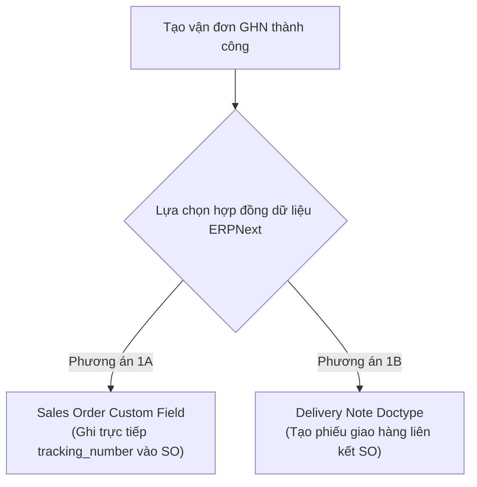

# Open Architecture & Business Decisions – Release 1 v1.1 (RB-R1-002)

**Ngày lập:** 07/11/2026  
**Phiên bản:** v1.1 (Cập nhật chuẩn hóa sau Task G1-06A)  
**Trạng thái:** Hồ sơ trình nhóm dự án & GVHD xem xét quyết định  

Tài liệu này tổng hợp **6 quyết định kỹ thuật và kiến trúc thực sự cần nhóm xác nhận** trước khi tiến hành chỉnh sửa mã nguồn và cập nhật tài liệu phân tích nghiệp vụ. Bản v1.1 đã loại bỏ các giả định chủ quan, đánh giá toàn diện các rủi ro kỹ thuật (bao gồm race condition) và duy trì tính trung lập giữa các phương án cho đến khi có sự thống nhất chính thức.

---

## MỤC LỤC CÁC QUYẾT ĐỊNH
1. [DEC-01: Hợp đồng dữ liệu đồng bộ Vận chuyển sang ERPNext (AC-27.3, AC-28.2)](#dec-01-hợp-đồng-dữ-liệu-đồng-bộ-vận-chuyển-sang-erpnext-ac-273-ac-282)
2. [DEC-02: Cơ chế ghi nhận kết quả Sửa/Hủy đơn vào Pending Action (AC-19.3, AC-20.4)](#dec-02-cơ-chế-ghi-nhận-kết-quả-sửahủy-đơn-vào-pending-action-ac-193-ac-204)
3. [DEC-03: Đánh giá giải pháp kỹ thuật thu hồi Batch AI lỗi thời - SUPERSEDED (AC-07.2, QR-01)](#dec-03-đánh-giá-giải-pháp-kỹ-thuật-thu-hồi-batch-ai-lỗi-thời---superseded-ac-072-qr-01)
4. [DEC-04: Kiến trúc đối soát tự động Vận đơn khi gặp Timeout (AC-29.2, AC-29.3)](#dec-04-kiến-trúc-đối-soát-tự-động-vận-đơn-khi-gặp-timeout-ac-292-ac-293)
5. [DEC-05: Ranh giới Kiến trúc Native Inbox vs Chatwoot Adapter (CR-001)](#dec-05-ranh-giới-kiến-trúc-native-inbox-vs-chatwoot-adapter-cr-001)
6. [DEC-06: Phạm vi và Lộ trình xem xét CR-002: Handling Extension (AC-23.5, DEC-MVP-40)](#dec-06-phạm-vi-và-lộ-trình-xem-xét-cr-002-handling-extension-ac-235-dec-mvp-40)

---

## DEC-01: HỢP ĐỒNG DỮ LIỆU ĐỒNG BỘ VẬN CHUYỂN SANG ERPNEXT (AC-27.3, AC-28.2)

### 1. Bối cảnh & Vấn đề
Sau khi nhân viên CSKH bấm "Tạo vận đơn" thành công trên Native Dashboard, Backend CSKH gọi sang GHN API và nhận được `ma_van_don`. Mã này hiện chỉ lưu cục bộ tại bảng `orders` của PostgreSQL. Để bộ phận kho và kế toán trên ERPNext có thể in phiếu xuất/giao hàng và theo dõi hành trình, Backend cần đồng bộ thông tin vận chuyển sang ERPNext. 

### 2. Các phương án lựa chọn (Duy trì trung lập đến khi xác minh)

| Tiêu chí | Phương án 1A: Ghi vào Custom Field của `Sales Order` | Phương án 1B: Tạo Doctype `Delivery Note` chuẩn ERPNext |
|---|---|---|
| **Mô tả kỹ thuật** | Gọi REST API cập nhật trường `custom_tracking_number`, `shipping_carrier` trên bản ghi `Sales Order` tương ứng (`PUT /api/resource/Sales Order/{id}`). | Gọi REST API tạo mới chứng từ `Delivery Note` liên kết với `Sales Order`, trừ kho ERP và điền `tracking_number` (`POST /api/resource/Delivery Note`). |
| **Ưu điểm** | • Triển khai đơn giản, chỉ cần 1 lời gọi API. • Không phụ thuộc vào cấu hình tài khoản kế toán kho hay quyền tạo phiếu xuất kho. • Phù hợp với mô hình bán lẻ dropship/thương mại điện tử tinh gọn. | • Đúng chuẩn luồng nghiệp vụ Fulfillment của hệ thống ERPNext. • Quản lý được từng đợt giao hàng nếu đơn hàng bị tách kiện. • Tự động kích hoạt luồng xuất kho tài chính trên ERPNext. |
| **Nhược điểm & Rủi ro** | • Cần tạo thêm custom field trên Doctype Sales Order của ERPNext nếu chưa có. • Không thể hiện được chứng từ giao hàng chính thức trong kế toán kho. | • Ràng buộc nghiệp vụ cao: Sales Order phải ở trạng thái đã Submit, tồn kho kho xuất phải đủ. • Tài khoản API ERPNext có thể bị thiếu quyền tạo chứng từ tài chính. |

### 3. Khuyến nghị & Điều kiện quyết định
- **Khuyến nghị kỹ thuật:** Thực hiện nhiệm vụ `TASK-VERIFY-03` để kiểm tra trực tiếp tài khoản API và schema Doctype trên máy chủ ERPNext demo trước khi chốt.
  - Nếu ERPNext demo đã cài sẵn phân hệ Kho và tài khoản có quyền Delivery Note $\rightarrow$ Chọn **Phương án 1B**.
  - Nếu ERPNext demo chỉ cấp quyền bán hàng cơ bản $\rightarrow$ Chọn **Phương án 1A** để đảm bảo thông suốt cho buổi bảo vệ khóa luận.
- **Tác động:** Định hình payload của `TASK-CODE-02` và kịch bản test `TASK-TEST-07`.

### 4. Khung ký duyệt
- **Người quyết định:** Nhóm BA & Lead tích hợp ERP  
- **Trạng thái:** `Needs Decision` (Chờ kết quả từ `TASK-VERIFY-03`)  
- **Lựa chọn chính thức:** `[ ] Phương án 1A` | `[ ] Phương án 1B`  

---

## DEC-02: CƠ CHẾ GHI NHẬN KẾT QUẢ SỬA/HỦY ĐƠN VÀO PENDING ACTION (AC-19.3, AC-20.4)

### 1. Bối cảnh & Vấn đề
Khi khách hàng yêu cầu sửa hoặc hủy đơn qua chat, AI Agent đã tạo đúng Pending Action và cờ `orders.yeu_cau_huy_luc`, đồng thời chuyển giao cho nhân viên (Handover). Theo AC-19.3 và AC-20.4, sau khi nhân viên xử lý sửa/hủy đơn trên ERPNext, kết quả thực tế phải được ghi nhận vào hệ thống CSKH để kết thúc yêu cầu và thông báo cho khách.

### 2. Các phương án lựa chọn

| Tiêu chí | Phương án 2A (Thủ công trên Native Dashboard) | Phương án 2B (Tự động hóa qua ERPNext Webhook) |
|---|---|---|
| **Mô tả kỹ thuật** | Nhân viên thao tác sửa/hủy trên ERPNext. Sau đó, trên Native Dashboard CSKH, nhân viên bấm nút **"Xác nhận kết quả sửa/hủy"** tại card Pending Action. Hệ thống cập nhật `cong_viec.trang_thai = 'xong'` và gửi tin nhắn soạn sẵn cho khách. | Viết Server Script / Webhook trên ERPNext: khi Sales Order đổi trạng thái sang `Cancelled` hoặc lưu bản sửa, ERPNext tự động POST webhook về endpoint `/api/erp/webhook` của Backend CSKH để đóng Pending Action. |
| **Ưu điểm** | • **Hoàn toàn chủ động:** Không phụ thuộc hạ tầng mạng ERPNext nội bộ (vốn có thể nằm sau VPN/NAT không gọi ngược lại được). • Nhân viên kiểm soát được nội dung và thời điểm gửi thông báo cho khách. • Phù hợp với câu chữ BA gốc: *"Nhân viên ghi nhận kết quả xử lý thực tế"*. | • Tự động hóa, nhân viên không phải thao tác xác nhận 2 lần. • Dữ liệu cập nhật tức thời khi đơn hàng bị hủy từ bất kỳ màn hình nào trên ERPNext. |
| **Nhược điểm & Rủi ro** | • Thêm một thao tác bấm nút xác nhận của nhân viên CSKH trên giao diện Native Inbox. | • Rủi ro mạng: ERPNext container có thể không gọi được webhook vào Backend CSKH do khác bridge network. • Phức tạp hóa cấu hình bảo mật HMAC webhook từ ERPNext. |

### 3. Khuyến nghị Kỹ thuật
> [!TIP]
> **Khuyến nghị lựa chọn Phương án 2A (Thủ công trên Dashboard):**  
> Đáp ứng đầy đủ tiêu chí của AC-19.3 và AC-20.4 mà không làm phát sinh rủi ro kết nối mạng phức tạp trong môi trường lab demo. Đảm bảo nhân viên CSKH luôn là người kiểm duyệt thông điệp cuối cùng gửi đến khách hàng.

### 4. Khung ký duyệt
- **Người quyết định:** Nhóm BA & Product Owner  
- **Trạng thái:** `Needs Decision`  
- **Lựa chọn chính thức:** `[ ] Phương án 2A` | `[ ] Phương án 2B`  

---

## DEC-03: ĐÁNH GIÁ GIẢI PHÁP KỸ THUẬT THU HỒI BATCH AI LỖI THỜI - SUPERSEDED (AC-07.2, QR-01)

### 1. Bối cảnh & Vấn đề
Khi khách gửi tin nhắn thứ hai trong lúc AI vẫn đang sinh phản hồi cho tin nhắn thứ nhất ở chế độ Auto, phản hồi đang sinh của batch cũ có thể bị lỗi thời hoặc lạc đề so với ngữ cảnh mới. Hệ thống cần hủy bỏ batch cũ (`SUPERSEDED`) trước khi gửi ra ngoài kênh.

### 2. Phân tích Kỹ thuật & Rủi ro Race Condition

> [!WARNING]
> **Đánh giá rủi ro Race Condition giữa Kiểm tra và Gọi API gửi tin:**  
> Dù dùng Epoch Counter hay Timestamp, **không có giải pháp nào đảm bảo an toàn tuyệt đối 100%** nếu chỉ dựa vào kiểm tra trước khi gọi API bên ngoài (Time-of-Check to Time-of-Use - TOCTOU):
> - *Kịch bản rủi ro:* Outbox Worker nhặt job lên, kiểm tra thấy `job.epoch == conversation.generation_epoch` (hợp lệ). Ngay tại mili-giây tiếp theo, worker bắt đầu gửi HTTP request sang Zalo/Meta API; đúng lúc đó tin nhắn mới của khách ập vào CSDL. Phản hồi cũ vẫn được phát ra ngoài vì HTTP request đã bay đi trên đường truyền mạng.
> - *Biện pháp giảm thiểu:* Cần kết hợp:
>   1. Kiểm tra epoch/timestamp sát thời điểm gửi nhất có thể.
>   2. Đặt timeout gọi Channel API ngắn (≤ 3 giây).
>   3. Khóa mềm (soft-lock / optimistic lock) bản ghi hội thoại trong lúc dispatch.
>   4. Chấp nhận khoảng hở mili-giây tối thiểu này như một giới hạn tự nhiên của hệ thống phân tán (Network Boundary).

### 3. So sánh các phương án

| Tiêu chí | Phương án 3A: Epoch Counter / Generation Token | Phương án 3B: So sánh Timestamp trước khi Outbox Dispatch |
|---|---|---|
| **Mô tả kỹ thuật** | Thêm cột `generation_epoch INT DEFAULT 1` vào `conversations`. Khi có tin nhắn khách đến, tăng `generation_epoch`. Job AI mang theo `epoch` lúc tạo. Outbox Worker trước khi gọi Channel API kiểm tra: nếu `job.epoch < conversation.generation_epoch` thì cập nhật `job.status = 'superseded'` và bỏ qua. | Không đổi schema CSDL. Outbox Worker khi nhặt job lên gửi sẽ truy vấn `conversations.last_message_at`: nếu `job.created_at < conversation.last_message_at` (có tin khách mới hơn thời điểm job được tạo), lập tức đánh dấu job lỗi thời và hủy gửi. |
| **Ưu điểm** | • Nguyên tử (atomic), chống race condition logic rất tốt bằng số đếm nguyên số tăng dần. • Dễ dàng kiểm thử, ghi log và truy vết nguyên nhân hủy job theo số epoch. | • Không cần migration thêm cột CSDL mới. • Tận dụng ngay các trường thời gian sẵn có trong bảng `conversations`. |
| **Nhược điểm** | • Cần 1 file migration nhỏ thêm cột `generation_epoch`. | • Phụ thuộc vào độ chính xác đồng hồ máy chủ (clock skew nếu scale đa server). • Dễ bị biên lệch mili-giây nếu tin khách và job tạo gần như đồng thời. |

### 4. Khung ký duyệt
- **Người quyết định:** Tech Lead  
- **Trạng thái:** `Needs Decision`  
- **Lựa chọn chính thức:** `[ ] Phương án 3A (Epoch Counter)` | `[ ] Phương án 3B (Timestamp)`  

---

## DEC-04: KIẾN TRÚC ĐỐI SOÁT TỰ ĐỘNG VẬN ĐƠN KHI GẶP TIMEOUT (AC-29.2, AC-29.3)

### 1. Bối cảnh & Vấn đề
Khi Backend gọi sang GHN API để tạo vận đơn nhưng gặp Timeout mạng (chưa rõ GHN đã nhận và tạo đơn hay chưa), hệ thống không được tạo lại ngay vì nguy cơ nhân đôi kiện hàng. Cần cơ chế đối soát tự động tra cứu lại GHN theo `client_order_code`.

### 2. Các phương án lựa chọn

| Tiêu chí | Phương án 4A: Worker Đối soát Độc lập | Phương án 4B: Mở rộng `vong_dong_bo.py` của ERP | Phương án 4C: Đối soát On-demand (Check-before-retry) |
|---|---|---|---|
| **Mô tả kỹ thuật** | Viết tiến trình nền riêng `ShippingReconciliationWorker` chạy loop mỗi 60 giây quét các đơn có trạng thái kẹt để tra cứu GHN. | Tận dụng tiến trình nền `vong_dong_bo.py` hiện có, bổ sung thêm nhánh quét và đối soát các đơn vận chuyển bị kẹt. | Trong hàm `tao_van_don_cho_don()`: trước khi gửi request tạo mới, gọi hàm tra cứu theo `client_order_code`. Nếu GHN đã có mã, nhận luôn kết quả cũ; nếu chưa có mới tạo mới. |
| **Ưu điểm** | • Tách biệt hoàn toàn trách nhiệm giữa module ERP và Shipping. | • Tiết kiệm tài nguyên máy chủ, không phát sinh thêm tiến trình worker chạy nền trong Docker. | • Cực kỳ nhẹ, không tốn polling định kỳ, không làm quá tải rate limit của GHN API; ngăn chặn tạo trùng ngay lập tức khi người dùng bấm thử lại. |
| **Nhược điểm** | • Tốn tài nguyên CPU/RAM chạy background loop liên tục. | • Trộn lẫn logic đối soát ERP và logic đơn vị vận chuyển bên thứ ba vào chung 1 worker. | • Nếu nhân viên không mở lại đơn, giao dịch kẹt sẽ ở trạng thái chờ cho đến khi có tương tác. |

### 3. Khuyến nghị Kỹ thuật
> [!TIP]
> **Khuyến nghị phối hợp Phương án 4C (Chính) và Phương án 4B (Dự phòng):**  
> Triển khai ngay Phương án 4C trong hàm tạo vận đơn để chặn đứng 100% rủi ro tạo trùng khi bấm thử lại. Sau đó mở rộng `vong_dong_bo.py` để tự động quét dọn các đơn kẹt quá 15 phút.

### 4. Khung ký duyệt
- **Người quyết định:** Tech Lead  
- **Trạng thái:** `Needs Decision`  
- **Lựa chọn chính thức:** `[ ] Phương án 4A` | `[ ] Phương án 4B` | `[ ] Phương án 4C (kết hợp 4B)`  

---

## DEC-05: RANH GIỚI KIẾN TRÚC NATIVE INBOX VS CHATWOOT ADAPTER (CR-001)

### 1. Bối cảnh & Vấn đề
Trong bản thảo BA ban đầu, Chatwoot được mô tả như giao diện vận hành chính. Tuy nhiên trong thực tế mã nguồn, nhóm đã tự phát triển hoàn chỉnh hệ thống **Native Inbox** (`agent/omnichannel/`, `inbox_service.py`, `dashboard/app.js`) làm Single Source of Truth nội bộ. Đề xuất Change Request CR-001 cần được nhóm dự án chính thức xác nhận để thống nhất tài liệu phục vụ bảo vệ khóa luận.

### 2. Các phương án lựa chọn

| Tiêu chí | Phương án 5A: Phê duyệt nội bộ CR-001 | Phương án 5B: Giữ nguyên mô tả Chatwoot là lõi |
|---|---|---|
| **Mô tả** | Chính thức phê duyệt CR-001 trong nội bộ nhóm: Khẳng định **Native Inbox là hệ thống vận hành CSKH trung tâm**; Chatwoot là hệ thống tham khảo mô hình dữ liệu và là adapter ngoại vi tùy chọn trong lab. | Cố gắng duy trì song song cả hai giao diện và đồng bộ trạng thái hai chiều giữa Chatwoot và Native Inbox. |
| **Đánh giá** | • Phản ánh trung thực công sức tự chủ công nghệ của nhóm (tự xây dựng toàn bộ Native Inbox đa kênh). • Triệt tiêu hoàn toàn rủi ro echo webhook và xung đột trạng thái dữ liệu khi vận hành. | • Rất dễ lỗi: Nếu 1 Fanpage kết nối cả Chatwoot lẫn Native Webhook, tin nhắn sẽ bị nhân đôi và SLA bị sai lệch. • Khó giải trình trước Hội đồng chấm khóa luận về sự tồn tại của 2 màn hình CSKH độc lập. |

### 3. Trạng thái & Khung ký duyệt
- **Người quyết định:** Nhóm tác giả Khóa luận & GVHD  
- **Trạng thái:** `Needs Decision` (Đang ở trạng thái Đề xuất - Chờ ký duyệt nội bộ, không tự ý coi là đã duyệt)  
- **Lựa chọn chính thức:** `[ ] Phương án 5A (Chấp thuận CR-001)` | `[ ] Phương án 5B`  

---

## DEC-06: PHẠM VI VÀ LỘ TRÌNH XEM XÉT CR-002: HANDLING EXTENSION (AC-23.5, DEC-MVP-40)

### 1. Bối cảnh & Vấn đề
Yêu cầu `AC-23.5` và `DEC-MVP-40` đề cập đến Change Request CR-002: *"Cho phép nhân viên có quyền gia hạn thời gian xử lý hội thoại Manual Mode kèm lý do hợp lệ, ghi Audit Log và không xóa vi phạm SLA gốc"*. Cần xác định trạng thái xem xét chính thức của CR-002.

### 2. Các phương án lựa chọn

| Tiêu chí | Phương án 6A: Giữ trạng thái Pending CR-002 để xem xét | Phương án 6B: Phê duyệt và Triển khai ngay trong Release 1 |
|---|---|---|
| **Mô tả** | Giữ nguyên trạng thái `Pending CR-002` trong tài liệu BA và ma trận kiểm toán; không tự ý chuyển sang Release 2 khi chưa có quyết định chính thức, nhưng không ưu tiên viết code trước các mục P0/P1. | Phê duyệt CR-002 ngay: Tạo thêm API `POST /api/inbox/conversations/{id}/extend-deadline`, thêm modal nhập lý do gia hạn trên Dashboard và bổ sung bảng audit gia hạn. |
| **Đánh giá** | • Tập trung nguồn lực tối đa cho các hạng mục P0 và P1 cấp bách. • Giữ đúng nguyên tắc quản lý phạm vi của đề tài. | • Tốn thêm thời gian thiết kế UI/UX và logic tính toán lại hạn SLA. • Nguy cơ làm chậm tiến độ hoàn thiện các phân hệ cốt lõi (Shipping, Knowledge Base). |

### 3. Trạng thái & Khung ký duyệt
- **Người quyết định:** Product Owner & Nhóm tác giả  
- **Trạng thái:** `Needs Decision` (Giữ nguyên trạng thái `Pending CR-002`, không tự ý dời scope)  
- **Lựa chọn chính thức:** `[ ] Phương án 6A (Giữ Pending xem xét)` | `[ ] Phương án 6B (Làm ngay)`  

