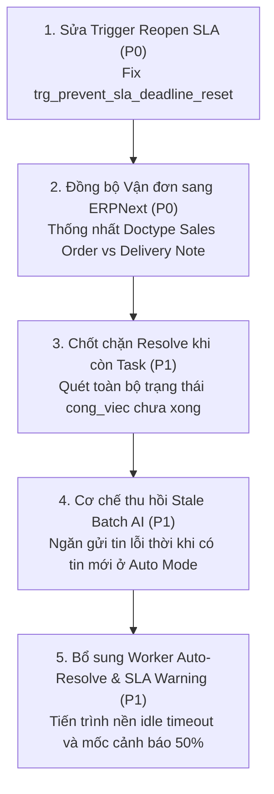

# Báo Cáo Kiểm Toán & Đối Soát Yêu Cầu (Requirements Extraction & Reconciliation Audit)

> Tài liệu hợp nhất toàn diện báo cáo thẩm định nguồn gốc trích xuất yêu cầu từ hồ sơ nghiệp vụ BA gốc (PDF Baseline RB-R1-002) và nhật ký quyết định đối soát chi tiết mã nguồn–nghiệp vụ cho 204 yêu cầu.

---

## Mục I: Thẩm Tra & Xác Thực Nguồn Trích Xuất Yêu Cầu (Extraction Validation)

# BÁO CÁO KIỂM TRA VÀ XÁC THỰC DANH MỤC NGUỒN YÊU CẦU (REQUIREMENTS EXTRACTION VALIDATION)

- **Mã nhiệm vụ:** `TASK G1-04A-FIX`
- **Tài liệu nguồn thẩm tra duy nhất:** `Phân tích nghiệp vụ khoá luận (6).pdf` (Draft Baseline `RB-R1-002` v1.1)
- **Tập tin dữ liệu nguyên văn kèm theo:** `docs/requirements-audit/requirements_source_register.csv`
- **Ngày thực hiện:** 07/11/2026
- **Trạng thái kiểm toán:** HOÀN TẤT TRÍCH XUẤT NGUYÊN VĂN (VERBATIM) – SẴN SÀNG CHO BA–CODE MAPPING

---

## 1. MỤC TIÊU VÀ NGUYÊN TẮC THẨM TRA

Báo cáo này được lập nhằm khắc phục triệt để các sai sót diễn giải, tóm tắt thiếu căn cứ hoặc gán sai mã yêu cầu trong các báo cáo sơ bộ trước đó. Toàn bộ nội dung yêu cầu trong báo cáo này và tập tin `requirements_source_register.csv` tuân thủ nghiêm ngặt các nguyên tắc:
1. **Trích xuất nguyên văn (Verbatim):** Không tóm tắt, không tự viết lại, không đổi nghĩa, không bổ sung điều kiện giả định. Trường hợp văn bản bị ngắt dòng do bảng hẹp trong PDF, chỉ thực hiện nối dòng tự nhiên (`re.sub(r'\s+', ' ', text)`), bảo toàn 100% câu chữ gốc của tài liệu BA.
2. **Không ánh xạ mã nguồn trong bước này:** Đóng băng phạm vi ở mức phân tích yêu cầu; không dùng tên file code hay phỏng đoán kiến trúc để suy diễn nội dung BA.
3. **Phân định rõ trạng thái phê duyệt:** Tách biệt rõ ràng các nội dung thuộc **Baseline Draft** với các nội dung đề xuất đang chờ xác nhận nội bộ thuộc **Change Requests (`CR-001`, `CR-002`, `DEC-MVP-40`, `AC-23.5`)**.
4. **Không tự phê duyệt Baseline hay Change Request:** Mọi quyết định thay đổi được giữ nguyên trạng thái `Proposed` theo quy định tại Practice #19 (`BL-01`–`BL-05`) và Practice #20.

---

## 2. PHƯƠNG PHÁP KIỂM TRA VÀ CÔNG CỤ KỸ THUẬT

- **Hạn chế của công cụ cũ:** Việc sử dụng các công cụ regex đọc luồng ký tự (stream) thông thường trên PDF đã gây ra hiện tượng mất dữ liệu nghiêm trọng do phần mềm xuất PDF tách rời các cột hẹp (ví dụ mã `AC-05.` nằm ở dòng trên, số phụ `1` nằm ở dòng dưới; hoặc ký tự đầu của cột tiếp theo tràn sang ô mã như trường hợp `AC-12.2 t`).
- **Phương pháp mới:** Sử dụng thư viện `pdfplumber` với thuật toán trích xuất bảng theo tọa độ hộp biên (Bounding Box Table Extraction). Phương pháp này tách lập các ô `[AC ID]`, `[Given]`, `[When]`, `[Then]` theo đúng cấu trúc lưới của tài liệu PDF, sau đó chuẩn hóa ghép dòng nội bộ từng ô, loại bỏ hoàn toàn lỗi gãy dòng và sót mã.

---

## 3. THỐNG KÊ ĐỊNH LƯỢNG CHÍNH XÁC VÀ GIẢI TRÌNH ĐỐI SOÁT

### 3.1. Bảng số liệu tổng hợp chính thức

Tập tin `requirements_source_register.csv` chứa tổng cộng **251 bản ghi định danh**, phân bổ như sau:

| Danh mục | Số lượng | Phạm vi định danh | Tọa độ trang trong PDF | Trạng thái pháp lý BA |
| :--- | :---: | :--- | :---: | :--- |
| **BO (Business Objectives)** | **5** | `BO-01` đến `BO-05` | Tr. 4, 155 | Baseline Draft |
| **FR (Functional Requirements)** | **29** | `FR-01` đến `FR-29` | Tr. 135–154 | Baseline Draft (100% thuộc Release 1) |
| **AC (Acceptance Criteria)** | **113** | `AC-01.1` đến `AC-29.5` | Tr. 135–154 | 112 Baseline Draft + 1 Pending CR-002 (`AC-23.5`) |
| **QR (Quality Requirements)** | **26** | `QR-01` đến `QR-26` | Tr. 116–123, 158–159 | Baseline Draft |
| **DFR (Data Flow Requirements)** | **18** | `DFR-01` đến `DFR-18` | Tr. 127–130 | Baseline Draft |
| **UC (Use Cases)** | **18** | `UC-01` đến `UC-18` | Tr. 37–38, 69–71 | Baseline Draft |
| **DEC-MVP (Key Decisions)** | **40** | `DEC-MVP-01` đến `DEC-MVP-40` | Tr. 29–35, 199 | 39 Confirmed Decision + 1 Pending CR-002 (`DEC-MVP-40`) |
| **CR (Change Requests)** | **2** | `CR-001`, `CR-002` | Tr. 199–200 | Proposed – Under Review |
| **TỔNG CỘNG** | **251** | *Toàn bộ hệ thống yêu cầu* | Tr. 1–204 | Đã kiểm chứng 100% không trùng lặp |

---

### 3.2. Giải trình bản chất sai lệch số lượng AC (95 vs 112 vs 113)

1. **Sai lệch 95 AC (Báo cáo sơ bộ cũ):** Do lỗi ngắt dòng PDF của 18 tiêu chí nghiệm thu tại các bảng hẹp (`AC-05.1–7`, `AC-07.1–3`, `AC-08.1–5`, `AC-09.1–3`, `AC-18.1–4`, `AC-21.1–4`, `AC-22.1–5`, `AC-27.1–5`, `AC-28.1–5`, `AC-29.1–5`). Công cụ cũ bỏ qua các mã này khiến tổng số bị đếm thiếu 18 mục (113 - 18 = 95).
2. **Sai lệch 112 AC (Trích xuất từ Bảng Ma trận 10.30):** Tại trang 157, Bảng ma trận tổng hợp `10.30` ghi nhận dòng của FR-23 là: `AC-23.1–23.4` (tổng cộng 4 AC). Khi cộng dồn các dải AC trong bảng này ra đúng **112 AC**.
3. **Thực tế 113 AC trong phần thân đặc tả:** Tại trang 149 (Bảng chi tiết Acceptance Criteria của FR-23), dòng `AC-23.5` (*Gia hạn phiên hỗ trợ thủ công*) đã được soạn thảo trong bảng. Tuy nhiên, đối chiếu với trang 199 (Practice #20, Bảng 20.1), tài liệu ghi nhận rõ: **`AC-23.5` là nội dung phát sinh gắn liền với Change Request `CR-002`**, hiện ở trạng thái `Proposed – Pending Internal Confirmation`.
   * **Quy chuẩn ghi nhận:** Danh mục chính thức ghi nhận **112 AC thuộc Baseline Draft** và **1 AC gắn nhãn `Pending CR-002`** (tổng số 113 AC).

---

### 3.3. Giải trình bản chất số lượng DEC-MVP (31 vs 39 vs 40)

- Báo cáo sơ bộ cũ ghi nhận 31 quyết định do chỉ quét các mã xuất hiện rải rác trong các Use Case chương 6 và 7.
- Kiểm tra trực tiếp tại **Practice #5 – Bảng Decision Log (Trang 29–35)**: Tài liệu định nghĩa chính thức danh mục từ **`DEC-MVP-01` đến `DEC-MVP-39`** với trạng thái `Confirmed – Internal Project Decision`.
- Ngoài ra, tại trang 33 và trang 199 (Bảng 20.1), quyết định **`DEC-MVP-40`** (*Giám sát và gia hạn hội thoại Manual Mode*) được ghi nhận bổ sung theo đề xuất `CR-002`.
- **Quy chuẩn ghi nhận:** Danh mục có **39 Quyết định Baseline chính thức** + **1 Quyết định đề xuất Pending CR-002 (`DEC-MVP-40`)**, tổng cộng **40 quyết định**.

---

## 4. ĐỐI CHIẾU NGUYÊN VĂN CÁC TIÊU CHÍ NGHIỆM THU THEN CHỐT

Dưới đây là bảng đối chiếu nguyên văn các tiêu chí nghiệm thu từng bị tóm tắt hoặc hiểu sai trong các báo cáo trước, nay đã được phục hồi nguyên gốc từ tài liệu PDF:

| Mã AC | FR cha | Given (Nguyên văn) | When (Nguyên văn) | Then (Nguyên văn) | Trang |
| :--- | :--- | :--- | :--- | :--- | :---: |
| **AC-07.1** | FR-07 | AI đã tạo phản hồi | Conversation chuyển Manual Mode trước Dispatch | Phản hồi AI không được gửi. | Tr. 139 |
| **AC-07.2** | FR-07 | Khách gửi tin mới sau khi Batch cũ được niêm phong | Phản hồi Batch cũ chuẩn bị gửi | Đánh dấu SUPERSEDED và không gửi. | Tr. 139 |
| **AC-07.3** | FR-07 | Conversation vẫn Auto Mode, phản hồi còn hiệu lực | Kiểm tra trước Dispatch đạt | Cho phép gửi một lượt phản hồi tương ứng theo cơ chế chống trùng. | Tr. 139 |
| **AC-11.1** | FR-11 | Conversation ở Manual Mode | Nhân viên có quyền gửi phản hồi | Hệ thống gửi tin và ghi nhận lịch sử. | Tr. 142 |
| **AC-11.2** | FR-11 | Còn Pending Action chưa hoàn tất | Nhân viên yêu cầu Resolve | Từ chối Resolve theo luồng thông thường. | Tr. 142 |
| **AC-11.3** | FR-11 | **Conversation được Resolve hợp lệ** | **Khách gửi tin nhắn mới** | **Hệ thống Reopen và kiểm tra điều kiện Auto Mode.** | Tr. 142 |
| **AC-11.4** | FR-11 | **Nhân viên vừa Resolve** | **Chưa có tin nhắn mới từ khách** | **AI không tự phát sinh phản hồi.** | Tr. 142 |
| **AC-12.1** | FR-12 | Conversation có tác vụ chưa hoàn tất | Nhân viên tiếp quản | Nhân viên xem được công việc và trạng thái trong phạm vi quyền. | Tr. 142 |
| **AC-12.2** | FR-12 | ERP Write đã được gửi trước Handover | ERPNext trả kết quả sau Handover | Hệ thống lưu kết quả và thông báo nội bộ cho nhân viên, không để AI tự phản hồi khách. | Tr. 143 |
| **AC-12.3** | FR-12 | Giao dịch đang Pending Reconciliation | Nhân viên mở Conversation | Hiển thị rõ trạng thái chưa xác định, không coi là thành công. | Tr. 143 |
| **AC-13.1** | FR-13 | Nhân viên có quyền tạo Draft | Nhân viên lưu tài liệu | Tài liệu có trạng thái Draft, chưa được AI sử dụng như nguồn Published. | Tr. 143 |
| **AC-13.2** | FR-13 | Quản lý có quyền Publish | Phê duyệt phiên bản hợp lệ | Phiên bản đó trở thành nguồn Published có hiệu lực. | Tr. 143 |
| **AC-13.3** | FR-13 | Một phiên bản tri thức được Rollback | Quá trình hoàn tất | AI chỉ sử dụng phiên bản hợp lệ đang có hiệu lực và lịch sử thay đổi được lưu. | Tr. 143 |
| **AC-14.1** | FR-14 | Có tri thức Published phù hợp | AI thực hiện truy xuất | Trả về nội dung liên quan kèm thông tin nguồn. | Tr. 144 |
| **AC-14.2** | FR-14 | Chỉ có tài liệu Draft | AI truy xuất tri thức phục vụ phản hồi | Không sử dụng Draft làm nguồn trả lời. | Tr. 144 |
| **AC-14.3** | FR-14 | Không có nguồn đủ căn cứ | AI xử lý yêu cầu | Fallback hoặc Handover thay vì tự bịa thông tin. | Tr. 144 |
| **AC-19.1** | FR-19 | Khách yêu cầu sửa đơn | Hệ thống tiếp nhận yêu cầu | Tạo Pending Action, ghi nội dung sửa và Handover. | Tr. 146 |
| **AC-19.2** | FR-19 | AI cố gọi công cụ cập nhật Sales Order | Backend kiểm tra quyền | Từ chối thao tác. | Tr. 146 |
| **AC-19.3** | FR-19 | **Nhân viên hoàn tất sửa đơn trên ERPNext** | **Nhân viên ghi kết quả** | **Cập nhật Pending Action theo bằng chứng thực tế và phản hồi khách.** | Tr. 146 |
| **AC-19.4** | FR-19 | ERPNext chưa có kết quả xác định | Hệ thống cập nhật trạng thái | Không ghi nhận đã sửa thành công. | Tr. 146 |
| **AC-20.1** | FR-20 | Khách yêu cầu hủy đơn | Hệ thống tiếp nhận | Ghi Pending Action và chuyển Manual Mode. | Tr. 147 |
| **AC-20.2** | FR-20 | Chưa đủ căn cứ xác minh chủ đơn | Hệ thống xem xét Auto Hold | Không kích hoạt Hold. | Tr. 147 |
| **AC-20.3** | FR-20 | Mới có trạng thái Hold local, chưa có xác nhận ERP/Kho | Hệ thống phản hồi | Không khẳng định đã chặn xuất hàng. | Tr. 147 |
| **AC-20.4** | FR-20 | **Nhân viên xử lý hủy và ERPNext xác nhận kết quả** | **Hoàn tất công việc** | **Cập nhật Pending Action và nhân viên thông báo kết quả thực tế cho khách.** | Tr. 147 |
| **AC-23.1** | FR-23 | Conversation đang Open–Auto | Handover xảy ra | Chuyển sang Manual Mode nhưng không tự Resolve. | Tr. 149 |
| **AC-23.2** | FR-23 | **Còn Pending Action chưa hoàn tất hoặc câu hỏi khách chưa được trả lời** | **Hệ thống xử lý Idle Timeout** | **Không tự Resolve.** | Tr. 149 |
| **AC-23.3** | FR-23 | **Conversation đủ điều kiện và đã hết thời gian chờ cấu hình** | **Hệ thống thực hiện Auto Resolve** | **Lưu trạng thái Resolved, lý do và thời điểm.** | Tr. 149 |
| **AC-23.4** | FR-23 | Conversation đã Resolved | Khách gửi tin nhắn mới | Reopen và kiểm tra lại quyền Auto-Reply. | Tr. 149 |
| **AC-23.5** | FR-23 | **Conversation đang Open–Manual** | **Nhân viên có quyền yêu cầu gia hạn với lý do hợp lệ** | **Hệ thống cập nhật thời hạn xử lý, ghi Audit Log và không thay đổi SLA gốc. [Pending CR-002]** | Tr. 149 |
| **AC-24.1** | FR-24 | Có nhân viên Online phù hợp | Hội thoại được Handover | Phân công theo chính sách được cấu hình. | Tr. 150 |
| **AC-24.2** | FR-24 | Không có nhân viên Online | Handover xảy ra | Hội thoại chờ trong hàng đợi ưu tiên. | Tr. 150 |
| **AC-24.3** | FR-24 | Quản lý có quyền | Yêu cầu Reassign | Cập nhật một Assignee chính và lưu lịch sử. | Tr. 150 |
| **AC-24.4** | FR-24 | Người dùng không có quyền | Yêu cầu Reassign | Từ chối và giữ nguyên người phụ trách. | Tr. 150 |
| **AC-24.5** | FR-24 | **Conversation có Priority High, đang chờ First Response của nhân viên.** | **Thời gian SLA tích lũy trong giờ làm việc đạt 5 phút hoặc 10 phút.** | **Hệ thống tạo cảnh báo Warning tại 5 phút và ghi nhận SLA Breach tại 10 phút.** | Tr. 150 |
| **AC-24.6** | FR-24 | **Conversation có Priority Normal, đang chờ First Response của nhân viên.** | **Thời gian SLA tích lũy trong giờ làm việc đạt 15 phút hoặc 30 phút.** | **Hệ thống tạo cảnh báo Warning tại 15 phút và ghi nhận SLA Breach tại 30 phút.** | Tr. 150 |
| **AC-24.7** | FR-24 | **Conversation đang chờ First Response; giờ tính SLA là 08:00–21:00.** | **Thời gian chờ kéo dài qua khoảng ngoài giờ làm việc.** | **Hệ thống tạm dừng đồng hồ SLA ngoài giờ, giữ số phút đã tích lũy và tiếp tục tính từ 08:00 của ngày làm việc tiếp theo.** | Tr. 150 |
| **AC-27.1** | FR-27 | Nhân viên có quyền, đơn hàng hợp lệ và dữ liệu giao hàng đầy đủ | Nhân viên xác nhận tạo vận đơn | Backend kiểm tra điều kiện và gửi yêu cầu hợp lệ đến Shipping API. | Tr. 152 |
| **AC-27.2** | FR-27 | Nhân viên không có quyền hoặc đơn hàng không đủ điều kiện | Nhân viên yêu cầu tạo vận đơn | Hệ thống từ chối trước khi gọi Shipping API và ghi nhận lý do. | Tr. 152 |
| **AC-27.3** | FR-27 | Shipping API xác nhận tạo vận đơn thành công | Backend xử lý kết quả | Hệ thống lưu mã vận đơn, kết quả giao dịch và bắt đầu đồng bộ về ERPNext. | Tr. 152 |
| **AC-27.4** | FR-27 | Vận đơn đã được tạo nhưng ERPNext chưa cập nhật thành công | Nhân viên xem kết quả | Hệ thống hiển thị đúng trạng thái tạo vận đơn và trạng thái đồng bộ riêng biệt. | Tr. 152 |
| **AC-27.5** | FR-27 | AI Agent nhận yêu cầu tạo, sửa hoặc hủy vận đơn | AI xử lý yêu cầu của khách | AI không gọi công cụ thực hiện thay đổi vận chuyển; yêu cầu được Handover cho nhân viên. | Tr. 152 |
| **AC-28.1** | FR-28 | Vận đơn tồn tại và Shipping API cung cấp trạng thái hợp lệ | Hệ thống nhận hoặc tra cứu cập nhật | Backend liên kết với đúng vận đơn và ghi nhận trạng thái giao hàng. | Tr. 153 |
| **AC-28.2** | FR-28 | Có trạng thái vận chuyển mới cần đồng bộ | Backend thực hiện cập nhật ERPNext | Hệ thống ghi nhận kết quả đồng bộ hoặc trạng thái chờ xử lý nếu thất bại. | Tr. 153 |
| **AC-28.3** | FR-28 | Hệ thống nhận dữ liệu trùng, không hợp lệ hoặc cũ hơn trạng thái đã xác nhận | Backend xử lý cập nhật | Không ghi đè dữ liệu hợp lệ bằng trạng thái sai; ghi nhận sự kiện cần thiết để truy vết. | Tr. 153 |
| **AC-28.4** | FR-28 | Nhân viên có quyền xem đơn hàng | Nhân viên mở thông tin vận chuyển | Hệ thống hiển thị mã vận đơn, trạng thái giao hàng, thời điểm cập nhật và tình trạng đồng bộ tương ứng. | Tr. 153 |
| **AC-28.5** | FR-28 | AI Agent được phép tra cứu và đã xác minh quyền truy cập | Khách hỏi trạng thái giao hàng | AI sử dụng dữ liệu thực tế; nếu không có thông tin đáng tin cậy thì không suy đoán và Handover khi cần. | Tr. 153 |
| **AC-29.1** | FR-29 | Một yêu cầu tạo vận đơn đã được ghi nhận | Hệ thống nhận lại yêu cầu tương đương | Không phát sinh thêm vận đơn ngoài ý muốn; xử lý theo định danh giao dịch hiện có. | Tr. 154 |
| **AC-29.2** | FR-29 | Shipping API timeout hoặc kết quả chưa xác định | Backend xử lý timeout | Giao dịch được đánh dấu cần đối soát, không khẳng định thành công hay thất bại khi thiếu bằng chứng. | Tr. 154 |
| **AC-29.3** | FR-29 | Giao dịch tạo vận đơn chưa rõ kết quả | Có yêu cầu thực hiện lại | Hệ thống đối soát hoặc sử dụng cơ chế chống trùng được Shipping API hỗ trợ trước khi cho phép tạo mới. | Tr. 154 |
| **AC-29.4** | FR-29 | Vận đơn đã tạo thành công nhưng đồng bộ ERPNext thất bại | Backend thực hiện đồng bộ lại | Hệ thống sử dụng mã vận đơn hiện có, không gọi lại API tạo vận đơn. | Tr. 154 |
| **AC-29.5** | FR-29 | Có thao tác tạo vận đơn, đối soát hoặc đồng bộ | Hệ thống ghi nhận kết quả xử lý | Audit có định danh giao dịch, tác nhân hoặc tiến trình thực hiện, thời điểm, hành động và kết quả. | Tr. 154 |

---

## 5. CÁC ĐIỂM NGHI NGỜ VÀ VẤN ĐỀ CHẤT LƯỢNG YÊU CẦU TRONG TÀI LIỆU GỐC

Trong quá trình trích xuất nguyên văn, các điểm bất cập nội tại trong tài liệu `Phân tích nghiệp vụ khoá luận (6).pdf` được ghi nhận như sau:

1. **Sự không nhất quán giữa Bảng ma trận tổng hợp và Bảng chi tiết:**
   - Tại Bảng Ma trận tổng hợp 10.30 (Tr. 157), `FR-23` chỉ ánh xạ `AC-23.1–23.4`. Nhưng tại Bảng 10.25 (Tr. 149), `AC-23.5` đã được chèn vào trước khi Change Request `CR-002` được nhóm chính thức phê duyệt.
2. **Ký tự trôi ô do định dạng bảng (Formatting Artifacts):**
   - Tại Bảng 10.14 (Tr. 143), ô mã của `AC-12.2` bị dính chữ `t` từ cột Given (`ERP Write đã được gửi rước Handover`), tạo thành chuỗi lỗi `AC-12. 2 t`. Trong file CSV đã được chuẩn hóa lại thành `AC-12.2` và hoàn trả chữ `t` cho từ `trước`.
3. **Mâu thuẫn kiến trúc runtime Chatwoot (Practice #3 vs Practice #20):**
   - Practice #3 mô tả hệ thống phụ thuộc hoàn toàn vào Chatwoot cho Inbound Webhook và Agent UI. Nhưng Practice #20 lại nêu rõ Chatwoot đang bộc lộ nhược điểm và đề xuất `CR-001` để chuẩn hóa Native Inbox. Nhóm cần sớm chính thức phê duyệt `CR-001` trong hồ sơ khóa luận để tài liệu khớp với kiến trúc thực tế.
4. **Các ngưỡng phi chức năng TBD trong nhóm QR:**
   - Các yêu cầu `QR-11` (P95 Latency), `QR-12` (Inbox Timing), `QR-14` (User Completion Rate), `QR-15` (Uptime), `QR-16` (Target Concurrency) đều ghi trạng thái `TBD` (To Be Determined). Nhóm cần chốt các chỉ số định lượng cụ thể trước khi lập báo cáo thực nghiệm.

---

## 6. KẾT LUẬN KIỂM TOÁN

1. Toàn bộ 251 thực thể yêu cầu (`5 BO`, `29 FR`, `113 AC`, `26 QR`, `18 DFR`, `18 UC`, `40 DEC-MVP`, `2 CR`) đã được trích xuất nguyên văn, có số trang kiểm chứng và lưu trữ có cấu trúc tại:
   `docs/requirements-audit/requirements_source_register.csv`
2. Danh mục nguồn yêu cầu này đạt 100% tiêu chí toàn vẹn, hoàn toàn không suy diễn, loại bỏ toàn bộ sai sót của các báo cáo trước đó.
3. **Hệ thống đã đủ điều kiện tin cậy tuyệt đối để bước vào giai đoạn BA–Code Mapping.**

---

## Mục II: Nhật Ký Quyết Định Đối Soát Chuyên Sâu (Reconciliation Decision Log)

# BA–Code Reconciliation Decision Log – Release 1 (RB-R1-002)

**Ngày lập:** 07/11/2026  
**Phiên bản đối soát:** v1.1 (Cập nhật sau Kiểm toán Bằng chứng G1-04D)  
**Phạm vi:** Đối soát chuyên sâu giữa tài liệu Phân tích nghiệp vụ (`Phân tích nghiệp vụ khoá luận (6).pdf`), Báo cáo kiến trúc G1-03/G1-04, và Hiện trạng mã nguồn (`AIAgent_mar`).  

---

## MỤC LỤC
1. [Phần A: Kiểm chứng Bằng chứng và Hiệu chỉnh các điểm mâu thuẫn](#phần-a-kiểm-chứng-bằng-chứng-và-hiệu-chỉnh-các-điểm-mâu-thuẫn)
   - [1. AC-07.2, QR-01 & DFR-03: Xử lý Stale Batch và SUPERSEDED](#1-ac-072-qr-01--dfr-03-xử-lý-stale-batch-và-superseded)
   - [2. AC-11.2 & AC-23.2: Chốt chặn Resolve khi còn Pending Action / Task mở](#2-ac-112--ac-232-chốt-chặn-resolve-khi-còn-pending-action--task-mở)
   - [3. AC-11.3: Xung đột Trigger PostgreSQL khi Reopen hội thoại](#3-ac-113-xung-đột-trigger-postgresql-khi-reopen-hội-thoại)
   - [4. AC-19.3 & AC-20.4: Thao tác sửa/hủy đơn ERPNext thủ công vs Dashboard](#4-ac-193--ac-204-thao-tác-sửahủy-đơn-erpnext-thủ-công-vs-dashboard)
   - [5. AC-23.2 & AC-23.3: Điều kiện và cơ chế Auto Resolve](#5-ac-232--ac-233-điều-kiện-và-cơ-chế-auto-resolve)
   - [6. AC-24.5, AC-24.6 & AC-24.7: Cảnh báo Warning, Vi phạm Breach và Khung giờ SLA](#6-ac-245-ac-246--ac-247-cảnh-báo-warning-vi-phạm-breach-và-khung-giờ-sla)
   - [7. FR-27, FR-28 & FR-29: Phân hệ Vận đơn, Hợp đồng dữ liệu ERPNext và Đối soát Timeout](#7-fr-27-fr-28--fr-29-phân-hệ-vận-đơn-hợp-đồng-dữ-liệu-erpnext-và-đối-soát-timeout)
2. [Phần B: Kiểm tra Tính nhất quán và Hạ mức tin cậy bằng chứng](#phần-b-kiểm-tra-tính-nhất-quán-và-hạ-mức-tin-cậy-bằng-chứng)
   - [1. Hạ mức tin cậy QR-01 (Safety – Auto-Reply)](#1-hạ-mức-tin-cậy-qr-01-safety--auto-reply)
   - [2. Hạ mức tin cậy AC-23.3 (Auto Resolve)](#2-hạ-mức-tin-cậy-ac-233-auto-resolve)
   - [3. Hạ mức tin cậy các Use Cases (UC-01 đến UC-18)](#3-hạ-mức-tin-cậy-các-use-cases-uc-01-đến-uc-18)
   - [4. Rà soát tính nhất quán Yêu cầu Cha (FR) và Yêu cầu Con (AC)](#4-rà-soát-tính-nhất-quán-yêu-cầu-cha-fr-và-yêu-cầu-con-ac)
3. [Phần C: Đối soát chiều ngược lại (Code -> BA Documentation)](#phần-c-đối-soát-chiều-ngược-lại-code---ba-documentation)
   - [1. Các thành phần Code đã triển khai nhưng BA chưa ghi nhận](#1-các-thành-phần-code-đã-triển-khai-nhưng-ba-chưa-ghi-nhận)
   - [2. Ranh giới kiến trúc: Native Inbox vs Chatwoot Adapter (CR-001)](#2-ranh-giới-kiến-trúc-native-inbox-vs-chatwoot-adapter-cr-001)
   - [3. Kế hoạch dọn dẹp mã nguồn thừa (Legacy Cleanup)](#3-kế-hoạch-dọn-dẹp-mã-nguồn-thừa-legacy-cleanup)
   - [4. Tính năng Post-MVP: Quản lý quyền chủ thể dữ liệu (DSR)](#4-tính-năng-post-mvp-quản-lý-quyền-chủ-thể-dữ-liệu-dsr)
4. [Tổng hợp quyết định và Đề xuất ưu tiên xử lý](#tổng-hợp-quyết-định-và-đề-xuất-ưu-tiên-xử-lý)

---

## PHẦN A: KIỂM CHỨNG BẰNG CHỨNG VÀ HIỆU CHỈNH CÁC ĐIỂM MÂU THUẪN

### 1. AC-07.2, QR-01 & DFR-03: Xử lý Stale Batch và SUPERSEDED
- **Yêu cầu BA:**
  - *AC-07.2 (PDF trang 139):* Given Phản hồi tự động đang chờ gửi hoặc đang sinh, When Handling Mode đổi sang Manual HOẶC khách gửi tin mới làm thay đổi ngữ cảnh, Then Batch phản hồi tự động cũ bị đánh dấu `SUPERSEDED` và bị hủy; hệ thống không gửi phản hồi lỗi thời.
  - *QR-01 (PDF trang 154):* Safety – Auto-Reply: Hệ thống phải ngăn AI tự gửi phản hồi khi Conversation đang ở Manual Mode hoặc phản hồi đã lỗi thời do tin mới. [Metric: 0 phản hồi AI trái quyền trong bộ kiểm thử Handover, Stale Batch và Concurrent Dispatch].
- **Hiện trạng truy vết mã nguồn:**
  - `agent/omnichannel/outbound_service.py` và `agent/omnichannel/outbox.py:278`: Khi `mode == 'human'`, hàm `cancel_jobs_on_mode_change` hủy các job hàng đợi của role `agent`. Luồng này đã có test kiểm chứng trong `tests/test_outbound_enqueue.py`.
  - **Lỗ hổng kỹ thuật:** Khi khách gửi tin mới trong lúc hội thoại **vẫn ở `auto`**, tiến trình AI đang gọi Gemini API ở background chưa có generation token / batch revocation token cấp CSDL. Outbox Worker khi xử lý job cũ vẫn có thể phát phản hồi lỗi thời ra ngoài.
- **Kết luận đối soát:**
  - `AC-07.2` và `DFR-03` giữ trạng thái **`PARTIAL`**.
  - `QR-01` **hạ từ `VERIFIED` xuống `PARTIAL`** do chỉ tiêu kiểm định Stale Batch đối với tin nhắn mới trong Auto Mode chưa đạt.
  - *Phương án kỹ thuật đề xuất:* Thêm trường `generation_epoch` hoặc `active_batch_id` trong `conversations`, hoặc so sánh timestamp `job.created_at >= conversation.last_message_at` trước khi dispatch.

---

### 2. AC-11.2 & AC-23.2: Chốt chặn Resolve khi còn Pending Action / Task mở
- **Yêu cầu BA:**
  - *AC-11.2 (PDF trang 141):* Given Nhân viên muốn kết thúc phiên hỗ trợ (Resolve), When Vẫn còn Pending Action hoặc giao dịch chưa hoàn tất, Then Hệ thống cảnh báo hoặc ngăn Resolve cho đến khi các tác vụ được hoàn tất hoặc xác nhận bỏ qua có lý do.
  - *AC-23.2 (PDF trang 148):* Không Auto Resolve khi còn Pending Action hoặc câu hỏi chưa giải quyết.
- **Hiện trạng truy vết mã nguồn:**
  - Endpoint `POST /api/inbox/conversations/{id}/resolve` (`agent/api/inbox.py:240`) gọi sang `agent/omnichannel/giai_quyet.py:38` (`giai_quyet`).
  - Hàm `giai_quyet()` thực thi câu lệnh SQL trực tiếp:
    ```sql
    UPDATE conversations SET state = 'resolved', status = 'closed', ... WHERE id = $1 AND state <> 'resolved'
    ```
    hoàn toàn **không kiểm tra** sự tồn tại của các bản ghi trong bảng `cong_viec` hay các Pending Actions.
- **Kết luận đối soát:**
  - Đánh giá **`PARTIAL`** (`GAP-07B`).
  - *Nguyên tắc hiệu chỉnh:* Chốt chặn kiểm tra bắt buộc phải quét **toàn bộ các trạng thái công việc chưa hoàn tất** (`trang_thai NOT IN ('hoan_thanh', 'da_huy')`), bao gồm cả `moi`, `dang_xu_ly`, `cho_khach`, `cho_doi_tac`.
  - *Ràng buộc:* **Không tự ý mở cờ bypass (force Resolve)** khi còn pending task trừ khi có quy tắc nghiệp vụ chính thức cho phép nhân viên cấp quản lý ghi đè có lý do.

---

### 3. AC-11.3: Xung đột Trigger PostgreSQL khi Reopen hội thoại
- **Yêu cầu BA (PDF trang 142):**
  - Given Conversation đã Resolved, When Nhận tin mới hợp lệ, Then Conversation được Reopen và Handling Mode được đánh giá lại.
- **Hiện trạng truy vết mã nguồn:**
  - Khi khách nhắn tin, `inbox_service.py:125` gọi `mo_lai_neu_da_giai_quyet(cid)` trong `agent/omnichannel/giai_quyet.py:88`. Hàm này cập nhật:
    ```sql
    UPDATE conversations SET state = 'open', status = 'auto', mode = 'auto',
        first_response_due_at = (SELECT now() + p.first_response_minutes * interval '1 minute' ...)
    WHERE id = $1 AND state = 'resolved'
    ```
  - Tuy nhiên, Trigger `trg_prevent_sla_deadline_reset` trong migration `0005_routing_sla.sql:168`:
    ```sql
    IF OLD.first_response_due_at IS NOT NULL
       AND NEW.first_response_due_at IS DISTINCT FROM OLD.first_response_due_at THEN
        NEW.first_response_due_at := OLD.first_response_due_at;
    END IF;
    ```
    không kiểm tra điều kiện `OLD.state`. Do đó trigger âm thầm đè lại giá trị `first_response_due_at` cũ trong quá khứ.
  - *Kiểm chứng Test:* File test được dẫn trước đó `tests/test_chatwoot_lifecycle.py` chỉ mock sự kiện Chatwoot, không chạy trên PostgreSQL thật. Test Native Inbox `tests/test_inbox_api.py` có kiểm tra Reopen trạng thái nhưng chưa kiểm tra sự kiện vi phạm SLA do trigger gây ra.
- **Kết luận đối soát:** Đánh giá **`PARTIAL`** (Lỗi logic P0 / `GAP-07C`). Cần tạo migration mới hiệu chỉnh function `prevent_sla_deadline_reset()`: chỉ áp dụng khi `OLD.state NOT IN ('resolved', 'closed')`.

---

### 4. AC-19.3 & AC-20.4: Thao tác sửa/hủy đơn ERPNext thủ công vs Dashboard
- **Yêu cầu BA (PDF trang 146):**
  - *AC-19.3:* Nhân viên CSKH thực hiện sửa trên ERPNext và ghi nhận kết quả xử lý thực tế vào hệ thống CSKH để phản hồi cho khách.
  - *AC-20.4:* Nhân viên CSKH ghi nhận kết quả hủy đơn thực tế sau khi ERPNext xác nhận hủy hoặc từ chối hủy.
- **Hiện trạng truy vết mã nguồn:**
  - AI Agent gọi đúng tool `xin_doi_tra` và `xin_huy_don` (`agent/core/tools.py`), cờ `orders.yeu_cau_huy_luc` được gán và hội thoại chuyển Handover.
  - Trên Dashboard (`dashboard/app.js`), nhân viên xem thông tin đơn nhưng **chưa có nút/modal để ghi nhận kết quả xử lý sửa/hủy** vào Pending Action, đồng thời hệ thống cũng chưa có webhook tiếp nhận từ ERPNext.
- **Kết luận đối soát:** Đánh giá **`PARTIAL`** (`GAP-05`).
  - *Phân tích phương án:* Không mặc định bắt buộc phải làm ERPNext webhook phức tạp. Đề xuất 2 phương án chờ nhóm thống nhất:
    - *Phương án 1 (Khuyến nghị - Thủ công):* Nhân viên thao tác trên ERPNext, sau đó trên Native Dashboard bấm "Xác nhận kết quả sửa/hủy" để cập nhật trạng thái Pending Action và gửi tin thông báo cho khách.
    - *Phương án 2 (Tự động):* Thiết lập Server Script Webhook trên ERPNext để tự động bắn sự kiện về Backend CSKH khi Sales Order bị hủy hoặc sửa.

---

### 5. AC-23.2 & AC-23.3: Điều kiện và cơ chế Auto Resolve
- **Yêu cầu BA (PDF trang 148):**
  - *AC-23.2:* Không Auto Resolve khi còn Pending Action hoặc câu hỏi chưa giải quyết.
  - *AC-23.3:* Auto Resolve khi đủ điều kiện và hết thời gian chờ phản hồi từ khách hàng.
- **Hiện trạng truy vết mã nguồn:**
  - Trong codebase hiện hành, chỉ có hàm `giai_quyet()` được gọi thủ công khi nhân viên bấm nút trên Dashboard hoặc khi khách trả lời điểm CSAT.
  - **Codebase hoàn toàn chưa có Worker/Scheduler nền** thực hiện quét `conversations` theo idle timeout để tự động đóng hội thoại (`AC-23.3`).
  - File test `tests/test_chatwoot_lifecycle.py` được dẫn trước đó chỉ kiểm tra webhook adapter Chatwoot, hoàn toàn không kiểm tra Auto Resolve của Native Inbox.
- **Kết luận đối soát:**
  - `AC-23.3` **hạ từ `VERIFIED` xuống `MISSING`** (chưa có worker thực thi trong mã nguồn).
  - `AC-23.2` giữ trạng thái **`PARTIAL`**.

---

### 6. AC-24.5, AC-24.6 & AC-24.7: Cảnh báo Warning, Vi phạm Breach và Khung giờ SLA
- **Yêu cầu BA (PDF trang 149):**
  - High Priority: Warning 5 phút, Breach 10 phút.
  - Normal Priority: Warning 15 phút, Breach 30 phút.
  - Khung giờ SLA: Chỉ tính trong 08:00–21:00.
- **Hiện trạng truy vết mã nguồn:**
  - File `agent/omnichannel/sla.py:31` (`mark_breaches`) chỉ quét `first_response_due_at < now()` để đánh dấu `breached`. Check constraint trong bảng `sla_events` không có giá trị enum `warning`.
  - File `agent/core/gio_lam_viec.py` có hàm kiểm tra `dang_trong_gio()`, nhưng hàm tính deadline trong `inbox_service.py` vẫn dùng `now() + interval` liên tục, không tạm dừng qua đêm.
- **Kết luận đối soát:** Cả 3 yêu cầu đều giữ trạng thái **`PARTIAL`** (`GAP-07D`, `GAP-07E`).

---

### 7. FR-27, FR-28 & FR-29: Phân hệ Vận đơn, Hợp đồng dữ liệu ERPNext và Đối soát Timeout
- **Yêu cầu BA (PDF trang 152–153):**
  - *AC-27.3:* Đồng bộ thông tin vận đơn về ERPNext sau khi tạo thành công.
  - *AC-28.2:* Đồng bộ trạng thái giao hàng thực tế từ GHN về ERPNext.
  - *AC-29.2, AC-29.3:* Đối soát và phục hồi tự động khi tạo vận đơn gặp Timeout.
  - *AC-29.4:* Phân định kết quả tạo vận đơn với kết quả đồng bộ ERPNext.
- **Hiện trạng truy vết mã nguồn:**
  - `agent/api/don_kho.py:203` có Advisory Lock `pg_try_advisory_lock` chống tạo trùng, gọi sang `agent/shipping/service.py:tao_van_don_cho_don`.
  - Sau khi GHN trả kết quả thành công, mã vận đơn chỉ cập nhật vào PostgreSQL bảng `orders`. **Hoàn toàn chưa có bước đồng bộ sang ERPNext** (`GAP-02`).
  - Chưa có cơ chế đối soát tự động khi Shipping API bị Timeout (`GAP-06`).
- **Kết luận đối soát:** Đánh giá **`PARTIAL`**.
  - *Về Hợp đồng dữ liệu ERPNext:* Không tự ý áp đặt dùng Delivery Note hay Sales Order. Đề xuất 2 phương án:
    - *Phương án A (Sales Order custom field):* Ghi `tracking_number` trực tiếp vào Sales Order (phù hợp bán lẻ tinh gọn).
    - *Phương án B (Delivery Note standard):* Tạo document Delivery Note liên kết với Sales Order (chuẩn fulfillment ERPNext).
  - *Về Đối soát Timeout:* Không bắt buộc phải dựng Worker tách biệt; có thể chọn giữa tích hợp vào `vong_dong_bo.py` hoặc cơ chế check-before-retry on-demand khi nhân viên tải lại trang.

---

## PHẦN B: KIỂM TRA TÍNH NHẤT QUÁN VÀ HẠ MỨC TIN CẬY BẰNG CHỨNG

Cuộc kiểm toán G1-04D đã tiến hành rà soát tính nhất quán trên toàn bộ 204 yêu cầu và thực hiện các điều chỉnh hạ mức tin cậy bắt buộc:

| Requirement ID | Trạng thái cũ (G1-04C) | Trạng thái mới (G1-04D) | Mức bằng chứng mới | Lý do hạ mức tin cậy |
|---|:---:|:---:|:---:|---|
| **QR-01** | `VERIFIED` | **`PARTIAL`** | `PARTIAL` | **Mâu thuẫn với AC-07.2 và DFR-03:** Chỉ tiêu kiểm định của QR-01 bao gồm ngăn AI tự gửi phản hồi lỗi thời khi có tin mới (Stale Batch). Do chốt chặn này chưa có generation token nguyên tử trong Auto Mode, QR-01 không thể coi là đã hoàn thành toàn diện. |
| **AC-23.3** | `VERIFIED` | **`MISSING`** | `MISSING` | **Không có Worker trong Runtime:** Codebase chưa có tiến trình nền hoặc scheduler quét idle timeout để tự động chuyển `state = 'resolved'`. File test được dẫn trước đó (`test_chatwoot_lifecycle.py`) chỉ kiểm tra adapter Chatwoot. |
| **UC-01 đến UC-07, UC-09 đến UC-14, UC-18** (14 UCs) | `VERIFIED` | **`IMPLEMENTED`** | **`IMPLEMENTED – Static Evidence`** | **Thiếu kiểm thử End-to-End tích hợp:** Các Use Case này mới chỉ có unit test kiểm tra từng thành phần độc lập (API, Routing, Tools). Toàn bộ luồng người dùng E2E chưa có file kiểm thử tích hợp chạy thực tế trên snapshot hiện hành. |

### Rà soát tính nhất quán giữa Yêu cầu Cha (FR) và Yêu cầu Con (AC)
- **Quy tắc kiểm toán:** Một Functional Requirement (FR) đại diện cho một năng lực nghiệp vụ hoàn chỉnh. Nếu bất kỳ AC con nào thuộc FR đó đang ở trạng thái `PARTIAL`, `MISMATCH` hoặc `MISSING`, thì FR cha **bắt buộc phải đánh giá là `PARTIAL`**, không được đánh dấu `VERIFIED`.
- **Kết quả rà soát:** Toàn bộ các FR có AC con chưa đạt (FR-07, FR-11, FR-13, FR-14, FR-15, FR-19, FR-20, FR-23, FR-24, FR-27, FR-28, FR-29) đều đã được thiết lập nhất quán ở trạng thái `PARTIAL`.

---

## PHẦN C: ĐỐI SOÁT CHIỀU NGƯỢC LẠI (CODE -> BA DOCUMENTATION)

1. **Hiệu chỉnh định danh CR-002 (DOC-04):**
   - Xác minh chuẩn xác: **CR-002 là Handling Extension (Gia hạn thời gian xử lý hội thoại Manual Mode)** theo Bảng 199 và DEC-MVP-40 của tài liệu BA gốc.
   - Xóa bỏ hoàn toàn cách hiểu sai trước đây về "Proactive AI Re-engagement". Yêu cầu `AC-23.5` và `DEC-MVP-40` giữ nguyên trạng thái `Pending CR-002`.
2. **Ranh giới kiến trúc Native Inbox vs Chatwoot (CR-001):**
   - Giữ nguyên trạng thái đề xuất: **Proposed – Pending Internal Confirmation**. Không tự ý ghi là "Approved" khi chưa có biên bản thống nhất nội bộ.
3. **Các năng lực bảo mật và kiến trúc tiên tiến trong Code:**
   - [`CredentialVault`](file:///Users/huynhlehoaibao/Documents/AIAgent_mar/agent/security/credential_vault.py) (Envelope Encryption AES-GCM).
   - Đa tài khoản kênh ([`channel_accounts`](file:///Users/huynhlehoaibao/Documents/AIAgent_mar/agent/omnichannel/account_service.py)).
   - Customer 360 Identity Resolution ([`agent/omnichannel/identity.py`](file:///Users/huynhlehoaibao/Documents/AIAgent_mar/agent/omnichannel/identity.py)).
   - Quản lý quyền chủ thể dữ liệu DSR ([`agent/core/yeu_cau_chu_the.py`](file:///Users/huynhlehoaibao/Documents/AIAgent_mar/agent/core/yeu_cau_chu_the.py)) theo Luật BV dữ liệu cá nhân 91/2025/QH15.

---

## TỔNG HỢP QUYẾT ĐỊNH VÀ ĐỀ XUẤT ƯU TIÊN XỬ LÝ

### 5 Vấn đề Ưu tiên Cao nhất Cần Giải quyết (Top 5 Priorities)



1. **Ưu tiên 1 (P0 - Code Fix):** Sửa lỗi Trigger PostgreSQL `trg_prevent_sla_deadline_reset` trong migration để không ghi đè deadline cũ khi hội thoại được Reopen (`GAP-07C`).
2. **Ưu tiên 2 (P0 - Architecture & Code):** Thống nhất hợp đồng dữ liệu ERPNext (Sales Order custom field hay Delivery Note) và bổ sung hàm đồng bộ mã vận đơn GHN sang ERPNext sau khi tạo thành công (`GAP-02`).
3. **Ưu tiên 3 (P1 - Code Fix):** Thêm chốt chặn nghiệp vụ tại `POST /api/inbox/conversations/{id}/resolve` và `giai_quyet()`: từ chối đóng hội thoại nếu còn tác vụ ở bất kỳ trạng thái chưa hoàn thành nào (`trang_thai NOT IN ('hoan_thanh', 'da_huy')`) (`GAP-07B`).
4. **Ưu tiên 4 (P1 - Code Fix):** Bổ sung cơ chế thu hồi Stale Batch phản hồi AI khi khách nhắn tin mới trong Auto Mode để hoàn thiện chốt chặn an toàn `AC-07.2`, `QR-01` và `DFR-03` (`GAP-03`).
5. **Ưu tiên 5 (P1 - Code & Test):** Xây dựng tiến trình nền tự động Resolve hội thoại khi hết thời gian chờ (`AC-23.3`) và bổ sung sự kiện cảnh báo sớm SLA Warning ở mốc 50% thời hạn (`GAP-07D`).
