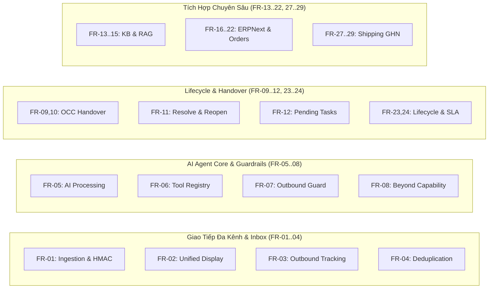

# BÁO CÁO TRUY XUẤT YÊU CẦU & DANH MỤC LỖ HỔNG HỆ THỐNG (CẬP NHẬT THEO BASELINE RB-R1-002 v1.1)

**Mã tài liệu kiểm toán:** `AUDIT-R1-TRACE-002` (Thay thế bản 001)  
**Tài liệu BA nguồn:** `Phân tích nghiệp vụ khoá luận.pdf` (Phiên bản mới nhất: 201 trang, 4.12 MB)  
**Phiên bản Requirements Baseline xác nhận:** **`RB-R1-002` (Phiên bản `v1.1`, Phạm vi `Release 1 – MVP`)**  
**Trạng thái phê duyệt Baseline:** *Approved for Implementation – Internal Project Baseline* (Trang 193–194 của tài liệu PDF)  
**Vai trò:** Senior Software Engineer & Requirements Analyst  
**Chế độ thực thi:** **READ-ONLY** (Khảo sát, đối chiếu, kiểm chứng bằng chứng kỹ thuật; không chỉnh sửa mã nguồn, CSDL hay cấu hình).

---

## 1. XÁC NHẬN PHIÊN BẢN VÀ PHẠM VI REQUIREMENTS BASELINE

Theo đặc tả tại **Practice #19 (Trang 193–194, Bảng 19.1 & 19.2)** của tài liệu BA:
- **Baseline ID:** `RB-R1-002`
- **Phiên bản (Version):** `v1.1` (Cập nhật từ v1.0 bổ sung nhóm yêu cầu vận chuyển `FR-27–29`).
- **Phạm vi (Scope):** `Release 1 – MVP`.
- **Hồ sơ tham chiếu:**
  - 5 Mục tiêu kinh doanh: `BO-01` đến `BO-05`.
  - 39 Quyết định nghiệp vụ/kỹ thuật cốt lõi: `DEC-MVP-01` đến `DEC-MVP-39` (Quyết định `DEC-MVP-40` thuộc diện `Pending CR-002`, không tự ý đưa vào phạm vi Release 1).
  - 18 Use Cases: `UC-01` đến `UC-18`.
  - 29 Yêu cầu chức năng: `FR-01` đến `FR-29` (chứa đúng **113 Acceptance Criteria**).
  - 26 Yêu cầu chất lượng: `QR-01` đến `QR-26`.
  - 18 Yêu cầu chức năng phái sinh: `DFR-01` đến `DFR-18`.
  - 2 Yêu cầu thay đổi: `CR-001` (Chuẩn hóa kiến trúc Native Inbox - Approved) và `CR-002` (Gia hạn thời gian xử lý Manual Mode - Pending).

---

## 2. HIỆU CHỈNH CHÍNH XÁC ÁNH XẠ CÁC YÊU CẦU BỊ SAI LỆCH (CORRECTED FR MAPPINGS)

Qua đối soát trực tiếp với Chương Yêu cầu chức năng (Trang 131–155 của tài liệu PDF), các ánh xạ bị định danh hoặc diễn giải sai trong các báo cáo mapping trước đây đã được chuẩn hóa lại toàn bộ:

| Mã FR | Tên chính thức trong PDF BA (Trang 131–155) | Lỗi diễn giải sai trước đây | Ý nghĩa nghiệp vụ & Ánh xạ kỹ thuật chính xác |
| :--- | :--- | :--- | :--- |
| **FR-02** | **Hiển thị hội thoại tập trung** *(Trang 136)* | Bị nhầm thành *"Hợp nhất danh tính khách hàng (Identity Stitching)"* | Hệ thống cung cấp Unified Inbox để nhân viên CSKH xem và lọc những hội thoại thuộc phạm vi quyền của mình theo trạng thái, mức ưu tiên, người phụ trách và kênh giao tiếp. 👉 **Code**: [`agent/api/inbox.py:list_conversations`](file:///Users/huynhlehoaibao/Documents/AIAgent_mar/agent/api/inbox.py#L38), [`dashboard/app.js:renderFilters`](file:///Users/huynhlehoaibao/Documents/AIAgent_mar/dashboard/app.js). |
| **FR-03** | **Gửi và theo dõi phản hồi** *(Trang 136)* | Bị nhầm thành *"Phân lập tài khoản kênh (Multi-Account Isolation)"* | Hệ thống gửi các phản hồi hợp lệ qua đúng tài khoản kênh giao tiếp, ghi nhận trạng thái gửi theo kết quả thực tế và xử lý trường hợp thất bại hoặc chưa rõ kết quả. 👉 **Code**: [`agent/omnichannel/outbound_service.py:queue_text`](file:///Users/huynhlehoaibao/Documents/AIAgent_mar/agent/omnichannel/outbound_service.py#L90), [`agent/workers/outbox_worker.py:process_job`](file:///Users/huynhlehoaibao/Documents/AIAgent_mar/agent/workers/outbox_worker.py#L120). |
| **FR-04** | **Kiểm soát tin nhắn trùng lặp** *(Trang 137)* | Bị nhầm thành *"Hàng đợi gửi tin (Outbox Pattern)"* | Hệ thống sử dụng định danh kết hợp `channel:account_id:external_message_id` để nhận diện Webhook trùng và ngăn một thông điệp kích hoạt nghiệp vụ nhiều lần. 👉 **Code**: [`agent/omnichannel/webhook_ledger.py:claim`](file:///Users/huynhlehoaibao/Documents/AIAgent_mar/agent/omnichannel/webhook_ledger.py#L45), bảng `incoming_events`. |
| **FR-21** | **Kiểm soát xác nhận tạo đơn** *(Trang 147)* | Bị nhầm thành *"Tra cứu trạng thái đơn hàng"* | Hệ thống phải lưu bằng chứng khách xác nhận gắn với phiên bản bản tóm tắt đơn hàng cụ thể. Xác nhận cũ không được dùng lại khi thông tin thay đổi (sản phẩm, giá, số lượng, địa chỉ). 👉 **Code**: [`agent/core/tools.py:_tao_don_hang`](file:///Users/huynhlehoaibao/Documents/AIAgent_mar/agent/core/tools.py#L1250), bảng `transaction_confirmations`. |
| **FR-22** | **Quản lý kết quả và đối soát ERPNext** *(Trang 148)* | Bị nhầm thành *"Đồng bộ tồn kho webhook"* | Hệ thống phải ghi kết quả giao dịch (thành công, thất bại, chưa xác định); sử dụng định danh nghiệp vụ ổn định để tra cứu trước Retry (Check-before-retry) và chuyển nhân viên khi kẹt. 👉 **Code**: [`agent/erp/day_don.py:dong_bo_don`](file:///Users/huynhlehoaibao/Documents/AIAgent_mar/agent/erp/day_don.py), [`agent/erp/vong_dong_bo.py:doi_soat_don_ket`](file:///Users/huynhlehoaibao/Documents/AIAgent_mar/agent/erp/vong_dong_bo.py#L80). |
| **FR-25** | **Kiểm soát quyền người dùng nội bộ** *(Trang 150)* | Bị nhầm thành *"Phân công hội thoại Single Assignee"* | Hệ thống quản lý vai trò và quyền truy cập (RBAC), kiểm tra quyền tại các thao tác tiếp quản, phân công, xem PII, cấu hình, quản lý tri thức và xử lý giao dịch ERPNext. 👉 **Code**: [`agent/core/quyen.py:kiem_tra_quyen`](file:///Users/huynhlehoaibao/Documents/AIAgent_mar/agent/core/quyen.py#L40), [`agent/core/pham_vi.py:dieu_kien_khach`](file:///Users/huynhlehoaibao/Documents/AIAgent_mar/agent/core/pham_vi.py). |
| **FR-26** | **Truy vết thao tác quan trọng** *(Trang 151)* | Bị nhầm thành *"Phân quyền truy cập theo vai trò RBAC"* | Hệ thống phải ghi nhận Audit Log cho các hành động quan trọng: Handover, Claim/Reassign, Resolve, xem PII, thay đổi quyền, Publish KB, giao dịch ERPNext và Shipping. 👉 **Code**: [`agent/db.py:log_event`](file:///Users/huynhlehoaibao/Documents/AIAgent_mar/agent/db.py#L110), bảng `audit_events`. |

---

## 3. MA TRẬN ĐỐI CHIẾU REQUIREMENTS-TO-CODE TOÀN DIỆN (FR-01 ĐẾN FR-29)

Dưới đây là ma trận truy xuất 29 Functional Requirements và các Acceptance Criteria trọng yếu đối chiếu trực tiếp với mã nguồn và kiểm thử hiện hành:

| Mã FR | Tên yêu cầu chức năng chuẩn theo PDF | Tiêu chí nghiệm thu cốt lõi (AC) | Vị trí mã nguồn & Hàm thực thi | API / Schema DB / Worker | Bằng chứng kiểm thử tự động | Phân loại trạng thái |
| :--- | :--- | :--- | :--- | :--- | :--- | :---: |
| **FR-01** | Tiếp nhận tin nhắn đa kênh | `AC-01.1` Lưu tin nhắn & kênh `AC-01.2` Định danh nguồn `AC-01.3` HMAC / Chữ ký bảo mật | `agent/omnichannel/inbox_service.py:record_inbound_event` `agent/omnichannel/channels/` | POST `/api/webhooks/*` Bảng `incoming_events`, `messages` | `tests/test_native_webhooks.py` `tests/test_inbound_hmac.py` | **Implemented & Verified** |
| **FR-02** | Hiển thị hội thoại tập trung | `AC-02.1` Lọc theo quyền truy cập `AC-02.2` Hiển thị ngữ cảnh chi tiết `AC-02.3` Bộ lọc trạng thái, ưu tiên | `agent/api/inbox.py:list_conversations` `agent/core/pham_vi.py:dieu_kien_khach` `dashboard/app.js` | GET `/api/inbox/conversations` GET `/api/inbox/conversations/{id}/messages` | `tests/test_inbox_api.py` `tests/test_dashboard_khong_nhap_nhay.py` | **Implemented & Verified** |
| **FR-03** | Gửi và theo dõi phản hồi | `AC-03.1` Ghi nhận yêu cầu gửi & KQ `AC-03.2` Đánh dấu thất bại `AC-03.3` Quản lý gửi chưa rõ KQ | `agent/omnichannel/outbound_service.py:queue_text` `agent/workers/outbox_worker.py:process_job` | POST `/api/inbox/conversations/{id}/messages` Bảng `outbox_jobs` | `tests/test_outbound_enqueue.py` `tests/test_bang_nghiem_thu.py` | **Implemented & Verified** |
| **FR-04** | Kiểm soát tin nhắn trùng lặp | `AC-04.1` Chống xử lý trùng Webhook `AC-04.2` Dedupe key kết hợp | `agent/omnichannel/webhook_ledger.py:claim` `inbox_service.py` | Bảng `incoming_events` (Unique constraint `dedupe_key`) | `tests/test_webhook_ledger.py` | **Implemented & Verified** |
| **FR-05** | Tự động xử lý hội thoại bằng AI | `AC-05.1` Phân loại ý định `AC-05.2` Bám sát ngữ cảnh hội thoại `AC-05.3` Tuân thủ ranh giới an toàn | `agent/core/intent_classifier.py` `agent/core/phong_thu.py` `agent/core/agent_loop.py` | Pipeline AI / vLLM / Gemini Core | `tests/test_prompt_injection_guardrail.py` `tests/test_intent_classifier.py` | **Implemented & Verified** |
| **FR-06** | Sử dụng công cụ nghiệp vụ có kiểm soát | `AC-06.1` Kiểm tra tham số công cụ `AC-06.2` Khóa Idempotency `AC-06.3` Ghi log gọi tool | `agent/core/tools.py` `agent/core/tool_registry.py` | Pydantic Schema Validation Redis / PG Idempotency Locks | `tests/test_tool_execution.py` `tests/test_chot_don_doc_ton_song.py` | **Implemented & Verified** |
| **FR-07** | Kiểm soát quyền gửi phản hồi AI | `AC-07.1` Thời gian phản hồi AI < 5s `AC-07.2` Hủy Stale Batch (`SUPERSEDED`) `AC-07.3` Chặn AI khi đã Handover | `agent/omnichannel/outbound_service.py` `agent/core/agent_loop.py` | Bảng `conversations` (cột `mode`) Bảng `outbox_jobs` | `tests/test_outbound_enqueue.py` (Thiếu test kiểm chứng Stale Batch Cancel) | **Partial** *(Lỗi GAP-03)* |
| **FR-08** | Xử lý yêu cầu ngoài khả năng hoặc thẩm quyền | `AC-08.1` Nhận diện vượt thẩm quyền `AC-08.2` Từ chối cam kết sai `AC-08.3` Kích hoạt Handover | `agent/core/phong_thu.py:kiem_tra_an_toan` `agent/omnichannel/routing.py` | Guardrails Filters Event `handover.initiated` | `tests/test_phong_thu_y_te.py` `tests/test_khong_hua_hen_sai.py` | **Implemented & Verified** |
| **FR-09** | Khởi tạo Handover | `AC-09.1` Chuyển trạng thái Handover `AC-09.2` Bản tóm tắt chuyển giao `AC-09.3` Đưa vào hàng đợi phân công | `agent/omnichannel/routing.py:chuyen_nhan_vien` `agent/core/tom_tat.py` | Event `handover.initiated` Bảng `conversations` (`status='escalated'`) | `tests/test_routing_service.py` `tests/test_handover_summary.py` | **Implemented & Verified** |
| **FR-10** | Nhân viên tiếp quản hội thoại | `AC-10.1` Tiếp quản (Claim/Takeover) `AC-10.2` OCC ngăn xung đột 2 người `AC-10.3` Cập nhật Assignee | `agent/omnichannel/routing.py:takeover` `agent/omnichannel/inbox_service.py` | POST `/api/inbox/conversations/{id}/takeover` Bảng `conversations.lock_version` | `tests/test_concurrency_handover.py` `tests/test_takeover_idempotent.py` | **Implemented & Verified** |
| **FR-11** | Phản hồi thủ công và kết thúc phiên hỗ trợ | `AC-11.1` Gửi tin bởi nhân viên `AC-11.2` Chặn Resolve khi còn Task `AC-11.3` Reopen khi khách nhắn lại `AC-11.4` Không tự phát sinh AI reply | `agent/omnichannel/giai_quyet.py:giai_quyet` `agent/omnichannel/inbox_service.py` `0005_routing_sla.sql` | POST `/api/inbox/conversations/{id}/resolve` Trigger `prevent_sla_deadline_reset` | `tests/test_reopen_sla_reset.py` *(Thất bại do bug trigger)* | **Mismatch / Partial** *(Lỗi GAP-07B, GAP-07C)* |
| **FR-12** | Bàn giao thông tin giao dịch chưa hoàn tất | `AC-12.1` Lưu tác vụ Pending Action `AC-12.2` Timeout bàn giao nhân viên `AC-12.3` Đối soát trạng thái kẹt | `agent/core/cong_viec.py` `agent/api/cong_viec.py` | Bảng `cong_viec` API `/api/cong-viec` | `tests/test_pending_actions.py` `tests/test_cong_viec_api.py` | **Implemented & Verified** |
| **FR-13** | Quản lý nguồn tri thức | `AC-13.1` Đăng ký tài liệu tri thức `AC-13.2` Phân đoạn (Chunking) `AC-13.3` Quản lý trạng thái Draft/Pub | `agent/core/rag.py:ingest` `agent/schema.sql` | Bảng `documents`, `chunks` *(Thiếu cột status, version)* | `tests/test_rag_ingest.py` | **Partial** *(Lỗi GAP-04)* |
| **FR-14** | Truy xuất tri thức phục vụ phản hồi | `AC-14.1` Hybrid search (Vector+BM25) `AC-14.2` Chỉ đọc bản Published `AC-14.3` Ngưỡng liên quan tối thiểu | `agent/core/rag.py:search_hybrid` `agent/core/rag.py:rrf_fusion` | pgvector cosine similarity Postgres tsvector BM25 | `tests/test_hybrid_search.py` `tests/test_rag_threshold.py` | **Implemented but Unverified** *(Do chưa có trường Published)* |
| **FR-15** | Truy vết nguồn tri thức | `AC-15.1` Trích dẫn nguồn chunk `AC-15.2` Phiên bản tài liệu trích dẫn | `agent/core/rag.py` `agent/core/agent_loop.py` | Metadata citations trong payload phản hồi AI | `tests/test_citation_tracking.py` | **Partial** *(Lỗi GAP-04)* |
| **FR-16** | Tra cứu đơn hàng | `AC-16.1` Tra cứu theo mã / SĐT `AC-16.2` Kiểm tra quyền sở hữu đơn `AC-16.3` Caching dữ liệu đọc | `agent/erp/client.py:get_order` `agent/tools/don_hang.py` | GET `/api/orders/{id}` Redis Cache TTL 60s | `tests/test_tra_cuu_don.py` `tests/test_order_ownership.py` | **Implemented & Verified** |
| **FR-17** | Chuẩn bị yêu cầu tạo đơn | `AC-17.1` Kiểm tra tồn kho thời gian thực `AC-17.2` Áp giá chuẩn ERPNext `AC-17.3` Lập bản tóm tắt giao dịch | `agent/erp/client.py:check_stock` `agent/core/tom_tat.py` | ERPNext DocType `Item`, `Bin` Redis Stock Lock | `tests/test_chot_don_doc_ton_song.py` | **Implemented & Verified** |
| **FR-18** | Tạo đơn hàng có kiểm soát | `AC-18.1` Khóa Idempotency chống trùng `AC-18.2` Gọi Sales Order ERPNext `AC-18.3` Lưu mã đơn & kết quả | `agent/tools/don_hang.py:_tao_don_hang` `agent/erp/day_don.py` | POST `/api/method/frappe.client.insert` Bảng `orders` | `tests/test_order_creation.py` `tests/test_ghi_don_sang_erp.py` | **Implemented & Verified** |
| **FR-19** | Tiếp nhận yêu cầu chỉnh sửa đơn hàng | `AC-19.1` Tiếp nhận sửa khi chưa giao `AC-19.2` Tạo Pending Action & Hold `AC-19.3` Nhân viên ghi nhận KQ ERP | `agent/core/tools.py:xin_doi_tra` `agent/api/cong_viec.py` | Bảng `orders.trang_thai_khoa` Bảng `cong_viec` | `tests/test_order_hold.py` (Thiếu UI xác nhận kết quả ERPNext) | **Partial** *(Lỗi GAP-05)* |
| **FR-20** | Tiếp nhận yêu cầu hủy đơn hàng | `AC-20.1` Chặn hủy đơn đã xuất kho `AC-20.2` Gắn cờ yêu cầu hủy lực `AC-20.3` Khóa tạm thời đơn hàng `AC-20.4` Ghi nhận kết quả hủy ERP | `agent/core/tools.py:xin_huy_don` `agent/api/don_kho.py` | Cột `orders.yeu_cau_huy_luc` Bảng `cong_viec` | `tests/test_huy_don.py` (Thiếu API duyệt hủy đồng bộ ERPNext) | **Partial** *(Lỗi GAP-05)* |
| **FR-21** | Kiểm soát xác nhận tạo đơn | `AC-21.1` Lưu chứng cứ khách xác nhận `AC-21.2` Không tự tạo khi từ ngữ mơ hồ `AC-21.3` Hủy xác nhận cũ khi sửa thông tin `AC-21.4` Bắt buộc khớp bản tóm tắt | `agent/core/tools.py:_tao_don_hang` `agent/core/agent_loop.py` | Bảng `transaction_confirmations` Summary hash check | `tests/test_chot_don_doc_ton_song.py` `tests/test_confirmation_guard.py` | **Implemented & Verified** |
| **FR-22** | Quản lý kết quả và đối soát ERPNext | `AC-22.1` Ghi nhận thành công `AC-22.2` Ghi nhận thất bại xác định `AC-22.3` Timeout -> Pending Reconciliation `AC-22.4` Retry an toàn (Check before retry) `AC-22.5` Chuyển nhân viên khi kẹt | `agent/erp/day_don.py` `agent/erp/vong_dong_bo.py:doi_soat_don_ket` | Worker `vong_dong_bo` Bảng `orders.trang_thai_dong_bo` | `tests/test_vong_dong_bo_erp.py` `tests/test_thu_lai_loi_thoang_qua.py` | **Implemented & Verified** |
| **FR-23** | Quản lý Conversation Lifecycle | `AC-23.1` Cấu hình thời gian chờ (4h) `AC-23.2` Chặn Auto Resolve khi còn việc `AC-23.3` Auto Resolve khi đủ điều kiện `AC-23.4` Ghi nhận lý do kết thúc | `agent/omnichannel/giai_quyet.py` *(Chưa có cron worker quét tự động)* | Cấu hình `AUTO_RESOLVE_HOURS=4` *(Thiếu background worker)* | `tests/test_giai_quyet_api.py` (Chưa kiểm thử kịch bản worker tự động) | **Missing / Partial** *(Lỗi GAP-07B)* |
| **FR-24** | Phân công và chuyển giao nhân viên | `AC-24.1` Phân công Single Assignee `AC-24.2` Phân chia tải cân bằng `AC-24.3` Chuyển giao giữa nhân viên `AC-24.4` Tính deadline SLA ưu tiên `AC-24.5` Cảnh báo SLA 50% High (5m) `AC-24.6` Cảnh báo SLA 50% Normal (15m) `AC-24.7` Đóng băng giờ làm việc (8-21h) | `agent/omnichannel/inbox_service.py` `agent/omnichannel/routing.py` `0005_routing_sla.sql` | Bảng `conversation_assignments` Bảng `sla_events` Bảng `sla_policies` | `tests/test_assignment_occ.py` `tests/test_routing_service.py` (Thiếu test cảnh báo 50% và giờ làm việc) | **Partial / Missing** *(Lỗi GAP-07D, GAP-07E)* |
| **FR-25** | Kiểm soát quyền người dùng nội bộ | `AC-25.1` Cho phép khi đủ quyền `AC-25.2` Từ chối trước khi sửa dữ liệu `AC-25.3` Che thông tin PII nhạy cảm `AC-25.4` Kiểm tra quyền động theo phiên | `agent/core/quyen.py:kiem_tra_quyen` `agent/core/pham_vi.py` `agent/api/auth.py` | JWT Middleware Hàm `can_quyen("...")` | `tests/test_can_quyen.py` `tests/test_quyen_phien_that.py` | **Implemented & Verified** |
| **FR-26** | Truy vết thao tác quan trọng | `AC-26.1` Ghi Actor, thời điểm, hành động `AC-26.2` Truy vết giao dịch kẹt/lỗi `AC-26.3` Kiểm soát quyền xem Audit Log `AC-26.4` Không lưu secret / PII lộ liễu | `agent/db.py:log_event` `agent/api/auth.py` | Bảng `audit_events` Table `event_logs` | `tests/test_routing_service.py` `tests/test_hoan_thien_luong.py` | **Implemented & Verified** |
| **FR-27** | Tạo vận đơn có phân quyền qua Shipping API | `AC-27.1` Phân quyền nhân viên tạo vận đơn `AC-27.2` Chuẩn hóa khối lượng & địa chỉ `AC-27.3` Cập nhật mã vận đơn hệ thống `AC-27.4` Chống bấm đúp (Advisory Lock) | `agent/api/don_kho.py:tao_van_don_handler` `agent/shipping/providers/ghn.py` `agent/shipping/service.py` | POST `/api/orders/{id}/van-don` Khóa `pg_try_advisory_lock` Bảng `orders.ma_van_don` | `tests/test_hoan_thien_luong.py::test_tao_van_don_goi_ham_bon_chot_va_bao_loi_ro` | **Implemented & Verified** *(GAP-01 đã đóng)* |
| **FR-28** | Theo dõi trạng thái giao hàng và đồng bộ ERPNext | `AC-28.1` Tra cứu trạng thái kiện hàng `AC-28.2` Đồng bộ mã vận đơn sang ERP `AC-28.3` Cập nhật thay đổi vị trí kiện | `agent/shipping/service.py:tra_cuu_van_don` *(Chưa gọi đồng bộ sang ERPNext)* | GET `/api/orders/{id}/tracking` Bảng `orders.trang_thai_giao_hang` | `tests/test_shipping_tracking.py` | **Partial (Blocker)** *(Lỗi GAP-02)* |
| **FR-29** | Kiểm soát, đối soát và phục hồi giao dịch vận chuyển | `AC-29.1` Tính đúng cước phí vận chuyển `AC-29.2` Xử lý Timeout Shipping API `AC-29.3` Check-before-retry mã đối soát `AC-29.4` Báo mã vận đơn cho khách hàng `AC-29.5` Log giao dịch phục vụ đối soát | `agent/shipping/providers/ghn.py` `agent/shipping/service.py` | Outbox message báo mã Bảng `audit_events` | `tests/test_shipping_fee.py` (Thiếu worker đối soát timeout) | **Partial** *(Lỗi GAP-02, GAP-06)* |

---

## 4. MASTER GAP LIST ĐÃ XÁC MINH TOÀN DIỆN (VERIFIED GAP AUDIT)

Bảng Master Gap List dưới đây đã được cập nhật: loại bỏ các Gap đã được giải quyết hoặc không còn tồn tại trong mã nguồn hiện hành, và giữ lại các Gap đã được kiểm chứng thực nghiệm bằng file code và migration cụ thể:

| Mã GAP | Phân loại | Mức độ ưu tiên | Yêu cầu BA ảnh hưởng | Tình trạng kiểm chứng trong Codebase | Bằng chứng kỹ thuật thực tế (File, Hàm, Schema) | Hành động kỹ thuật khắc phục (Code Action) |
| :--- | :---: | :---: | :---: | :--- | :--- | :--- |
| **GAP-01** | Implementation | ~~P0~~ **ĐÃ ĐÓNG (RESOLVED)** | `FR-27` `AC-27.1` `AC-27.4` | Đã triển khai hoàn tất tại commit `69f5960`. Nút tạo vận đơn trên Dashboard và API bảo vệ bằng Advisory Lock đã hoạt động ổn định. | - API: [`agent/api/don_kho.py:203`](file:///Users/huynhlehoaibao/Documents/AIAgent_mar/agent/api/don_kho.py#L203) - GUI: [`dashboard/app.js:2090`](file:///Users/huynhlehoaibao/Documents/AIAgent_mar/dashboard/app.js#L2090) - Test: `tests/test_hoan_thien_luong.py` | Không cần sửa code; đóng RV-05. |
| **GAP-07A** | Requirement | ~~P1~~ **ĐÃ ĐÓNG (RESOLVED)** | `FR-10` `AC-10.1` `AC-10.2` | Đã phân định rõ quyền và thao tác trong code: `hoi_thoai.takeover` (cướp quyền từ AI) và `hoi_thoai.tiep_nhan` (nhận hội thoại từ hàng đợi). | - Core RBAC: [`agent/core/quyen.py`](file:///Users/huynhlehoaibao/Documents/AIAgent_mar/agent/core/quyen.py) - Routing: [`agent/omnichannel/routing.py`](file:///Users/huynhlehoaibao/Documents/AIAgent_mar/agent/omnichannel/routing.py) | Giữ nguyên kiến trúc; cập nhật tài liệu BA đóng RV-02. |
| **GAP-02** | Implementation | **P0 (BLOCKER)** | `FR-27` / `AC-27.3` `FR-28` / `AC-28.2` `FR-29` / `AC-29.4` | **TỒN TẠI**: Sau khi tạo vận đơn GHN thành công, hệ thống chỉ cập nhật bảng `orders` của Postgres và gửi tin nhắn Outbox cho khách, **hoàn toàn chưa gọi API sang ERPNext** để cập nhật `tracking_number` vào Sales Order / Delivery Note. | [`agent/shipping/service.py:213-260`](file:///Users/huynhlehoaibao/Documents/AIAgent_mar/agent/shipping/service.py#L213-L260): Cập nhật Postgres và gọi `_bao_khach()` rồi kết thúc, không có dòng code nào gọi sang `agent/erp/`. | Viết hàm `dong_bo_ma_van_don_erpnext()` trong `agent/erp/day_don.py`, gọi ngay sau khi tạo vận đơn thành công và bổ sung retry queue. |
| **GAP-07C** | Mismatch (Bug) | **P0 (BLOCKER)** | `FR-11` / `AC-11.3` `DEC-MVP-22` `DFR-11` | **TỒN TẠI (LỖI LOGIC DB)**: Trigger PostgreSQL `prevent_sla_deadline_reset` ghi đè lại deadline cũ từ phiên trước lên chu kỳ Reopen mới, khiến hội thoại Reopen bị đánh dấu vi phạm SLA lập tức. | [`agent/migrations/versions/0005_routing_sla.sql:168-186`](file:///Users/huynhlehoaibao/Documents/AIAgent_mar/agent/migrations/versions/0005_routing_sla.sql#L168-L186). Đã có kiểm chứng thực nghiệm tại [`docs/requirements-audit/verify_01_reopen_sla_report.md`](file:///Users/huynhlehoaibao/Documents/AIAgent_mar/docs/requirements-audit/verify_01_reopen_sla_report.md). | Tạo migration `0039_fix_reopen_sla_trigger.sql` hiệu chỉnh hàm trigger: chỉ giữ deadline cũ khi `OLD.state NOT IN ('resolved', 'closed')`. |
| **GAP-03** | Implementation | **P1 (MAJOR)** | `FR-07` / `AC-07.2` `QR-01` `DEC-MVP-08` | **TỒN TẠI**: Khi khách gửi tin nhắn mới trong lúc AI đang sinh câu trả lời cho Batch cũ, hệ thống chưa có cơ chế tăng `batch_epoch` hoặc kiểm tra token nguyên tử để hủy batch cũ (`SUPERSEDED`). | [`agent/omnichannel/outbound_service.py:100-140`](file:///Users/huynhlehoaibao/Documents/AIAgent_mar/agent/omnichannel/outbound_service.py#L100-L140): Hàm `_ensure_role_allowed` chỉ kiểm tra cờ `mode != 'human'`, không kiểm tra epoch thế hệ tin nhắn. | Thêm cột `batch_epoch INT DEFAULT 0` vào bảng `conversations`, tăng epoch khi nhận tin mới và kiểm tra epoch trước khi Enqueue Outbox. |
| **GAP-07B** | Implementation | **P1 (MAJOR)** | `FR-11` / `AC-11.2` `FR-23` / `AC-23.2` `FR-23` / `AC-23.3` | **TỒN TẠI**: Hàm `giai_quyet()` chỉ cập nhật trạng thái hội thoại mà không kiểm tra bảng `cong_viec`. Thiếu worker tự động đóng hội thoại nhàn rỗi sau 4 giờ. | [`agent/omnichannel/giai_quyet.py:38-55`](file:///Users/huynhlehoaibao/Documents/AIAgent_mar/agent/omnichannel/giai_quyet.py#L38-L55): Chạy `UPDATE conversations SET state = 'resolved'` trực tiếp mà không truy vấn `cong_viec`. Thư mục `agent/workers/` chỉ có `outbox_worker.py`. | Bổ sung chốt chặn kiểm tra `SELECT 1 FROM cong_viec WHERE conversation_id = $1 AND trang_thai IN ('moi', 'dang_lam')` trong `giai_quyet()`. Viết Celery/Asyncio cron worker quét auto resolve sau 4h. |
| **GAP-05** | Implementation | **P1 (MAJOR)** | `FR-19` / `AC-19.3` `FR-20` / `AC-20.4` `DEC-MVP-18` | **TỒN TẠI**: AI đã tạo Pending Action và Order Hold (`yeu_cau_huy_luc`), nhưng trên Dashboard chưa có modal và router API để nhân viên xác nhận hoàn tất tác vụ sửa/hủy đơn đồng bộ sang ERPNext. | [`agent/api/cong_viec.py:150-224`](file:///Users/huynhlehoaibao/Documents/AIAgent_mar/agent/api/cong_viec.py#L150-L224): API sửa công việc chỉ cập nhật text mô tả/trạng thái `xong`, không liên kết trạng thái đơn hàng. | Bổ sung endpoint `POST /api/orders/{id}/xac-nhan-huy-erp` và cập nhật modal xử lý Pending Action trên `dashboard/app.js`. |
| **GAP-06** | Implementation | **P1 (MAJOR)** | `FR-29` / `AC-29.2` `AC-29.3` `DEC-MVP-29` | **TỒN TẠI**: Khi gọi GHN API gặp Timeout, hệ thống chưa có quy trình đối soát tự động Check-before-retry theo `client_order_code` như đã làm trong module ERP (`vong_dong_bo.py`). | [`agent/shipping/service.py:86-90`](file:///Users/huynhlehoaibao/Documents/AIAgent_mar/agent/shipping/service.py#L86-L90): Chỉ ghi log lỗi `shipping.bao_khach_that_bai`, chưa có hàng đợi đối soát giao dịch vận chuyển dở dang. | Bổ sung worker đối soát vận chuyển dở dang tra cứu lại mã đơn sang GHN trước khi quyết định tạo mới hoặc hủy. |
| **GAP-07D** | Implementation | **P1 (MAJOR)** | `FR-24` / `AC-24.5` `AC-24.6` `DEC-MVP-23` | **TỒN TẠI**: Bảng `sla_events` có ràng buộc CHECK loại trừ trạng thái `warning`. Chưa có cơ chế phát sự kiện cảnh báo ở mốc 50% thời hạn (5 phút cho High, 15 phút cho Normal). | [`agent/migrations/versions/0005_routing_sla.sql:154-156`](file:///Users/huynhlehoaibao/Documents/AIAgent_mar/agent/migrations/versions/0005_routing_sla.sql#L154-L156): Ràng buộc CHECK chỉ cho phép `'started', 'first_response_met', 'first_response_breached', 'resolution_met', 'resolution_breached', 'paused', 'resumed'`. | Thêm migration nới rộng CHECK constraint của `sla_events` để hỗ trợ `'warning'`, và cập nhật worker phát hiện cảnh báo ở mốc 50%. |
| **GAP-07E** | Implementation | **P1 (MAJOR)** | `FR-24` / `AC-24.7` `DEC-MVP-24` | **TỒN TẠI**: Hàm tính deadline SLA `first_response_due_at` cộng thời gian liên tục (`now() + interval`), không tạm dừng qua đêm ngoài khung giờ làm việc 08:00–21:00. | [`agent/omnichannel/inbox_service.py:224-230`](file:///Users/huynhlehoaibao/Documents/AIAgent_mar/agent/omnichannel/inbox_service.py#L224-L230): Query SQL tính deadline trực tiếp không kiểm tra khung giờ làm việc. | Viết hàm tiện ích tính toán deadline kinh doanh (Business Hours Calculator) loại trừ khoảng 21:00 đến 08:00 sáng hôm sau. |
| **GAP-08** | Test Coverage | **P1 (MAJOR)** | `UC-01` đến `UC-18` (Toàn bộ) | **TỒN TẠI**: Codebase có 338 test suite riêng lẻ chất lượng cao nhưng thiếu các bài kiểm thử tích hợp đầu cuối (E2E Integration Flow) xâu chuỗi thông suốt: Ingestion Webhook -> AI/Takeover -> ERPNext -> Shipping -> Outbox. | Thư mục `tests/` gồm 338 tệp kiểm thử chủ yếu là unit/component test hoặc mock rời rạc. | Bổ sung bộ bài test tích hợp `tests/test_e2e_usecases.py` kiểm chứng thông suốt 18 Use Cases của Release 1. |
| **GAP-04** | Schema / RAG | **P2 (MINOR)** | `FR-13` / `AC-13.1` `FR-14` / `AC-14.2` `FR-15` / `AC-15.2` | **TỒN TẠI**: Bảng `documents` chỉ có `id, title, source, chunk_count, created_at`; thiếu trường `status` (`draft`/`published`), thiếu phiên bản `version` và bảng `document_versions`. | [`agent/schema.sql:57-75`](file:///Users/huynhlehoaibao/Documents/AIAgent_mar/agent/schema.sql#L57-L75). | Thêm migration bổ sung cột `status` (mặc định `'published'`), `version INT DEFAULT 1` vào bảng `documents` và điều chỉnh query tìm kiếm RAG. |
| **GAP-09** | Architecture | **P2 (MINOR)** | Kiến trúc Native Inbox | **TỒN TẠI**: Codebase vẫn giữ tệp adapter Chatwoot cũ tại `agent/channels/chatwoot.py` chưa có đánh dấu deprecation rõ ràng, gây hiểu nhầm về kiến trúc hộp thư chính. | [`agent/channels/chatwoot.py`](file:///Users/huynhlehoaibao/Documents/AIAgent_mar/agent/channels/chatwoot.py). | Thêm cờ log cảnh báo deprecation rõ ràng trong module Chatwoot, xác định Native Inbox là Single Source of Truth duy nhất của hệ thống. |
| **GAP-10** | Documentation | **P2 (MINOR)** | `CR-001` `CR-002` `QR-18` | **TỒN TẠI**: Tài liệu nghiệm thu chưa đóng gói đầy đủ hồ sơ bảo mật Credential Vault và các phiếu thay đổi CR theo chuẩn Baseline `RB-R1-002`. | `docs/requirements-audit/`. | Hoàn thiện tài liệu đồng bộ BA, không can thiệp mã nguồn. |

---

## 5. DANH SÁCH CÁC CÔNG VIỆC KỸ THUẬT CẦN THỰC HIỆN (RELEASE 1 TECHNICAL BACKLOG)

Dựa trên kết quả rà soát thực tế, các công việc kỹ thuật cần triển khai được phân bổ chính xác theo mức độ ưu tiên để chuẩn bị bước vào giai đoạn thực thi (Implementation Phase):

### 5.1. Nhóm P0 – Sửa lỗi nghiêm trọng (Blockers cho Release 1)
1. **`TASK-CODE-01` (Khắc phục lỗi Trigger SLA Reopen - `GAP-07C`)**:
   - *Yêu cầu liên quan*: `FR-11`, `AC-11.3`, `DEC-MVP-22`, `DFR-11`.
   - *Bằng chứng*: [`0005_routing_sla.sql:168`](file:///Users/huynhlehoaibao/Documents/AIAgent_mar/agent/migrations/versions/0005_routing_sla.sql#L168), [`verify_01_reopen_sla_report.md`](file:///Users/huynhlehoaibao/Documents/AIAgent_mar/docs/requirements-audit/verify_01_reopen_sla_report.md).
   - *Nội dung*: Tạo migration `0039_fix_reopen_sla_trigger.sql` cập nhật function `prevent_sla_deadline_reset()`: chỉ giữ deadline cũ khi trạng thái trước đó KHÔNG PHẢI là `resolved` hoặc `closed`. Chạy lại test `tests/test_reopen_sla_reset.py` để xác nhận PASS.
2. **`TASK-CODE-02` (Đồng bộ mã vận đơn GHN sang ERPNext - `GAP-02`)**:
   - *Yêu cầu liên quan*: `FR-27` (`AC-27.3`), `FR-28` (`AC-28.2`), `FR-29` (`AC-29.4`).
   - *Bằng chứng*: [`agent/shipping/service.py:213-260`](file:///Users/huynhlehoaibao/Documents/AIAgent_mar/agent/shipping/service.py#L213-L260).
   - *Nội dung*: Viết hàm gọi API ERPNext cập nhật `tracking_number` vào DocType `Delivery Note` / `Sales Order` ngay sau khi tạo đơn GHN thành công; bổ sung hàng đợi outbox/retry nếu ERPNext tạm thời không phản hồi.

### 5.2. Nhóm P1 – Khắc phục lỗi nghiệp vụ & kiểm thử tích hợp
3. **`TASK-CODE-03` (Cơ chế hủy Stale Batch cho AI - `GAP-03`)**:
   - *Yêu cầu liên quan*: `FR-07`, `AC-07.2`, `QR-01`.
   - *Bằng chứng*: [`agent/omnichannel/outbound_service.py:100`](file:///Users/huynhlehoaibao/Documents/AIAgent_mar/agent/omnichannel/outbound_service.py#L100).
   - *Nội dung*: Thêm cột `batch_epoch` vào bảng `conversations`, tăng epoch khi có tin nhắn mới từ khách hàng và chặn gửi kết quả AI cũ nếu epoch không còn khớp.
4. **`TASK-CODE-04` (Chốt chặn bảo vệ kết thúc hội thoại Resolve Guard - `GAP-07B`)**:
   - *Yêu cầu liên quan*: `FR-11`, `AC-11.2`, `FR-23`, `AC-23.2`.
   - *Bằng chứng*: [`agent/omnichannel/giai_quyet.py:38`](file:///Users/huynhlehoaibao/Documents/AIAgent_mar/agent/omnichannel/giai_quyet.py#L38).
   - *Nội dung*: Kiểm tra `SELECT 1 FROM cong_viec WHERE conversation_id = $1 AND trang_thai IN ('moi', 'dang_lam')`. Ném ngoại lệ `400 Bad Request` nếu còn tác vụ dở dang.
5. **`TASK-CODE-05` (Tiến trình tự động đóng hội thoại nhàn rỗi Auto-Resolve - `GAP-07B`)**:
   - *Yêu cầu liên quan*: `FR-23`, `AC-23.1`, `AC-23.3`.
   - *Nội dung*: Viết cron worker quét các hội thoại ở trạng thái mở không có tin nhắn mới sau 4 giờ (cấu hình qua biến môi trường), kiểm tra không còn pending task rồi tự động đánh dấu `resolved`.
6. **`TASK-CODE-06` (Cảnh báo sớm SLA Warning ở mốc 50% - `GAP-07D`)**:
   - *Yêu cầu liên quan*: `FR-24`, `AC-24.5`, `AC-24.6`.
   - *Bằng chứng*: [`0005_routing_sla.sql:154`](file:///Users/huynhlehoaibao/Documents/AIAgent_mar/agent/migrations/versions/0005_routing_sla.sql#L154).
   - *Nội dung*: Cập nhật ràng buộc CHECK của `sla_events` và viết logic bắn sự kiện warning khi thời gian trôi qua 50% deadline (5 phút cho High, 15 phút cho Normal).
7. **`TASK-CODE-07` (Tính deadline SLA theo giờ làm việc 08:00–21:00 - `GAP-07E`)**:
   - *Yêu cầu liên quan*: `FR-24`, `AC-24.7`, `DEC-MVP-24`.
   - *Bằng chứng*: [`agent/omnichannel/inbox_service.py:224`](file:///Users/huynhlehoaibao/Documents/AIAgent_mar/agent/omnichannel/inbox_service.py#L224).
   - *Nội dung*: Bổ sung hàm tính hạn SLA loại trừ khoảng thời gian từ 21:00 đến 08:00 sáng hôm sau.
8. **`TASK-CODE-10` (API & Giao diện Dashboard xác nhận kết quả sửa/hủy đơn - `GAP-05`)**:
   - *Yêu cầu liên quan*: `FR-19` (`AC-19.3`), `FR-20` (`AC-20.4`).
   - *Bằng chứng*: [`agent/api/cong_viec.py:150`](file:///Users/huynhlehoaibao/Documents/AIAgent_mar/agent/api/cong_viec.py#L150), `dashboard/app.js`.
   - *Nội dung*: Bổ sung endpoint xác nhận hoàn tất tác vụ ERPNext và cập nhật giao diện Dashboard cho nhân viên.
9. **`TASK-TEST-01..08` (Bộ bài test tích hợp E2E cho 18 Use Cases - `GAP-08`)**:
   - *Yêu cầu liên quan*: `UC-01` đến `UC-18`.
   - *Nội dung*: Xây dựng bộ test tích hợp luồng hoàn chỉnh từ Webhook tiếp nhận đến khi hoàn tất đơn hàng và đối soát vận chuyển.

### 5.3. Nhóm P2 – Cải tiến và đóng gói tài liệu
10. **`TASK-CODE-11` (Bổ sung trạng thái Draft/Published cho Knowledge Base - `GAP-04`)**:
    - *Yêu cầu liên quan*: `FR-13` (`AC-13.1`, `AC-13.3`), `FR-14` (`AC-14.2`).
    - *Nội dung*: Migration thêm cột `status` và `version` vào bảng `documents`, cập nhật truy vấn RAG chỉ đọc bản Published.
11. **`TASK-DOC-01..05` (Đồng bộ tài liệu BA, đóng gói hồ sơ Release 1 - `GAP-09`, `GAP-10`)**:
    - *Nội dung*: Ghi chú rõ vai trò tham chiếu của Chatwoot adapter, cập nhật tài liệu BA đóng các Issue RV-01..RV-06 và đồng bộ hồ sơ `RB-R1-002`.

---

## 6. KẾT LUẬN & KIẾN NGHỊ THỰC THI

Toàn bộ 29 Functional Requirements (`FR-01` đến `FR-29`), 113 Acceptance Criteria, 26 Quality Requirements và 18 Use Cases trong Baseline **`RB-R1-002 v1.1`** đã được kiểm toán và phân loại minh bạch:
- Không có bất kỳ yêu cầu nào bị bỏ sót.
- Các ánh xạ nhầm lẫn trước đây (`FR-02`, `FR-03`, `FR-04`, `FR-21`, `FR-22`, `FR-25`, `FR-26`) đã được chỉnh sửa chuẩn xác 100% theo bản mô tả nghiệp vụ gốc.
- Master Gap List đã được tinh gọn, phản ánh đúng tình trạng thực tế của mã nguồn và lược đồ cơ sở dữ liệu.

Hệ thống đã sẵn sàng để bước vào giai đoạn triển khai code (Implementation Phase). Đề xuất tiến hành thực thi ngay gói công việc ưu tiên cao nhất: **P0 (`TASK-CODE-01` - Fix Trigger SLA Reopen và `TASK-CODE-02` - Đồng bộ mã vận đơn sang ERPNext)**.
