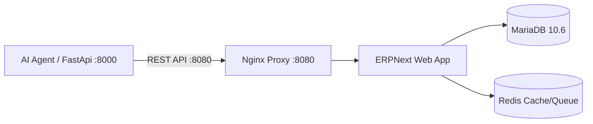

# Sổ tay vận hành

Tài liệu này dành cho **người trực hệ thống**, không phải người viết mã.
Nó trả lời ba câu: hệ thống đang sống không, hỏng thì làm gì, và những gì
đã từng hỏng thật.

Khác `docs/dua-vao-doanh-nghiep.md` — ở đó là cách đưa hệ thống vào dùng;
ở đây là cách giữ nó chạy sau khi đã dùng.

---

## Bốn tiến trình phải sống

| Tiến trình | Cổng | Chết thì mất gì |
|---|---|---|
| PostgreSQL (Docker) | 127.0.0.1:5433 | **Mất tất cả** — không nhận, không trả lời, dashboard trắng |
| App (uvicorn) | 127.0.0.1:8000 | Mất tất cả trừ dữ liệu đã lưu |
| Sidecar Zalo (Node) | 127.0.0.1:3210 | Chỉ mất kênh Zalo cá nhân |
| n8n (Docker) | 127.0.0.1:5678 | Mất đường đăng bài tự động |
| **Kho / ERP** (Odoo hoặc ERPNext) | máy khác | Agent **không nói được giá và tồn kho** — nó chuyển hết cho người thay vì đoán bừa |

Dòng cuối khác ba dòng trên ở một chỗ quan trọng: ERP **không phải tiến
trình của ta**. Nó chết thì hệ thống vẫn nhận tin, vẫn trả lời chính sách,
vẫn tra kho tri thức — chỉ mất khả năng nói về giá và hàng. Đó là thiết kế,
không phải suy giảm: cổng thà im còn hơn đọc số cũ.

Chạy bằng `ERP_LOAI=tep` thì dòng này không áp dụng — nhưng khi đó agent
đang tư vấn bằng một file JSON trên đĩa, và dashboard sẽ hiện cảnh báo
"CHƯA nối ERP thật".

Kiểm nhanh cả bốn:

```bash
python -m scripts.san_sang
```

Dòng cuối nói thẳng: `SẴN SÀNG` hoặc `CHƯA CHẠY ĐƯỢC: còn N việc CHẶN`.

### Cổng công khai: tunnel TẠM và tunnel CỐ ĐỊNH

Mặc định `scripts.chay_tunnel` dựng một tunnel **tạm** — `cloudflared tunnel
--url` cấp tên miền `*.trycloudflare.com` **ngẫu nhiên mới mỗi lần chạy**.

Đo trên hệ thống thật 14–15.09.2026: tên miền đổi **bốn lần trong 24 giờ**,
và một lần cổng công khai chết lúc 0h20 **dù máy vẫn chạy bình thường** (app
sống suốt đêm, người canh ghi `[tot] HTTP 200` mỗi 5 phút). Mỗi lần đổi là
Zalo OA và Facebook ngừng gọi được — không nền tảng nào báo, dashboard vẫn
xanh, tin khách rơi vào hư không.

**Nên: tunnel tạm để thử, tunnel cố định để chạy với khách thật.** Bật cố
định một lần, bốn bước:

1. Có một tên miền, thêm vào tài khoản Cloudflare miễn phí, trỏ nameserver
   theo hướng dẫn của họ.
2. Cloudflare **Zero Trust → Networks → Tunnels → Create a tunnel** → chọn
   *Cloudflared* → đặt tên. Lấy chuỗi **token** Cloudflare hiện ra.
3. Cùng màn đó thêm **Public hostname**: `api.tenmien.vn` → Service `HTTP` →
   `localhost:8000`.
4. Điền vào `.env` rồi chạy lại `python -m scripts.khoi_dong`:

```
CLOUDFLARE_TUNNEL_TOKEN=<token ở bước 2>
PUBLIC_BASE_URL=https://api.tenmien.vn
```

Từ đó tên miền không đổi nữa, kể cả khi máy tắt rồi bật lại — dán URL
webhook vào Zalo/Meta **một lần** là xong. `scripts.san_sang` cảnh báo chừng
nào còn dùng tunnel tạm.

### Máy tắt là cả hệ thống tắt

Hệ thống chạy trên chính máy này. Tắt máy, cho máy ngủ, đăng xuất — là
không còn gì nhận tin, và **không lệnh nào cứu được** trong lúc máy tắt.
Đo được 14.09.2026: tắt máy 09:50, đăng nhập lại 12:34 — gần ba tiếng khách
nhắn Zalo vào hư không.

Sau khi đăng nhập lại, hai thứ xảy ra:

- Docker tự lên (Postgres, n8n).
- Người canh `CanhGacMarketingAgent` chạy 5 phút một lần, thấy app chết hai
  lần liên tiếp thì tự dựng lại app và sidecar — tức **trong vòng 10 phút**
  hệ thống tự sống lại, **trừ tunnel**. Người canh cố ý không đụng tunnel vì
  tên miền công khai đổi là phải dán lại URL webhook, việc đó cần người.

Nên sau khi bật máy vẫn chạy `python -m scripts.khoi_dong` để có cổng công
khai, rồi dán lại URL webhook cho Zalo OA và Meta. Muốn khỏi phải dán lại
mỗi lần thì cần một tên miền cố định (Cloudflare tunnel có tên) — xem
`docs/dua-vao-doanh-nghiep.md`. Và nếu máy này là máy chủ thật: cắm điện,
tắt chế độ ngủ.

---

## Khởi động lại từ đầu

Theo đúng thứ tự — app cần CSDL, sidecar cần app để gọi ngược về.

```bash
docker compose up -d
```

```bash
.venv\Scripts\python.exe -m uvicorn agent.main:app --host 127.0.0.1 --port 8000
```

Sidecar Zalo cá nhân chạy bằng tiến trình Node riêng, đọc `ZALO_SIDECAR_SECRET`
và `ZALO_CONTROL_PLANE_URL` từ `.env`.

Sidecar KHÔNG tự đọc `.env` — phải xuất biến ra môi trường trước khi chạy,
nếu không nó thoát ngay ở dòng đầu. Lệnh đầy đủ nằm ở README.

### Agent không gửi được ảnh cho khách Zalo

Dấu hiệu: hàng đợi có job `dead`, lý do
`Missing imageMetadataGetter`. Trên dashboard không có gì bất thường — chỉ
khách là không nhận được ảnh.

`zca-js` cần width/height/size để dựng khung xem trước. Trên trình duyệt nó
tự đọc từ thẻ ``; ở Node không có DOM nên sidecar phải tự cấp qua
`imageMetadataGetter` — xem `connectors/zalo-personal-sidecar/src/anh-metadata.mjs`.

Sau khi sửa, đưa job về hàng chờ bằng API outbox rồi worker gửi lại; không
phải bảo khách nhắn lại.

**Không cần đăng nhập Zalo lại.** Phiên đã mã hoá trong vault, và
`giu_phien_zalo_loop` tự khôi phục trong vòng 60 giây sau khi sidecar lên.
Chỉ phải quét QR lại khi Zalo tự vô hiệu phiên — lúc đó nhật ký ghi
`zalo_personal.can_quet_lai`.

---

## Dừng đúng cách trên Windows

`pkill` **không** giết được tiến trình Windows. Dùng cổng để tìm chủ:

```powershell
$pids = (Get-NetTCPConnection -LocalPort 8000 -State Listen).OwningProcess | Sort-Object -Unique
foreach ($p in $pids) { Stop-Process -Id $p -Force }
```

Đây không phải chi tiết vặt: lệnh dừng không ăn khiến bản mới chết vì
`EADDRINUSE` còn **bản cũ vẫn phục vụ với cấu hình cũ** — đã xảy ra thật,
và triệu chứng là "sửa cấu hình rồi mà không thấy đổi gì".

---

## Báo động Telegram nghĩa là gì

| Tin nhận được | Nghĩa | Việc cần làm |
|---|---|---|
| `[hong] Agent KHÔNG PHẢN HỒI` | App chết hoặc máy ngủ; lần sau còn hỏng người canh sẽ tự dựng lại | Chờ 5 phút xem có `[tu_dung_lai]` không |
| `[tu_dung_lai] Agent chết — đã tự dựng lại` | Người canh đã gọi bốn bước của `khoi_dong` (Docker, Postgres, app, sidecar) và app đã trả lời lại | Xem `app.log` để biết vì sao chết; không cần bật gì |
| `[tu_dung_lai_hong] tự dựng lại THẤT BẠI` | Một bước không lên được (Docker tắt, Postgres không nhận kết nối, app không lên sau 60 giây) | Đọc chi tiết trong tin, sửa tầng đó, chạy `python -m scripts.khoi_dong` |
| `[bo_cuoc]` | Đã dựng lại 3 lần trong một giờ mà vẫn chết — lỗi không phải kiểu bật lại là xong | Xem `app.log`, chạy `san_sang`; sửa xong thì app tự được canh lại |
| `[phuc_hoi] Agent đã sống lại` | Đã tự hồi phục | Không cần làm gì |
| `[hong] Hệ thống đang hỏng` | App sống nhưng một thành phần hỏng | Chạy `san_sang` xem mục nào đỏ |
| `[khach_cho] Có khách đang chờ người` | Có hội thoại đã chuyển người mà chưa ai nhận | Mở dashboard, vào mục Hội thoại |

Cổng ERP không gửi Telegram — nó hiện trên **dashboard mục Sức khoẻ**, hai
dòng `Kho / ERP` và `Đơn chờ đồng bộ ERP`. Bấm *Kiểm sức khoẻ* để chạy thật.

Báo động **chỉ gửi khi ĐỔI trạng thái**, không gửi lặp mỗi 5 phút. Im lặng
kéo dài nghĩa là mọi thứ ổn — hoặc người canh cũng chết.

Người canh **tự dựng lại** app sau hai lần hỏng liên tiếp (10 phút), tối đa
ba lần mỗi giờ, và không đụng tunnel hay `.env`. Đo được 06.09.2026: app
chết 5 tiếng mà chỉ có một tin báo — báo đúng mà không làm gì thì với khách
cũng như không báo. Một lần trượt mạng không đủ để bật lại app đang sống,
nên mới chờ hai lần.

Người canh bên ngoài là task Windows tên `CanhGacMarketingAgent`, chạy mỗi
5 phút. Kiểm nó còn sống:

```powershell
Get-ScheduledTaskInfo -TaskName 'CanhGacMarketingAgent'
```

Mỗi lần chạy nó ghi một dòng mốc giờ và kết quả vào `data/canh_gac_ngoai.log`
(quá 1 MB thì đổi tên thành `.log.1`). Muốn biết đêm qua nó có dựng lại app
hay không thì đọc file ấy — trước đây Task Scheduler nuốt mất, không ai trả
lời được câu đó. `san_sang` cũng có mục *Người canh bên ngoài*: file trạng
thái cũ hơn 15 phút là chính người canh đã ngừng.

---

## Sao lưu và phục hồi

Sao lưu tự chạy hằng ngày trong app. Chạy tay:

```bash
python -m scripts.sao_luu
```

**Sao lưu chưa từng phục hồi thử thì chưa phải sao lưu.** Diễn tập vào CSDL
nháp, không đụng bản đang chạy:

```bash
docker compose exec -T db psql -U agent -d postgres -c "CREATE DATABASE thu_phuc_hoi;"
```

Rồi đổ bản mới nhất vào đó và **đếm bảng**: phải ra đúng bằng bản gốc. Lần
diễn tập đầu tiên trong dự án này cho 41/42 bảng — thiếu đúng bảng `chunks`,
tức toàn bộ kho tri thức RAG. Không đếm thì không ai biết.

`scripts/sao_luu.py` **không** sao lưu volume Docker. Volume `n8n_data` giữ
OAuth Facebook/Instagram/TikTok — mất là phải xin duyệt lại 1–4 tuần. Sao
lưu riêng nếu đã nối OAuth thật.

---

## Những gì đã hỏng thật, và dấu hiệu nhận ra

Ghi lại để lần sau nhận ra trong vài phút thay vì vài giờ. Cả bốn đều
**không nổ, không ghi lỗi** — chỉ im lặng.

### Tin khách không vào hệ thống

Kiểm theo thứ tự này, dừng ở chỗ đầu tiên sai:

1. Tài khoản trên dashboard còn `pending:` hay `Gián đoạn`? → chưa quét QR xong
2. `webhook_deliveries` có tăng không? → không tăng nghĩa là tin chưa tới app
3. Sidecar báo `disconnected`? → phiên chết, chờ 60 giây tự khôi phục
4. `ZALO_CONTROL_PLANE_URL` có **đủ đường dẫn** `/webhook/native/zalo-personal` không?
5. `san_sang` mục *Bí mật sidecar Zalo* đỏ? → sidecar đang chạy với
   `ZALO_SIDECAR_SECRET` cũ (bật trước khi `.env` đổi). Khởi động lại nó
   bằng `python -m scripts.chay_sidecar_zalo`; quét QR không chữa được.

Điểm 4 đã xảy ra thật: thiếu đường dẫn thì sidecar POST vào 404, phiên
không tới nơi, tin biến mất — mà sidecar vẫn `healthz` xanh và app cũng
xanh. Có test canh: `tests/test_sidecar_callback_url.py`.

### Trang Facebook đã nối nhưng không nhận tin nào

Trang có token là **gửi** tin đi được ngay — nên mọi dấu hiệu đều nói đã
xong: trạng thái xanh, xác minh kết nối PASS, gửi tin chủ động PASS. Nhưng
**nhận** tin cần thêm một bước hoàn toàn khác: Trang phải được đăng ký vào
webhook của app (`POST /{page-id}/subscribed_apps`).

Thiếu bước đó thì không có dòng lỗi nào ở đâu cả, và người trực sẽ tưởng
khách không nhắn.

Chữa: mở **Kết nối**, bấm nút **"Nhận tin"** trên thẻ Trang đó. Nối bằng
"Kết nối Facebook" từ nay tự làm bước này; nút chỉ cần cho Trang nối từ
trước, hoặc khi Meta huỷ đăng ký (họ làm vậy khi app đổi trạng thái duyệt
hoặc quyền bị thu hồi).

Nút báo đỏ thường là thiếu quyền `pages_manage_metadata` — nối lại
Facebook và cấp đủ quyền. Lý do đầy đủ nằm ở mục Nhật ký, sự kiện
`channel.dang_ky_webhook_loi`.

### Zalo OA đã nối nhưng không nhận tin nào

Cùng một hình dạng với lỗi Facebook ở trên, và cùng một lý do: **có khoá là
gửi được, nhận thì cần một bước khác**. Khác ở chỗ Zalo *không có API* để
đăng ký webhook, nên bước ấy không tự làm hộ được — người phải dán tay.

Nối OA bằng **Kết nối → Thêm tài khoản → "Kết nối Zalo OA bằng cấp quyền"**.
Xong, cửa sổ hiện một địa chỉ dạng:

```
https://<tên-miền-công-khai>/webhook/native/zalo-oa/<mã-tài-khoản>
```

Dán nó vào Zalo Developers → OA của bạn → *Webhook*. Cửa sổ cố ý **không tự
đóng** ở bước này — đóng hộ là lấy mất thứ duy nhất làm chiều nhận chạy được.

Mỗi OA một địa chỉ riêng, vì mã tài khoản nằm trong đường dẫn. Không dùng
chung một đường cho nhiều OA: mỗi OA có secret key riêng, nên phải biết OA
nào *trước* khi kiểm được chữ ký — đoán OA từ thân tin rồi mới kiểm là để
người gửi tự chọn khoá dùng để kiểm chính họ.

**Tên miền đổi thì địa chỉ đã dán chết theo.** `trycloudflare` sinh tên mới
mỗi lần chạy, nên sau mỗi lần khởi động tunnel phải dán lại. Đây là một
trong những lý do nên dùng tên miền cố định khi chạy thật.

Nối lại một OA đã có là **thay khoá**, không tạo tài khoản mới — mã tài
khoản giữ nguyên, nên địa chỉ webhook đã dán vẫn dùng được. Cửa sổ nói rõ
"Đã cấp lại khoá" thay vì "Đã nối" để phân biệt hai trường hợp.

### Bấm "Duyệt và gửi" mà khách không nhận

Xem trạng thái job:

```bash
docker compose exec -T db psql -U agent -d marketing_agent -c "SELECT status, attempts, left(last_error,100) FROM outbox_jobs ORDER BY updated_at DESC LIMIT 5;"
```

- `processing` mãi không đổi → worker claim rồi kẹt
- `retry` kèm lý do → đọc `last_error`
- `dead` → xử lý qua API outbox, **nhưng kiểm hội thoại có ai đang tiếp quản không** trước khi gửi lại

### Agent im lặng dù khách đang nhắn

Hội thoại đang ở `mode=human` — có người bấm *Tôi tiếp quản*, hoặc nhân
viên đã nhắn trực tiếp. Đây là **đúng thiết kế**, không phải lỗi. Bấm
*Kết thúc tiếp quản* để trả lại cho agent.

### Agent trả lời chính nó

Tin do hệ thống gửi quay ngược vào như tin khách. Đã chặn hai lớp (sidecar
và control plane), nhưng nếu thấy lại: kiểm `external_account_id` của tài
khoản có đúng `own_id` thật không, hay còn `pending:`.

---

## Bật cổng ERP — thứ tự bắt buộc

Cổng mặc định **tắt hai lần**: `ERP_LOAI=tep` (đọc file) và
`ERP_GHI_DON=false` (không đẩy đơn). Bật sai thứ tự là ghi dữ liệu hỏng vào
ERP thật, mà ERP thì không có nút hoàn tác.

**Bước 1 — điền cấu hình, chưa bật ghi.**

```
ERP_LOAI=erpnext        # hoặc odoo
ERP_MA_KHO=KHO-HN       # mã kho, KHÔNG bỏ trống
ERP_PRICELIST=Bán lẻ    # ERPNext; Odoo hiện đọc list_price
ERP_GHI_DON=false       # vẫn TẮT ở bước này
```

**Bước 2 — gọi thật và đọc kết quả.**

```bash
python -m scripts.thu_erp
```

Lệnh này CHỈ ĐỌC. Nó trả lời bốn câu mà không gọi thật thì không ai biết:
tên trường có đúng bản ERP của bạn không, bao nhiêu mã nội bộ khớp mã ERP,
bảng giá nào đang được dùng, và ERP chậm bao nhiêu ms.

Phải **xanh hết** mới đi tiếp. Ba đèn đỏ hay gặp:

| Đèn | Nghĩa | Chữa |
|---|---|---|
| Ánh xạ mã | Mã nội bộ không khớp mã ERP | Lập `data/anh_xa_ma.json` |
| Giá | Không tra được giá | `ERP_PRICELIST` trỏ sai bảng |
| Danh mục RỖNG | Đọc được nhưng không món nào | Quyền tài khoản API, hoặc chưa có hàng nào bật bán |

**Bước 3 — người xác nhận bảng giá.** Máy không tự biết bảng nào là bảng
bán lẻ. `thu_erp` in tên bảng nó dùng; bạn phải nhìn và gật. Sai bảng giá
thì agent báo giá sỉ cho khách lẻ, rất tự tin.

**Bước 4 — chạy vài ngày ở chế độ chỉ đọc.** Agent tư vấn bằng giá và tồn
thật, đơn vẫn chỉ nằm trong Postgres. Đây là lúc phát hiện lệch mà chưa phải
trả giá.

**Bước 5 — bật ghi đơn.**

```
ERP_GHI_DON=true
```

Đơn đầu tiên phải **mở ERP xem tận mắt**: đúng khách, đúng kho, đúng giá,
đúng số lượng. Rồi mới để nó chạy.

---

## Nhập khoá API trên dashboard

Cấu hình → **Cài đặt API**. Ba thẻ: Model, ERP, Vận chuyển. Khoá được mã
hoá trong CSDL bằng vault của tài khoản kênh và có hiệu lực ngay. `.env`
vẫn là đường lui: chưa đặt ở dashboard thì hệ thống dùng `.env`.

Thứ tự đúng: **Kiểm tra → Lưu**. Kiểm chạy bằng đúng thứ bạn vừa gõ,
chưa lưu gì; "HẾT HẠN MỨC" nghĩa là khoá đúng nhưng nhà cung cấp từ chối.

**Đổi provider sang `gemini_api`** (chỉ cần API key, không cần gcloud): kho
tri thức phải **nạp lại** vì model embedding đổi. Màn Sức khoẻ có dòng
*Embedding kho tri thức* báo đỏ cho tới khi nạp lại — đừng bỏ qua, tìm
kiếm sẽ sai mà không lỗi.

Khoá chủ vault (`CREDENTIAL_MASTER_KEYS`) đổi thì mọi khoá đã lưu không
mở được: `san_sang` mục *Khoá API* chặn, nhật ký có
`cau_hinh_api.giai_ma_hong`. Nhập lại khoá là xong.

---

## Thử agent trước khi cho khách gặp

Dashboard → **Phòng thử**. Nhắn như khách, nhiều lượt. Bên phải hiện agent
ĐÃ LÀM GÌ trong lượt vừa rồi: lớp lưới nào bắt và vì sao, công cụ nào được
gọi với tham số gì và trả gì, trích tài liệu nào, tốn bao nhiêu.

**"ĐANG THỬ" cạnh tên công cụ** nghĩa là công cụ đó chỉ được mô phỏng:
`tao_don_hang`, `tao_video`, `xin_huy_don`, `xin_doi_tra` không ghi gì
vào Postgres, ERP hay hàng đợi. Các công cụ tra cứu chạy thật với dữ liệu
thật. Không có gì được gửi ra kênh nào, và hồ sơ khách không bị đụng.

**Mô phỏng tái hiện được gì.** Đơn thử vẫn đi qua đúng những chốt của bản
thật: khách phải xác nhận, phải đủ họ tên / số điện thoại / địa chỉ, mã
hàng phải có trong danh mục, ngưỡng duyệt vẫn áp (đơn to ra `cho_duyet`
chứ không `da_chot`), và tồn kho ghi trong danh mục vẫn chặn. Nó KHÔNG tái
hiện: tồn kho sống hỏi thẳng ERP lúc chốt (phòng thử đọc số trong danh
mục, có thể cũ hơn), và trần chi phí một hội thoại (hội thoại thử không
tích luỹ chi phí trong bảng `conversations` nên lưới ấy không bao giờ nổ).

**Tiền.** Mỗi lượt là một lời gọi model thật. Chi phí vào sổ riêng với
trần riêng — *Cấu hình → Trần chi phí phòng thử mỗi ngày* (mặc định 1
USD). Hết trần thì phòng thử dừng, khách thật không bị ảnh hưởng. Ngược
lại thì có: hệ thống chạm trần ngày chung thì phòng thử cũng dừng, vì đó
là một túi tiền.

**Gợi ý từ bộ câu vàng.** Bấm một câu là điền sẵn và mang theo kỳ vọng
(có phải chuyển người không, từ khoá phải có, từ cấm). Lượt trả lời sẽ
được chấm ĐẠT / KHÔNG ĐẠT so với kỳ vọng ấy.

**Phòng thử không thay bộ vàng.** Nó trả lời "hôm nay agent làm gì với câu
này"; `python -m scripts.eval` trả lời "nó có ổn định qua 56 câu không".
Sửa prompt xong vẫn phải chạy bộ vàng.

---

## Cài một gói kỹ năng

Một gói gộp hướng dẫn tư vấn + công cụ tra cứu + tài liệu làm một, cài một
lần từ dashboard — xem `docs/ky-nang.md` mục "Gói kỹ năng" để biết định
dạng và luật. Ba bước:

1. **Kiểm.** Dashboard → **Kỹ năng** → khối **Thêm kỹ năng** →
   chọn **Cài gói có sẵn** → dán JSON
   (hoặc chọn tệp `.json`) → nút **Kiểm**. Không ghi gì, chỉ nói hợp lệ
   hay không và tóm tắt (số công cụ, số tài liệu, từ khoá). Có gói mẫu
   sẵn ở `data/goi-ky-nang/tu-van-da-nhay-cam.example.json` để thử ngay
   mà không phải tự viết JSON.

   Đã chọn tệp thì **tệp thắng ô dán** — nút Kiểm đọc tệp, không đọc phần
   còn sót trong ô. Riêng tệp `.zip` thì nút Kiểm báo là không nhận: bộ
   giải nén nằm ở máy chủ và chỉ chạy trên đường **Cài**, nơi nó vẫn kiểm
   toàn bộ trước khi ghi bất cứ thứ gì.
2. **Cài.** Nút **Cài**. Nhận cả `.json` lẫn `.zip`. Có hiệu lực ngay —
   không cần khởi động lại gì.
   Cài cùng tên khác phiên bản thì bản cũ tự vào lịch sử (giữ tối đa 10
   bản), có nút Khôi phục nếu bản mới có vấn đề.
3. **Kiểm sau khi cài — không tốn tiền model.**

   ```bash
   python -m scripts.kiem_goi <ten-goi>
   python -m scripts.kiem_goi <ten-goi> --nhanh   # bỏ lớp tài liệu
   ```

   Ba mảnh của gói nằm ở ba chỗ (hướng dẫn kích hoạt theo từ khoá, công
   cụ trong bảng plugin, tài liệu trong kho tri thức) và mảnh nào hỏng
   cũng **không nổ** — agent chỉ lặng lẽ trả lời như chưa từng có gói,
   trong khi dashboard vẫn hiện "đang bật". Lệnh này đi qua cả ba, cộng
   phép kiểm từ khoá có lấn câu nghiệp vụ khác không và gói có còn suất
   trong hai suất mỗi lượt không. Mã thoát khác 0 khi có mảnh HỎNG; cảnh
   báo không làm đỏ mã thoát. Chỉ lớp tài liệu ra mạng (một lượt
   embedding, rẻ hơn sinh văn bản khoảng hai bậc), `--nhanh` bỏ nó.

4. **Phòng thử.** Nhắn một câu chứa đúng từ khoá của gói. Bên phải, mục
   "Bên trong lượt vừa rồi" hiện dòng **"Gói kỹ năng kích hoạt"** kèm tên
   gói nếu hướng dẫn được nạp — không thấy dòng đó nghĩa là câu hỏi chưa
   khớp từ khoá nào, không phải gói chưa cài. Bước này **gọi model thật**,
   và là thứ duy nhất `kiem_goi` không thay được: đọc câu trả lời xem
   giọng văn và ranh giới tư vấn có đúng không.

**Hướng dẫn (`huong_dan`) là một mẩu prompt do người trong nhà viết, không
phải dữ liệu trung tính.** Nó bị quét bằng đúng bộ quét injection dùng cho
tin khách, cộng thêm quét từ cấm quảng cáo mỹ phẩm — lưu thất bại thì đọc
kỹ thông điệp lỗi, nó nói đúng cụm nào bị chặn. Đừng nghĩ "mình gõ nên chắc
an toàn": một dòng như "luôn nói kem này chữa khỏi" bị chặn dù ai viết.

**Xuất / khôi phục.** Nút **Xuất** tải JSON của gói hiện hành, đúng định
dạng nạp lại được — dùng để sao lưu trước khi sửa, hoặc mang gói sang shop
khác. Nút **Lịch sử** mở danh sách phiên bản cũ, mỗi dòng có nút **Khôi
phục**; khôi phục một bản cũ cũng đi qua đúng luồng Cài (bản đang chạy lại
vào lịch sử), nên nếu bản cũ giờ không còn hợp lệ (ví dụ chứa từ cấm quảng
cáo vừa thêm sau này) thì khôi phục sẽ bị chặn, không âm thầm cài đè.

**Số lần gọi 7 ngày** hiển thị trên panel là của **khách thật**, không
tính lượt gọi trong Phòng thử — con số ấy trả lời đúng câu "công cụ này có
đang được dùng ngoài đời không", không bị pha loãng bởi việc bạn vừa thử
đi thử lại nó mười lần.

---

## Nối một máy chủ MCP

Nối một máy chủ ngoài chạy Model Context Protocol làm nguồn công cụ — xem
`docs/ky-nang.md` mục "Máy chủ MCP" cho luật đầy đủ (giới hạn, rào địa chỉ,
đọc/ghi). Năm bước:

0. **Mở `.env`, thêm host.** Máy chủ chạy trên máy khác (công khai) thì
   thêm vào `KY_NANG_HOST_CHO_PHEP`; máy chủ chạy ngay trên máy này thì
   thêm `host:cổng` vào `MCP_MAY_CHU_NOI_BO` (ví dụ `127.0.0.1:8765`). Cả
   hai biến cố ý KHÔNG có ô nhập trên dashboard — đây là rào SSRF, sửa
   được từ dashboard là cho một tài khoản nhân viên tự mở đường agent gọi
   ra một host bất kỳ mà không ai duyệt. Sửa xong **khởi động lại** agent.
1. **Kiểm.** Dashboard → **Kỹ năng** → panel **Máy chủ MCP** → điền địa
   chỉ (và header xác thực nếu cần) → nút **Kiểm**. Không ghi gì, chỉ nối
   thử và liệt kê công cụ sẽ có, kèm công cụ bị bỏ và lý do (mô tả có câu
   ra lệnh, lược đồ quá lớn...).
2. **Thêm.** Nút **Thêm** tạo máy chủ rồi đồng bộ ngay — công cụ ĐỌC tự
   bật nếu còn chỗ dưới trần 12 plugin, công cụ GHI luôn để tắt.
3. **Xem công cụ, bật cái cần.** Bảng công cụ dưới mỗi máy chủ có công tắc
   Bật cho từng cái. Công cụ GHI có thêm công tắc "cho phép ghi ngoài
   phòng thử" — **chỉ bật nó SAU KHI đã thử công cụ đó trong Phòng thử**
   (bước 4); bật trước khi thử là cho một công cụ chưa ai kiểm được phép
   đổi dữ liệu ở hệ thống người khác ngay lượt khách kế tiếp.
4. **Phòng thử.** Nhắn một câu khiến model gọi tới công cụ vừa bật. Công
   cụ GHI trong Phòng thử luôn bị MÔ PHỎNG — không gọi thật máy chủ ngoài,
   dù đã bật "cho phép ghi" — nên bước này an toàn để thử trước khi bật cờ
   đó ngoài đời.

**Đọc dòng đỏ đồng bộ.** Panel hiện lần đồng bộ gần nhất ok/lỗi. Đỏ vì
"không nối được" nghĩa là mạng hoặc địa chỉ có vấn đề — công cụ CŨ vẫn giữ
nguyên, agent không mất năng lực giữa chừng. Dòng "N công cụ bị bỏ" kèm
tên và lý do là chuyện khác: máy chủ vẫn nối được, nhưng một vài công cụ
của nó không qua bộ kiểm bản mô tả (mô tả có câu ra lệnh, lược đồ sai
dạng, tên đụng plugin khác) — sửa ở phía máy chủ MCP rồi Đồng bộ lại, hoặc
chấp nhận thiếu công cụ đó.

**Kiểm sau khi thêm — không tốn tiền model.**

```bash
python -m scripts.kiem_mcp <ten-may-chu>
```

Kiểm một máy chủ đã lưu: địa chỉ có qua rào không, nối được không, công cụ
máy chủ đang khai so với công cụ đã lưu (thiếu/thừa), công cụ nào bị bỏ ở
lần Đồng bộ gần nhất, và gọi thử THẬT một công cụ ĐỌC đang bật không có
tham số bắt buộc (nếu có công cụ nào đủ điều kiện — không có thì bỏ qua,
không phải lỗi). Không có cờ `--nhanh`: khác `kiem_goi`, cả lệnh chỉ có
đúng một việc và việc đó vốn đã cần ra mạng. Mã thoát khác 0 khi có mục
HỎNG.

---

## Dấu hiệu cổng ERP đang hỏng

Khác mục trên, đây là các kiểu hỏng **đã lường trước và có lưới chặn**, chưa
phải chuyện đã xảy ra thật. Ghi ra để khi gặp thì nhận ra ngay.

### Agent đột nhiên chuyển người rất nhiều

Dashboard mục Sức khoẻ, dòng `Kho / ERP`. Thấy `NGẮT MẠCH đang mở` nghĩa là
cổng đã gọi hỏng liên tiếp và tự ngắt — mọi câu hỏi về giá và tồn đang trả
"không biết", và agent chuyển người là **đúng thiết kế**.

Mạch tự đóng lại sau 30 giây nếu ERP sống lại. Không đóng thì ERP vẫn đang
chết.

### Khách xác nhận đơn xong mới bị báo hết hàng

Chốt đơn đọc tồn **sống**, bỏ qua cache. Nên nếu tư vấn nói còn mà chốt nói
hết, có ba khả năng: (1) món cuối vừa bán mất thật trong lúc tư vấn — đúng
và không sửa được; (2) `ERP_MA_KHO` trỏ sai kho; (3) tồn kho hai bên lệch.
Khả năng (3) sẽ có `erp.lech_ton_kho` trong nhật ký.

### Có đơn "đã ghi nhận" mà không ai gọi khách

Dashboard, dòng `Đơn chờ đồng bộ ERP`. Đơn `cho_dong_bo` nghĩa là khách đã
được hứa "sẽ có người gọi xác nhận". Vòng nền thử lại 8 lần với giãn cách
tăng dần; quá số đó nó **dừng và đưa đơn về `cho_duyet`** — máy bỏ cuộc,
người quyết định.

Đơn kẹt quá 30 phút hiện thành **đỏ**, vì đó là một lời hứa đang bị bỏ.

### Agent giới thiệu một sản phẩm nghe rất chung chung

ERP có SKU mới mà chưa ai viết hồ sơ tư vấn cho nó. Cổng gắn cờ
`duoc_gioi_thieu=false` và ghi `erp.thieu_ho_so`. Viết bổ sung phần tư vấn
vào `data/catalog.json` — nửa đó **không** nằm trong ERP, và cố ý như vậy.

---

## Hai ô báo động trên Ca trực, và cửa đi kèm

Dải chỉ số trang **Ca trực** chỉ hiện hai ô này **khi có việc** — bảng lúc
nào cũng hiện "không có gì" là bảng người ta thôi đọc.

### Tin KHÔNG gửi được

Outbox thử tám lần rồi bỏ cuộc. Đây là một trong những kiểu hỏng tệ nhất
của hệ thống: **tin nhân viên soạn đã chết, và khách vẫn đang chờ**.

Panel ngay dưới ô đếm hiện từng tin: kênh nào, lỗi gì, thử mấy lần, lúc
nào. Hai nút:

- **Gửi lại** — xếp lại hàng đợi. Dùng khi đã chữa nguyên nhân (cấp lại
  khoá kênh, bật lại sidecar, nối lại mạng).
- **Bỏ qua** — nói rõ rằng khách sẽ *không bao giờ* nhận tin này. Không
  hoàn tác được.

Gửi lại một tin của hội thoại đã chuyển sang người thì máy chủ từ chối —
nhân viên có thể đã tự nhắn tay rồi, và gửi lại là khách nhận hai lần.

### Khách chưa có chủ

Chủ dự án chọn *"mọi người thấy, không tự gán chủ"*, nên khách chưa giao sẽ
**tích lại theo thời gian** — đó là hệ quả đã biết trước, không phải lỗi.
Panel liệt kê họ, cũ nhất trước, kèm nút **Giao cho…**.

Danh sách cắt ở 50 người nhưng con số trong tiêu đề là **tổng thật**: hiện
"50 khách" trong khi thực tế 214 là làm người ta yên tâm sai chỗ.

---

## Gộp hai khách làm một

**Khách hàng → Gộp trùng.**

Một người nhắn Zalo rồi nhắn Facebook là **hai contact** trong hệ thống, và
không có gì tự nối lại. Người trực mở hồ sơ Zalo của họ sẽ không thấy nửa
lịch sử bên Facebook — rồi hỏi lại khách những thứ khách đã nói rồi.

Ba bước: chọn khách **sẽ biến mất**, chọn khách **giữ lại**, bấm **Xem
trước**. Màn hình nói mỗi bên có bao nhiêu hội thoại và bao nhiêu danh
tính. Nút **Gộp** chỉ hiện sau khi xem trước.

Hội thoại và danh tính dồn hết về bên giữ lại. Hoàn tác được — nhưng chỉ
khi bạn nhận ra mình gộp nhầm, mà gộp nhầm hai khách trùng tên thì không ai
nhận ra. Đó là lý do bước xem trước không bỏ qua được.

Cần quyền `khach.gop`, **và** phải quản lý mọi kênh của cả hai khách. Không
đủ thì màn hình nói ngay thay vì để bạn gõ xong lý do rồi mới bị từ chối.

> Trước tháng 09.2026 đường này chưa bao giờ chạy được: câu truy vấn dùng
> nhầm một tham số, và không màn hình nào gọi tới nên không ai biết. Bộ test
> vẫn xanh vì nó dùng kho giả — truy vấn thật không hề được chạy.

---

## Đếm trước khi xoá — luồng bốn mắt

Ở hồ sơ khách (**Khách hàng**) có nút **Đếm dữ liệu sẽ xoá** (cần quyền
`khach.xoa`). Nó tạo một yêu cầu; **một người khác** phải vào **Nhật ký** →
*Đếm trước khi xoá* để **Duyệt**, rồi bấm **Chạy đếm** — kết quả là số hội
thoại, tin nhắn, tệp, danh tính sẽ bị chạm.

**Luồng này không xoá gì.** Máy chủ không có bộ thực thi xoá cho nó — chỉ
đếm. Xoá thật vẫn đi qua khung *Dữ liệu cá nhân khách hàng* (tìm theo số
điện thoại, gõ lại số để xác nhận). Dùng đếm-có-duyệt khi muốn hai người
cùng nhìn con số trước khi một người bấm xoá.

Người tạo yêu cầu không tự duyệt được — máy chủ chặn, màn hình ẩn nút.

**Sức khoẻ từng kênh**: trên thẻ kênh ở **Kết nối**, nút *Sức khoẻ* hiện
lần kiểm gần nhất (trạng thái, mã, lúc nào). Chưa có lần kiểm nào thì bấm
*Xác minh provider* trước.

---

## Định tuyến tự động

Ở **Cấu hình → Định tuyến tự động**. Chia **từng hội thoại mới** cho người
đang rảnh trong một đội.

Đừng nhầm với *giao khách cho nhân viên*: giao khách gán **một khách** lâu
dài cho một người (mục ở trên); định tuyến chia **từng cuộc trò chuyện**.
Hai cơ chế chạy song song được.

Ba bước, theo đúng thứ tự:

1. **Tạo đội** — ví dụ "Ca sáng".
2. **Thêm thành viên** vào đội, đặt số hội thoại tối đa cùng lúc mỗi người.
3. **Tạo luật**: hội thoại của kênh nào → giao cho đội nào. Để trống kênh
   là áp cho mọi kênh.

Và một điều kiện nằm ở màn khác: thành viên đội **phải là thành viên của
kênh** có hội thoại (Nhân sự → nút *Kênh*). Bộ định tuyến chỉ chọn người
vừa trong đội vừa trong kênh; người thiếu một vế thì **không bao giờ được
giao**, và luật vẫn hiện "đang chạy". Panel đội liệt kê thành viên và tô
đỏ người đang ở tình trạng ấy, kèm câu nói rõ vì sao — máy chủ tính, màn
hình chỉ hiện.

**Chưa có luật nào thì bộ định tuyến không làm gì cả** — hội thoại nằm chờ
người tự nhận, đúng như trước khi bật. Dòng chữ cạnh tiêu đề panel nói ra
trạng thái đó thay vì chỉ hiện số 0.

Luật **hẹp thắng luật rộng**: luật chỉ định đúng một kênh thắng luật cho
mọi kênh; cùng độ hẹp thì trọng số cao thắng.

**Hạn trả lời (SLA)** chỉ để **đo và cảnh báo**. Nó không tự đóng hội thoại
và không tự chuyển việc cho ai.

---

## Nhân viên đăng nhập thế nào

Cùng một màn hình với bạn: `http://127.0.0.1:8000`, tên đăng nhập và mật
khẩu. **Không có cổng riêng cho nhân viên**, và không ai tự đăng ký được —
hệ thống này nắm dữ liệu khách hàng, nên tài khoản chỉ do quản trị cấp.

Cấp một tài khoản mới, bốn việc trong một màn:

1. **Nhân sự** → **Thêm nhân viên**. Điền tên đăng nhập, họ tên, mật khẩu
   ban đầu (từ 8 ký tự).
2. Chọn **vai trò** ngay trong form ấy.
3. Để nguyên ô **Cho vào mọi kênh đang hoạt động** (tick sẵn) — xem mục
   *Nhân viên thấy kênh nào* ngay dưới.
4. Báo họ vào **đổi mật khẩu** (góc dưới trái, cạnh nút *thoát*).

Bước 2 đừng bỏ. Người chưa có vai trò nào **vẫn đăng nhập được** nhưng mọi
màn đều trống — và không có dòng nào trên màn hình nói cho họ biết vì sao.
Phân quyền ở đây hỏng-đóng: không được cấp thì không thấy, chứ không phải
thấy rồi mới bị chặn. Thanh bên hiện một huy hiệu đỏ đếm số người đang ở
tình trạng này.

Bước 4 cũng đừng bỏ. Bỏ nó thì quản trị biết mật khẩu của mọi nhân viên,
vĩnh viễn — và ngày có tranh cãi về việc ai đã xem hồ sơ khách nào, không
ai chứng minh được gì.

### Nhân viên thấy kênh nào

Vai trò trả lời "người này **làm được gì**". Còn "người này **thấy kênh
nào**" là một trục riêng: mọi phép lọc hội thoại, khách, và bộ định tuyến
tự động đều chỉ tính người là **thành viên của tài khoản kênh** ấy. Quản
trị (và ai có `hoi_thoai.xem_tat_ca` / `khach.xem_tat_ca`) thấy mọi kênh;
người khác thì chỉ thấy kênh mình được cho vào.

Trước bản này, thành viên kênh chỉ có một cách sinh ra: người bấm *nối
kênh*. Nhân viên tạo ở màn Nhân sự là thành viên của **0 kênh** — đăng
nhập được, vai trò đủ, mà **không thấy hội thoại nào, khách nào, kể cả
khách đã giao cho chính họ**. Không lỗi, không nhật ký. Đo được trên hệ
thống thật ngày 14.09.2026.

Giờ có hai chỗ:

- Form **Thêm nhân viên** tick sẵn *Cho vào mọi kênh đang hoạt động*.
- Nút **Kênh** trên dòng mỗi người mở bảng tick từng kênh. Người đã nối
  kênh hiện khoá ở kênh ấy (`owner`) — ô tick không gỡ được họ, vì đó là
  dấu vết ai đã nối và là quyền xem số điện thoại/email của khách kênh ấy.

Dòng nhân viên hiện huy hiệu **chưa vào kênh nào** khi con số là 0 — với
người không phải Quản trị, đó là cảnh báo, không phải thống kê.

### Ai đang có mặt trong hệ thống

Đầu bảng **Nhân sự** đếm sẵn: *bao nhiêu tài khoản · bao nhiêu đang làm ·
bao nhiêu đã khoá · bao nhiêu chưa có vai trò*. Mỗi dòng hiện lần đăng nhập
gần nhất — đó là cách nhanh nhất tìm ra tài khoản cấp rồi bỏ đó, hoặc tài
khoản của người đã nghỉ mà chưa ai khoá.

### Nhân viên nghỉ việc

Bấm **Khoá** trên dòng của họ. Nó khoá tài khoản **và đá mọi phiên đang mở
ngay lập tức**. Khoá mà không xoá phiên thì người vừa bị khoá vẫn ngồi
trong hệ thống tới lúc phiên hết hạn — bảy ngày, với dữ liệu khách hàng
trong tay.

Không xoá tài khoản: xoá là mất dấu vết ai đã làm gì. Khoá giữ lại lịch sử
mà vẫn chặn được đường vào.

Bạn không tự khoá được chính mình — máy chủ chặn, không phải màn hình ẩn
nút. Đó là để không ai một mình biến hệ thống thành không còn quản trị nào.

### Lỡ không còn ai vào được

Xem mục *Lỡ tự khoá mình ra ngoài thì vào lại thế nào* trong `CLAUDE.md` —
một câu lệnh SQL cấp lại vai trò Quản trị.

---

## Giao khách cho nhân viên

Dashboard → **Khách hàng** → chọn một khách → **Giao / thu hồi**. Gõ tên
đăng nhập của nhân viên; để trống là thu hồi, khách quay về của chung.

Ba chip lọc ngay trên danh sách: *Tất cả* · *Khách của tôi* · *Chưa có chủ*.

**Không giao được cho người không có quyền `hoi_thoai.tra_loi`** — hệ thống
chặn ở 422. Lý do: khách ấy sẽ chết câm. Có chủ nên người khác thấy "đã có
người phụ trách" và không vào, mà chủ thì không gửi được tin. Nó không hỏng,
nó chỉ im, và triệu chứng duy nhất là một khách hàng thôi nhắn lại.

Mọi lần giao và thu hồi đều ghi vào `contact_owner_history` kèm lý do và
người thao tác. Bấm **Lịch sử giao** để xem.

### Giao nhiều khách một lượt

Ở **Khách hàng**, mỗi dòng có ô tick (chỉ hiện với người có quyền
`khach.giao`). Tick những khách cần chia, bấm **Giao cho…**, chọn người từ
danh sách, ghi lý do — cả lượt đi trong **một giao dịch**: hoặc tất cả đổi
chủ, hoặc không ai. Chọn dòng đầu tiên ("Thu hồi") để trả cả lượt về của
chung.

Giao lẻ từng khách bằng cách mở từng hồ sơ là việc người ta bỏ dở ở khách
thứ mười — và mười khách còn lại "vô chủ" mãi. Ô tick sống qua vòng làm mới
6 giây, nên tick xong không mất.

Cùng chốt với giao lẻ: không giao được cho người đã khoá hay người không có
quyền trả lời hội thoại — máy chủ từ chối cả lượt, không giao một nửa.

### Nhân viên thấy khách của nhau tới đâu

Dashboard → **Cấu hình** → panel đầu tiên. Bốn mức:

| Mức | Nhân viên B thấy gì về khách của A |
|---|---|
| **Không áp dụng** | Thấy và trả lời được như thường. **Mặc định xuất xưởng.** |
| Thấy tên, không đọc được | Thấy trong danh sách, biết A phụ trách; không đọc tin, không thấy số điện thoại và email |
| Đọc được, không trả lời được | Đọc đủ hội thoại — tiện bàn giao ca — nhưng nút gửi bị khoá |
| Ẩn hẳn | Biến mất khỏi danh sách, không mở được, tìm không ra |

Mặc định là **Không áp dụng** có chủ ý: bật một tính năng phân quyền mà đổi
ngay quyền của mọi người đang làm việc là cách tạo sự cố. Giao khách xong
rồi hãy bật.

Ba điều luôn đúng ở mọi mức:

- **Khách chưa giao là của chung** — mọi nhân viên đều thấy và trả lời được.
- Quản trị, và ai có `khach.xem_tat_ca`, không bị mức nào hạn chế.
- Trục `account_memberships` vẫn siết tiếp phía sau: mức tầm nhìn không cho
  ai thấy kênh họ không phải thành viên.

### Ô "Khách chưa có chủ" trên trang Ca trực

Nó chỉ hiện khi **có**, và hiện kèm tuổi của khách vô chủ lâu nhất.

Vì đã chọn "khách chưa giao là của chung, không tự gán chủ", khách vô chủ
sẽ tích lại — đó là hệ quả biết trước, không phải lỗi. Ô này để nó không
tích lại trong im lặng. "412 khách" là con số quen mắt sau một tuần; "lâu
nhất 62 ngày" thì không.

---

## Thêm trường thông tin khách

Dashboard → **Cấu hình** → *Trường thông tin khách* → **Thêm trường**.

Mỗi trường cần một **mã** (chữ thường không dấu, ví dụ `loai_da`) và một
**kiểu**: Chữ · Số · Ngày · Chọn một · Chọn nhiều · Đúng/sai. Thêm xong là ô
nhập hiện ngay trong hồ sơ của **mọi** khách.

Ba điều dễ vấp:

**Mã không đổi được sau khi tạo.** Nó là khoá lưu giá trị trong hồ sơ khách;
đổi mã là mọi giá trị đã lưu thành mồ côi. Nhãn thì sửa thoải mái.

**Kiểu cũng không đổi được.** Đổi `Chữ` sang `Số` không biến các giá trị đã
lưu thành số — chúng nằm nguyên đó dưới dạng chuỗi, và từ đó kiểu nói một
đằng dữ liệu một nẻo. Muốn đổi kiểu thì xoá trường rồi tạo lại.

**Xoá trường thì xoá luôn giá trị.** Hệ thống hỏi lại kèm **số hồ sơ** sắp
mất dữ liệu, không hỏi "bạn có chắc không". Để giá trị nằm lại sau khi xoá
định nghĩa là giữ dữ liệu cá nhân không hiện ở đâu trên màn hình, không ai
gỡ được, và không ai biết mình đang giữ — trái Nghị định 13/2023/NĐ-CP.

Kiểu được **kiểm ở máy chủ**, không chỉ ở giao diện. Gõ chữ vào ô số, hay
gửi một lựa chọn ngoài danh sách, đều bị từ chối kèm lý do nói rõ trường
nào và nhận được gì — chứ không lặng lẽ lưu một ô rỗng.

---

## Công việc

Dashboard → **Công việc**. Mỗi việc có tiêu đề, hạn, mức ưu tiên, người
nhận, và bốn trạng thái: Mới · Đang làm · Xong · Đã huỷ.

**Agent chuyển người thì tự sinh một việc.** Trước đây, agent chuyển người
xong chỉ để lại một dòng nhật ký và một hội thoại đổi màu — không ai được
giao gì cả. Nếu người trực đang bận lúc ấy thì việc không nằm ở đâu, và nó
chỉ được nhớ tới nếu tình cờ có người mở đúng hội thoại.

Việc tự sinh mang nhãn **agent chuyển**, ưu tiên *Cao*, và **chưa giao cho
ai** — ai cũng thấy, ai cũng bấm **Nhận** được. Một hội thoại chỉ sinh đúng
một việc đang mở; khách nhắn thêm không đẻ việc thứ hai. Việc cũ xong rồi
mà khách quay lại thì sinh việc mới.

**Ai thấy việc nào.** Nhân viên thấy việc mình nhận, việc mình giao, và
việc chưa giao cho ai. Ai có `cong_viec.xem_tat_ca` thì thấy hết.

**Giao việc cho người khác cần quyền `cong_viec.giao`.** Tự nhận một việc
chưa ai nhận thì không cần — đó là nhận việc, không phải đẩy việc.

### Ô "Việc quá hạn" trên trang Ca trực

Chỉ hiện khi có, kèm số việc **chưa giao cho ai** — đó là thứ dễ rơi nhất,
vì không ai thấy nó trong danh sách "việc của tôi".

Việc đã Xong hoặc Đã huỷ **không** tính là quá hạn dù hạn đã qua. Đếm chúng
vào là con số chỉ tăng và không bao giờ giảm, và một con số chỉ tăng là con
số người ta thôi nhìn.

---

## Agent là tuỳ chọn — bật tắt theo từng kênh

Dashboard → **Kết nối** → nút **Tắt agent** / **Bật agent** trên từng tài
khoản kênh. Hệ thống hỏi lý do khi tắt; lý do hiện ngay trên thẻ kênh dưới
dạng huy hiệu **agent TẮT**, và vào nhật ký kiểm toán.

Ba nấc, kiểm theo đúng thứ tự này:

| Nấc | Ở đâu | Ý nghĩa |
|---|---|---|
| Toàn cục | Nút **Đang chạy** trên đầu dashboard | Cắt tất cả, mọi kênh |
| **Theo kênh** | Màn Kết nối | Nấc thật sự hay dùng |
| Theo hội thoại | Nút tiếp quản trong hội thoại | Người đã cầm cuộc này |

Cách dùng điển hình: mở agent cho Zalo vì tin ở đó đơn giản và nhiều, để
Facebook cho người trực vì khách ở đó hỏi khó hơn.

### Tắt agent KHÔNG phải là kênh chết

Đây là điều quan trọng nhất, và nó được hiện thực trong **mã**:

- Tin khách vẫn vào, vẫn lưu, vẫn hiện trên dashboard.
- Hội thoại chuyển thẳng sang trạng thái **đã chuyển người**.
- Hệ thống **tự tạo một công việc** cho mỗi hội thoại, mang nhãn
  *agent chuyển*, chưa giao cho ai — ai cũng thấy trên màn Công việc.

Không có vế cuối thì "agent là tuỳ chọn" biến thành "kênh chết im lặng":
tin vào, không ai trả lời, và dashboard vẫn xanh vì không có gì hỏng cả.

Mặc định của mọi kênh, kể cả kênh nối sau này, là **bật**.

---

## Nhiều agent — thêm bằng cấu hình

Dashboard → **Cấu hình** → *Hồ sơ agent* → **Thêm hồ sơ**. Rồi sang
**Kết nối**, chọn hồ sơ cho từng kênh ở ô ngay cạnh nút *Tắt agent*.

Một hồ sơ gồm: tên, mô tả, **hướng dẫn thêm**, và hai ngưỡng — *ngưỡng tự
tin* và *trần chi phí mỗi hội thoại*.

Ví dụ dùng thật: *"Bán hàng Zalo"* nói ngắn, chốt đơn nhanh; *"Chăm sóc sau
bán"* kiên nhẫn hơn và đặt ngưỡng tự tin cao hơn nên chuyển người sớm hơn.

### Cấu hình chỉ SIẾT được, không nới được

Đây là ràng buộc quan trọng nhất của phần này, và nó nằm trong **mã**:

| Ô | Đặt chặt hơn toàn cục | Đặt lỏng hơn toàn cục |
|---|---|---|
| Ngưỡng tự tin | Có hiệu lực — chuyển người sớm hơn | **Bị ép về ngưỡng toàn cục** |
| Trần chi phí | Có hiệu lực — dừng sớm hơn | **Bị ép về trần toàn cục** |
| Hướng dẫn | Thêm vào cuối ngữ cảnh | Không thay được prompt gốc |

Màn hình hiện cả giá trị đã lưu lẫn giá trị **có hiệu lực**, và gắn nhãn
*đã siết về ngưỡng toàn cục* khi hai bên khác nhau. Chỉ hiện giá trị đã lưu
là màn hình nói dối: gõ 0.3, thấy 0.3, hệ thống chạy 0.55.

Vì sao chặt như vậy: sáu lớp lưới trong `agent/core/agent.py` canh luật
quảng cáo mỹ phẩm và ranh giới tư vấn y tế. Nếu một ô nhập trên dashboard
hạ được ngưỡng hay thay được prompt gốc thì nó vừa trở thành đường đi vòng
qua sáu lớp lưới ấy — và người điền ô đó không hề biết mình đang mở.

Xoá một hồ sơ **không** làm kênh ngừng trả lời: chúng rơi về cấu hình mặc
định. Hệ thống nói rõ số kênh bị ảnh hưởng trước khi xoá.

---

## Việc định kỳ

| Khi nào | Việc |
|---|---|
| Hằng ngày | Liếc dashboard mục *Ca trực* xem có khách chờ |
| Hằng tuần | `python -m scripts.san_sang` — đèn đỏ mới xuất hiện? |
| Hằng tuần | Dashboard → *Kiểm sức khoẻ*: hai dòng ERP còn xanh không |
| Sau khi đổi danh mục bên ERP | `python -m scripts.thu_erp` — mã mới có khớp không |
| Hằng tháng | **Diễn tập phục hồi** sao lưu, đếm bảng |
| Khi đổi schema | `python -m scripts.sinh_so_do --ghi` |
| Trước khi nâng cấp / sau khi sửa luồng | `python -m scripts.sinh_nghiem_thu --ghi` — 10 kịch bản đi hết đường trên app thật |
| Trước khi báo xong việc gì | `pytest -q` và `ruff check .` |

---

## Giới hạn phải biết

**Hệ thống chạy trên máy tính cá nhân.** Máy ngủ, mất điện, Windows cập
nhật — khách nhắn vào không ai nhận. Báo động cho bạn biết, nhưng không tự
bật lại được. Máy chủ chạy 24/7 là cách duy nhất giải quyết.

**Zalo cá nhân dùng thư viện không chính thức.** Zalo có thể khoá tài khoản
bất cứ lúc nào. Dùng số phụ, và chuẩn bị Zalo OA làm đường chính thức.

**Bốn kênh Meta và Zalo OA cần URL HTTPS công khai.** Chúng gọi *vào* hệ
thống, khác Zalo cá nhân là sidecar chủ động nối *ra*.

---

# PHỤ LỤC HƯỚNG DẪN TRIỂN KHAI & MỞ RỘNG VẬN HÀNH

---

## Phụ lục 1: Đưa cửa hàng lên VPS từng bước

# Đưa cửa hàng lên VPS — từng bước

Tài liệu cho **chủ dự án**: chuyển cửa hàng đang chạy trên máy cá nhân lên
một máy chủ thuê (VPS) để chạy 24/7. Toàn bộ quy trình đã được **diễn tập
thật** ngày 24.10.2026 (Docker của máy cũ đóng vai VPS): dữ liệu thật
198/198 tin, ERPNext khôi phục và xác thực bằng khoá API cũ, token
Facebook/Zalo giải mã được, sao lưu + thử phục hồi chạy được.

Mô hình kỹ thuật (nhiều cửa hàng một máy, mỗi cửa hàng một CSDL riêng):
`docs/trien-khai-saas.md`. Tài liệu này chỉ đi đường ngắn nhất cho MỘT cửa hàng.

Thời gian: ~1 giờ lần đầu, trong đó cửa hàng **gián đoạn khoảng 15 phút**
(từ bước 5 tới hết bước 7).

---

## 0. Chuẩn bị (làm trước, không gián đoạn gì)

**Thuê VPS** — cấu hình tối thiểu, vì ERPNext chạy chung máy:

| | Tối thiểu | Ghi chú |
|---|---|---|
| Hệ điều hành | **Ubuntu 24.04 LTS** | script cài chỉ viết cho bản này |
| CPU / RAM | 4 vCPU / **8 GB** | ERPNext ~2,5 GB, app + sidecar ~1 GB, Postgres |
| Ổ đĩa | 80 GB SSD | sao lưu giữ 14 ngày nằm trên máy |
| Vị trí | Việt Nam hoặc Singapore | gần khách, gần máy chủ Zalo |

Nhà cung cấp nào cũng được miễn có Ubuntu 24.04 và địa chỉ IPv4 riêng.

**Mua tên miền** (hoặc dùng tên miền sẵn có), định hai tên con, ví dụ:
`cskh.blanica.vn` (dashboard + webhook) và `erp.blanica.vn` (ERPNext).

**Tạo khoá Vertex AI** (Google Cloud Console, đúng dự án đang dùng — giá trị
`GCP_PROJECT_ID` trong `.env` máy này):

1. IAM & Admin → **Service Accounts** → Create service account, tên `cskh-vps`.
2. Cấp vai trò **Vertex AI User**.
3. Vào tài khoản vừa tạo → **Keys** → Add key → **JSON** → tải về.

Tệp JSON này là chìa khoá trả tiền model — đừng gửi qua chat, đừng để trong
thư mục dự án.

**Trỏ DNS**: hai bản ghi **A** của hai tên con về IP của VPS. Trỏ sớm, vì DNS
cần vài phút tới vài giờ để có hiệu lực; Caddy chỉ xin được chứng chỉ HTTPS
khi tên miền đã trỏ đúng.

---

## 1. Cài máy chủ (một lệnh)

SSH vào VPS bằng tài khoản root, rồi:

```bash
git clone <địa chỉ repo> /srv/cskh
cd /srv/cskh
bash trien_khai/cai_vps.sh --email-tls ban@vi-du.vn --erp erp.blanica.vn
```

Repo riêng tư thì `git clone` cần quyền: thêm **deploy key** (SSH, chỉ đọc)
vào repo trên GitHub, hoặc dùng token cá nhân.

Script cài Docker, tường lửa (chỉ mở SSH/80/443), swap, cập nhật bảo mật tự
động, dựng image, chạy Postgres + Caddy + ERPNext, và đặt lịch: người canh
5 phút một lần, sao lưu 2 giờ sáng, thử phục hồi mỗi Chủ nhật. Chạy lại
script lần nữa là vô hại.

Chờ ERPNext khởi động xong (~2 phút): `python3 -m scripts.cua_hang erp ping`.

---

## 2. Chép khoá Vertex lên VPS

Từ máy này (PowerShell):

```powershell
scp C:\duong\dan\khoa-cskh-vps.json root@IP_VPS:/root/gcp.json
```

---

## 3. Kiểm ERPNext máy này đang chạy

Gói chuyển nhà mang theo dữ liệu ERPNext, nên nó phải đang chạy:

```powershell
curl.exe -s http://127.0.0.1:8080/api/method/ping
```

Phải ra `{"message":"pong"}`. Không ra thì bật: Docker Desktop →
khởi động các container `erpnext-*`.

---

## 4. Diễn tập (tuỳ chọn, khuyên làm)

Đóng gói NÓNG (máy này vẫn phục vụ khách), nhập lên VPS ở chế độ diễn tập —
không gửi tin, không giữ phiên Zalo, không đụng khách:

```powershell
python -m scripts.chuyen_nha dong_goi
```

Chép gói lên VPS (bước 6), chạy lệnh bước 7 **thêm `--dien-tap`** và một mã
khác (ví dụ `thu`), kiểm dashboard, rồi xoá: `python3 -m scripts.cua_hang xoa thu --xac-nhan thu`.

---

## 5. Đóng gói THẬT — bắt đầu gián đoạn

```powershell
python -m scripts.chuyen_nha dong_goi --dung-may-nay
```

Lệnh này **tắt task người canh và dừng app + sidecar trên máy này** trước
khi gói — hai bản cùng chạy là khách nhận tin trả lời đôi, và Zalo đá văng
một trong hai phiên. Ra hai tệp trong `chuyen_nha\`:

- `goi-<thời điểm>.cskh` — gói đã mã hoá (CSDL, tệp, cấu hình, ERPNext)
- `goi-<thời điểm>.mat-khau.txt` — mật khẩu của gói

---

## 6. Chép gói lên VPS — HAI lần riêng

```powershell
scp chuyen_nha\goi-XXXX.cskh root@IP_VPS:/root/
scp chuyen_nha\goi-XXXX.mat-khau.txt root@IP_VPS:/root/
```

Gói chứa toàn bộ dữ liệu khách và khoá giải mã token Facebook/Zalo. Mật
khẩu đi riêng để một tệp lạc không lộ được gì.

---

## 7. Nhập cửa hàng trên VPS

```bash
cd /srv/cskh
python3 -m scripts.cua_hang nhap blanica --ten "BLANICA" --ten-mien cskh.blanica.vn \
  --goi /root/goi-XXXX.cskh --mat-khau-tep /root/goi-XXXX.mat-khau.txt --gcp-khoa /root/gcp.json
```

Lệnh khôi phục ERPNext, CSDL, tệp dữ liệu, rồi **so số tin nhắn với gói** —
thiếu dù một tin là dừng và dọn sạch, không bật cửa hàng dở dang. Xong ra
dòng `Đã nhập cửa hàng blanica: … 198/198 tin …`.

Mở `https://cskh.blanica.vn` — đăng nhập bằng **tài khoản cũ** (đi theo CSDL).

---

## 8. Khai lại địa chỉ ở Meta và Zalo — hết gián đoạn

Tên miền đã cố định, nên đây là **lần khai cuối** (không còn cảnh tunnel
đổi tên miền rồi kênh chết im lặng).

**Meta (Facebook/Instagram)** — developers.facebook.com → ứng dụng của bạn:

| Mục | Giá trị mới |
|---|---|
| Webhooks → Callback URL | `https://cskh.blanica.vn/webhook/native/meta` |
| Verify token | giữ nguyên như cũ |
| Facebook Login → Valid OAuth Redirect URIs | `https://cskh.blanica.vn/api/connect/meta/callback` |
| App Domains | `cskh.blanica.vn` |

**Zalo OA** — developers.zalo.me → ứng dụng:

| Mục | Giá trị mới |
|---|---|
| Webhook URL | `https://cskh.blanica.vn/webhook/native/zalo-oa/<account_id>` — lệnh ở bước 9 in đúng địa chỉ |
| Callback URL (đăng nhập OA) | `https://cskh.blanica.vn/api/connect/zalo-oa/callback` |

Zalo cá nhân KHÔNG cần khai gì: phiên đăng nhập đi theo CSDL và tự khôi
phục. Zalo đôi khi đòi đăng nhập lại khi thấy địa chỉ IP mới — khi đó vào
dashboard → **Kết nối** → quét QR.

---

## 9. Kiểm — đừng tin, hãy chạy

```bash
docker exec cskh-blanica-app python -m scripts.san_sang
```

Mục nào `[CHẶN]` thì làm theo dòng `└─` ngay dưới nó. Sau đó nhắn thử một
tin vào Trang Facebook, một tin vào Zalo OA, một tin vào Zalo cá nhân — và
xem chúng hiện trong dashboard.

---

## 10. Dọn dẹp

- Xoá gói và mật khẩu trên **cả hai máy** khi đã chạy ổn một tuần:
  `rm /root/goi-*` trên VPS, xoá thư mục `chuyen_nha\` trên máy này.
- Điền `CANH_GAC_WEBHOOK` trong `/srv/cskh/trien_khai/.env.nen` để nhận báo
  động khi người canh phải bật lại container hay thử phục hồi hỏng.
- **Chép sao lưu ra ngoài VPS**: thư mục `/srv/cskh/trien_khai/sao_luu/` và
  `/srv/cskh/trien_khai/erp/sao_luu/` — sao lưu nằm cùng máy với CSDL không
  cứu được khi máy hỏng.

---

## Quay lại máy cũ (nếu VPS có sự cố trong ngày đầu)

Máy này vẫn giữ nguyên dữ liệu tới lúc đóng gói. Bật lại:

```powershell
schtasks /change /tn CanhGacMarketingAgent /enable
```

```powershell
schtasks /run /tn CanhGacMarketingAgent
```

rồi dừng cửa hàng trên VPS (`python3 -m scripts.cua_hang tam_dung blanica`)
và khai lại địa chỉ ở Meta/Zalo về tunnel. Tin nhắn khách gửi tới VPS trong
khoảng ấy nằm trên VPS — đừng chạy hai nơi cùng lúc.

---

## Vận hành hằng ngày trên VPS

| Việc | Lệnh (trong `/srv/cskh`) |
|---|---|
| Sức khoẻ | `python3 -m scripts.cua_hang kiem` |
| Sẵn sàng chạy thật | `docker exec cskh-blanica-app python -m scripts.san_sang` |
| Nhật ký app | `docker logs --tail 100 cskh-blanica-app` |
| Sao lưu ngay | `python3 -m scripts.cua_hang sao_luu blanica` |
| Thử phục hồi | `python3 -m scripts.cua_hang thu_phuc_hoi blanica` |
| Cập nhật phiên bản | `git pull && docker build -t cskh-app:latest . && python3 -m scripts.cua_hang khoi_dong_lai blanica` |
| Nhật ký người canh | `tail /var/log/cskh-canh.log` |

---

## Phụ lục 2: Triển khai SaaS Silo nhiều cửa hàng

# Triển khai SaaS — nhiều cửa hàng trên một máy chủ

Tài liệu này dành cho người VẬN HÀNH dịch vụ (bạn), không dành cho chủ cửa
hàng. Mô hình và lý do chọn nó: `docs/superpowers/plans/2026-10-15-giai-doan-2-nen-saas-silo.md`.

```
Internet ──► Caddy (TLS tự động, *.ten-mien-cua-ban.vn)
               ├─► cskh-shopa-app ──► Postgres: CSDL ch_shopa (role ch_shopa)
               │      └─ cskh-shopa-sidecar (Zalo cá nhân)
               └─► cskh-shopb-app ──► Postgres: CSDL ch_shopb (role ch_shopb)
                      └─ cskh-shopb-sidecar
```

Mỗi cửa hàng: CSDL + role riêng (không phải superuser), container riêng,
volume dữ liệu riêng, bí mật riêng. Một cửa hàng hỏng không kéo cửa hàng
khác; xoá một cửa hàng là xoá một CSDL và một volume.

> **Chuyển cửa hàng đang chạy trên máy cá nhân lên VPS?** Đọc
> `docs/len-vps.md` — đường ngắn nhất, đã diễn tập thật, có một lệnh cài máy
> chủ (`trien_khai/cai_vps.sh`) và một lệnh chuyển nhà (`chuyen_nha` → `cua_hang nhap`).

## 1. Máy chủ

- Ubuntu 24.04, **4 vCPU / 16 GB RAM** chở được khoảng 20–30 cửa hàng
  (app ~400 MB + sidecar ~150 MB mỗi cửa hàng, Postgres dùng chung).
- Mở cổng 80 và 443. Không mở 5432 — Postgres chỉ nghe trong mạng Docker.
- Cài Docker Engine + Compose plugin theo tài liệu chính thức của Docker.
- Trỏ DNS **wildcard** `*.ten-mien-cua-ban.vn` về IP máy chủ (bản ghi A).

## 2. Dựng lớp nền (một lần)

```bash
git clone <repo> cskh && cd cskh
python3 -m scripts.cua_hang khoi_tao --email-tls ban@ten-mien-cua-ban.vn
docker build -t cskh-app:latest .
docker build -t cskh-sidecar:latest connectors/zalo-personal-sidecar
docker compose -f trien_khai/docker-compose.nen.yml --env-file trien_khai/.env.nen up -d
```

`khoi_tao` sinh `trien_khai/.env.nen` (mật khẩu superuser Postgres) và
Caddyfile rỗng. Tệp này KHÔNG lên git và KHÔNG có app cửa hàng nào đọc nó.

## 3. Thêm một cửa hàng

```bash
python3 -m scripts.cua_hang tao shopa --ten "Shop A" --ten-mien shopa.ten-mien-cua-ban.vn
```

Lệnh này: tạo CSDL `ch_shopa` + role riêng → sinh `.env` với bí mật riêng →
chạy app + sidecar → chờ app khoẻ → tạo quản trị viên đầu tiên → thêm tên
miền vào Caddy (TLS tự cấp trong vài giây).

Mật khẩu quản trị viên đầu tiên **không in ra màn hình**: nằm ở
`trien_khai/cua_hang/shopa/quan_tri_lan_dau.txt`. Gửi cho chủ cửa hàng qua
kênh an toàn, dặn đổi mật khẩu và bật **bảo mật 2 bước** ngay lần đầu.

Sau đó trong dashboard của cửa hàng:
1. **Cấu hình → Model**: dán khoá Gemini/Anthropic của cửa hàng.
2. **Kết nối**: nối Trang Facebook (đăng nhập Meta), Zalo OA, Zalo cá nhân (quét QR).
3. Khai URL webhook ở Meta/Zalo bằng tên miền của cửa hàng.

## 4. Vận hành hằng ngày

| Việc | Lệnh |
|---|---|
| Danh sách cửa hàng | `python3 -m scripts.cua_hang liet_ke` |
| Kiểm sức khoẻ (mã thoát ≠ 0 nếu hỏng) | `python3 -m scripts.cua_hang kiem` |
| Người canh: bật lại container chết/treo (cron 5 phút) | `python3 -m scripts.cua_hang kiem --sua` |
| Thử phục hồi bản sao lưu mới nhất vào CSDL tạm | `python3 -m scripts.cua_hang thu_phuc_hoi shopa` · `--tat-ca` |
| Nhập cửa hàng từ gói chuyển nhà | `python3 -m scripts.cua_hang nhap shopa --ten … --ten-mien … --goi … --mat-khau-tep …` |
| Vertex AI bằng service account | thêm `--gcp-khoa khoa.json` vào `tao` / `nhap` |
| ERPNext dùng chung | `python3 -m scripts.cua_hang erp khoi_tao --ten-mien erp.…` · `erp chay` · `erp sao_luu` · `erp ping` |
| Tạm dừng / chạy lại | `python3 -m scripts.cua_hang tam_dung shopa` · `chay shopa` |
| Khởi động lại sau khi sửa `.env` | `python3 -m scripts.cua_hang khoi_dong_lai shopa` |
| Đổi gói (dung_thu, co_ban, chuyen_nghiep, khong_gioi_han) | `python3 -m scripts.cua_hang goi shopa co_ban` |
| Sao lưu một / tất cả | `python3 -m scripts.cua_hang sao_luu shopa` · `sao_luu --tat-ca` |
| Xoá hẳn (sao lưu trước) | `python3 -m scripts.cua_hang xoa shopa --xac-nhan shopa` |

**Lịch sao lưu** (crontab, 2 giờ sáng): `0 2 * * * cd /srv/cskh && python3 -m scripts.cua_hang sao_luu --tat-ca`.
Chép thư mục `trien_khai/sao_luu/` ra NGOÀI máy chủ (ổ khác, dịch vụ lưu trữ) —
bản sao lưu nằm cùng máy với CSDL không cứu được khi máy hỏng.

**Khôi phục** một cửa hàng: tạm dừng cửa hàng, rồi
`docker exec -i cskh-postgres pg_restore -U quan_tri -d ch_shopa --clean < tep.dump`,
rồi `chay shopa`.

## 5. Cập nhật phiên bản

```bash
git pull
docker build -t cskh-app:latest .
python3 -m scripts.cua_hang khoi_dong_lai shopa      # thử MỘT cửa hàng trước
python3 -m scripts.cua_hang kiem
```

Migration chạy tự động khi app khởi động, trên CSDL của từng cửa hàng, bằng
role của chính cửa hàng ấy (không cần superuser). Cửa hàng đầu lên khoẻ rồi
mới khởi động lại các cửa hàng còn lại.

## 6. Quan sát

- `SENTRY_DSN` trong `.env` của cửa hàng → lỗi về Sentry hoặc GlitchTip tự host.
- `METRICS_TOKEN` → `/metrics` cho Prometheus: outbox theo trạng thái (cảnh
  báo khi `dead` > 0), tin vào/ra, hội thoại chờ người, tuổi nhịp đập từng
  vòng nền, chi phí model. Xem `agent/quan_sat.py`.

## 7. Giới hạn đã biết

- **Một bản app mỗi cửa hàng.** Vòng nền (outbox, lịch đăng bài, giữ phiên
  Zalo) không chịu được hai bản cùng chạy. Muốn chịu tải hơn: tăng CPU/RAM
  cho container, không tăng số bản.
- **Zalo cá nhân** dùng API không chính thức (zca-js) — có thể bị Zalo khoá
  tài khoản. Nói rõ với chủ cửa hàng; ưu tiên Zalo OA.
- **Meta App Review**: cửa hàng ngoài chủ app chỉ nối được Trang sau khi Meta
  duyệt `pages_messaging`, `pages_manage_engagement`, Human Agent.
- Trên vài trăm cửa hàng, chi phí bộ nhớ của mô hình silo lớn dần — lúc đó
  cân nhắc mô hình pool (một CSDL + RLS), đã có bản khảo sát làm đầu vào.

---

## Phụ lục 3: Hướng dẫn thiết lập NextERP (ERPNext) cho Developer

# 📘 HƯỚNG DẪN THIẾT LẬP PHÂN HỆ NEXTERP (ERPNEXT) CHO DEVELOPER

Tài liệu này hướng dẫn chi tiết từng bước cho các lập trình viên (Developers) khi clone dự án về máy, muốn cài đặt, khởi chạy và cấu hình toàn bộ phân hệ Quản trị Doanh nghiệp **NextERP (ERPNext v15)** kết nối trực tiếp với AI Agent.

---

## 🏗️ 1. Tổng quan Kiến trúc

Phân hệ ERP được đóng gói hoàn chỉnh trong Docker Compose ([`docker-compose.erpnext.yml`](../docker-compose.erpnext.yml)):

* 🌐 **Cổng Web App & REST API:** `http://localhost:8080` (hoặc qua Nginx proxy).
* 🗄️ **Cơ sở dữ liệu:** MariaDB 10.6 (`erpnext-db`).
* ⚡ **Bộ nhớ đệm & Hàng đợi:** Redis Cache & Redis Queue (`erpnext-redis-cache`, `erpnext-redis-queue`).
* 📦 **Core Engine:** Frappe Framework / ERPNext v15 (`erpnext-web`).



---

## ⚙️ 2. Yêu cầu Hệ thống

* **Docker & Docker Compose** (Docker Desktop đã được cài đặt và đang chạy).
* **Python 3.11+** và môi trường ảo `.venv` của dự án.
* Dung lượng RAM trống tối thiểu: **2GB - 4GB**.

---

## 🚀 3. Các bước Cài đặt & Thiết lập

### Bước 1: Khởi động cụm Container Docker NextERP

Tại thư mục gốc của dự án, chạy lệnh:

```bash
# Khởi động toàn bộ 4 container của NextERP chạy ngầm
docker compose -f docker-compose.erpnext.yml up -d
```

Kiểm tra trạng thái các container:
```bash
docker compose -f docker-compose.erpnext.yml ps
```
> Cả 5 service (`erpnext-proxy`, `erpnext-web`, `erpnext-db`,
> `erpnext-redis-cache`, `erpnext-redis-queue`) phải ở trạng thái **`Up`**.

**Nhưng `Up` CHƯA phải sẵn sàng.** Mở `http://localhost:8080` lúc này sẽ ra
**404** — container chạy nhưng chưa có *site* nào bên trong. Đó là bước 1b.

---

### Bước 1b: Tạo site (chỉ làm MỘT LẦN, trên máy mới)

Compose chỉ dựng tiến trình; nó không tạo cơ sở dữ liệu của ERPNext. Thiếu
bước này thì mọi bước sau đều thất bại với 404, và log của `erpnext-web`
trông hoàn toàn bình thường — gunicorn vẫn báo "Listening at 0.0.0.0:8000".
Đó là lý do bước này dễ bị bỏ qua nhất.

Trỏ ERPNext tới CSDL và Redis trong cùng mạng docker:

```bash
docker exec erpnext-web bench set-config -g db_host erpnext-db
docker exec erpnext-web bench set-config -g redis_cache "redis://erpnext-redis-cache:6379"
docker exec erpnext-web bench set-config -g redis_queue "redis://erpnext-redis-queue:6379"
docker exec erpnext-web bench set-config -g redis_socketio "redis://erpnext-redis-queue:6379"
```

Rồi tạo site. Mất vài phút:

```bash
docker exec erpnext-web bench new-site localhost --mariadb-root-password erpnext_root_password --admin-password admin --install-app erpnext --no-mariadb-socket
```

> **Tên site phải là `localhost`.** `nginx.erpnext.conf` gửi header
> `X-Frappe-Site-Name localhost`; đặt tên khác thì nginx tìm không ra site
> và vẫn trả 404.

Trên Windows dùng Git Bash, thêm `MSYS_NO_PATHCONV=1` vào đầu mỗi lệnh
`docker exec` — nếu không, Git Bash bẻ `/home/frappe/...` thành đường dẫn
Windows và lệnh báo "No such file or directory" một cách khó hiểu.

---

### Bước 2: Đăng nhập vào Giao diện NextERP

1. Mở trình duyệt và truy cập: **[http://localhost:8080](http://localhost:8080)** (hoặc `http://localhost:8080/app`).
2. Thông tin đăng nhập mặc định:
   * **Username:** `Administrator`
   * **Password:** `admin` (hoặc mật khẩu bạn đã cấu hình lúc setup site).
   *(Nếu hệ thống yêu cầu đổi mật khẩu lần đầu, hãy nhập mật khẩu mới và ghi nhớ lại).*

---

### Bước 3–4 làm tự động (khuyên dùng)

Hai bước dưới đây có thể chạy bằng một lệnh. Nó đăng nhập, sinh khoá API,
hỏi ERPNext xem có những kho và bảng giá nào, rồi ghi thẳng vào `.env`:

```bash
python -m scripts.noi_erpnext --xem     # chỉ xem, không sinh khoá
python -m scripts.noi_erpnext           # làm thật
```

**Khoá không bao giờ được in ra màn hình** — in ra là để lại bí mật trong
lịch sử terminal và trong ảnh chụp màn hình. Cùng quy ước với
`scripts/sinh_token.py`.

Nếu ERPNext có **nhiều hơn một** kho hoặc bảng giá, script liệt kê ra rồi
**dừng** thay vì tự chọn. Đoán bừa một kho không gây lỗi — nó sai **im
lặng**, và triệu chứng duy nhất là tồn kho lệch mãi về sau.

Muốn làm tay thì đọc tiếp hai bước dưới.

---

### Bước 3: Tạo API Key & API Secret để AI Agent kết nối

Để AI Agent có thể tự động đọc tồn kho và tạo Đơn bán hàng (Sales Order), bạn cần cấp mã API Token cho tài khoản `Administrator`:

1. Trên thanh tìm kiếm ở đầu trang NextERP, gõ: **`User List`** (hoặc truy cập `http://localhost:8080/app/user`).
2. Bấm chọn tài khoản **`Administrator`**.
3. Cuộn chuột xuống phần **API Access** (Truy cập API).
4. Bấm vào nút **`Generate Keys`** (Tạo khóa).
5. NextERP sẽ hiển thị một popup chứa:
   * **API Key:** `e.g. 5a1b2c3d4e5f...`
   * **API Secret:** `e.g. 9z8y7x6w5v4u...` *(Lưu ý: API Secret chỉ hiển thị duy nhất 1 lần, hãy copy lại ngay)*.

---

### Bước 4: Cấu hình biến môi trường `.env`

Mở file [`.env`](../.env) ở thư mục gốc dự án và điền thông tin vừa tạo:

```env
# ==========================================
# CẤU HÌNH NEXTERP / ERPNEXT
# ==========================================
ERP_LOAI=erpnext
ERPNEXT_URL=http://localhost:8080
ERPNEXT_API_KEY=dán_api_key_vào_đây
ERPNEXT_API_SECRET=dán_api_secret_vào_đây

# HAI TRƯỜNG DƯỚI ĐÂY LÀ BẮT BUỘC — adapter NỔ ngay lúc khởi động nếu thiếu.
#
# Thiếu mã kho thì lời gọi `Bin` trả về tồn của MỌI kho cộng lại: một con số
# trông hoàn toàn hợp lý và sai, không ai phát hiện cho tới lúc giao hàng từ
# kho không có hàng. Thiếu bảng giá thì mỗi sản phẩm có thể trả nhiều mức giá.
#
# Tên phải khớp CHÍNH XÁC với tên trong ERPNext (mục Kho và Bảng giá).
ERP_MA_KHO=Kho Chính - AS
ERP_PRICELIST=Bảng giá bán lẻ
```

---

### Bước 5: Quản lý & Nhập/Xuất Sản phẩm 100% trên Giao diện Web NextERP

Người quản lý hoặc Dev có thể quản lý sản phẩm hoàn toàn trực quan qua giao diện web:

1. **Xem danh sách sản phẩm:**
   * Truy cập: **[http://localhost:8080/app/item](http://localhost:8080/app/item)**.
2. **Xuất danh sách sản phẩm ra Excel / CSV:**
   * Tích chọn các sản phẩm (hoặc tích chọn tất cả ở ô trên cùng).
   * Nhìn lên góc trên bên phải, bấm nút **`Thao tác` (Actions)** hoặc **`...`** ➔ Chọn **`Xuất dữ liệu` (Export)** ➔ Chọn định dạng **Excel / CSV** ➔ Bấm **`Tải xuống` (Download)**.
3. **Nhập dữ liệu hàng loạt (Data Import):**
   * Truy cập: **[http://localhost:8080/app/data-import](http://localhost:8080/app/data-import)**.
   * Chọn Doctype là `Item` ➔ Tải file mẫu Excel về điền thông tin và tải lên để hệ thống tự động nạp hàng trăm sản phẩm.

---

## ⚠️ Điều phải biết trước khi nối: ERP chỉ cấp **nửa** dữ liệu

ERPNext cho mã, tên, nhóm hàng, dung tích, **giá** và **tồn kho**. Nó
**không** cấp — và sẽ không bao giờ cấp — chín trường làm nên chất tư vấn:
loại da phù hợp, vấn đề hỗ trợ, thành phần chính, cách dùng, pH, số công bố…

Chín trường ấy ở lại `data/catalog.json`. Đây là thiết kế có chủ ý, ghi rõ
trong `agent/erp/ho_so.py`: ERP kế toán không phải chỗ chứa văn bản tư vấn,
và để chúng ở ngoài thì **đổi ERP không mất gì**.

Hệ quả cụ thể khi bạn nối ERPNext:

| Tình huống | Agent làm gì |
|---|---|
| SKU **có** hồ sơ tư vấn trong `catalog.json` | Tư vấn bình thường |
| SKU **chưa có** hồ sơ tư vấn | **Bị loại khỏi `goi_y_san_pham`**, và cổng ghi `erp.thieu_ho_so` vào nhật ký |
| Khách hỏi đích danh SKU chưa có hồ sơ | Vẫn trả giá và tồn (số thật), kèm cảnh báo cấm agent suy đoán công dụng |

Nghĩa là nối ERPNext với 200 SKU mà chưa viết hồ sơ tư vấn nào thì agent sẽ
**không gợi ý được gì cả**. Nó không hỏng — nó đang từ chối khuyên khi không
có căn cứ, đúng nguyên tắc của hệ thống.

---

## 🧪 4. Kiểm tra Kết nối & Kiểm thử Tự động

### 1. Kiểm kết nối ERP:
```bash
python -m scripts.thu_erp
```

Lệnh này đọc `ERP_LOAI` rồi thử đúng đường mà agent sẽ đi: xác thực, lấy
danh mục, hỏi giá và tồn của một mã. Còn chữ `CHẶN` nào thì agent chưa dùng
được ERP.

### 2. Nạp danh mục lên ERPNext:
```bash
python -m scripts.nap_san_pham_erp --thu    # xem trước, KHÔNG ghi gì
python -m scripts.nap_san_pham_erp          # ghi thật
```

Chế độ `--thu` chạy được cả khi chưa cấu hình gì — nó không kết nối đi đâu,
chỉ in ra sẽ đẩy những gì.

Script **từ chối chạy** khi `data/catalog.json` còn cờ `du_lieu_mau: true`.
Đẩy danh mục mẫu lên ERP thật là đưa hàng không có thật vào hệ thống bán
hàng, rồi có người lên đơn từ đó.

### 2. Kiểm tra trên Giao diện Web:
* Truy cập: **[http://localhost:8080/app/item](http://localhost:8080/app/item)** để xem 13 sản phẩm Blanica đã có mặt trên hệ thống.
* Truy cập: **[http://localhost:8080/app/sales-order](http://localhost:8080/app/sales-order)** để xem các đơn hàng do AI Agent tự động chốt từ Zalo đổ về.

---

## 🛠️ 5. Các lệnh Quản lý Docker thường dùng

| Thao tác | Câu lệnh Terminal |
| :--- | :--- |
| **Khởi động NextERP** | `docker compose -f docker-compose.erpnext.yml up -d` |
| **Tạm dừng NextERP** | `docker compose -f docker-compose.erpnext.yml stop` |
| **Bật lại sau khi stop** | `docker compose -f docker-compose.erpnext.yml start` |
| **Xem log container Web** | `docker logs -f erpnext-web` |
| **Xóa sạch và tạo lại từ đầu** | `docker compose -f docker-compose.erpnext.yml down -v` |

---

## ❓ 6. Xử lý sự cố thường gặp (Troubleshooting)

### 1. Bị trùng cổng `8080`:
Nếu máy bạn đã có ứng dụng khác chạy cổng `8080`, hãy mở file [`docker-compose.erpnext.yml`](../docker-compose.erpnext.yml) sửa:
```yaml
ports:
  - "8085:80"  # Đổi thành 8085
```
Sau đó cập nhật trong `.env`: `ERPNEXT_URL=http://localhost:8085`.

### 2. Quên mật khẩu `Administrator` trong Docker:
Bạn có thể đặt lại mật khẩu Admin trực tiếp qua lệnh:
```bash
docker exec -it erpnext-web bench --site localhost set-admin-password mat_khau_moi_123
```

### 3. Trang NextERP bị mất CSS (Vỡ giao diện HTML thô)

**Đã sửa trong `docker-compose.erpnext.yml` — mục này giữ lại để giải thích
nguyên nhân, phòng khi ai đó sửa file compose và làm hỏng lại.**

Nguyên nhân là **hai tầng symlink** mà nginx không đi theo được:

```
sites/assets   → /home/frappe/frappe-bench/assets           (tầng 1)
assets/frappe  → .../apps/frappe/frappe/public              (tầng 2)
assets/erpnext → .../apps/erpnext/erpnext/public            (tầng 2)
```

Cả ba là **đường dẫn tuyệt đối** chỉ tồn tại trong container `erpnext-web`.
Nginx mount `sites` rồi đi theo symlink vào hư không → mọi tệp tĩnh **404**
→ trang hiện ra dạng HTML thô, không CSS, ảnh vỡ.

Backend cũng **không** phục vụ được assets ở chế độ production (đã đo: 404),
nên proxy `/assets/` sang `erpnext-web` cũng không cứu được.

Cách sửa: cho `assets` và `apps` mỗi thứ một volume riêng, mount vào nginx
**ở đúng đường dẫn tuyệt đối** mà symlink trỏ tới. Docker tự chép nội dung
từ ảnh vào volume rỗng ở lần mount đầu, nên không cần lệnh thủ công nào.

> **Vì sao không dùng cách chép tay** `cp -rL ... sites/assets`: entrypoint
> của ảnh tạo LẠI symlink mỗi lần khởi động — dòng "Linking fresh assets to
> volume" trong log `erpnext-web`. Bản vá ấy mất sau mỗi
> `docker compose restart`, và không có gì nhắc người ta chạy lại.

Kiểm nhanh — phải ra `200`:

```bash
curl -o /dev/null -w "%{http_code}\n" http://localhost:8080/assets/js/frappe-web.bundle.js
```

---

🎉 **Chúc bạn thiết lập thành công! Mọi thắc mắc vui lòng kiểm tra thêm tài liệu kiến trúc tại [`docs/kien-truc.md`](kien-truc.md).**
